<Update label="11. November 2026">
## Mit einem anderen Modell neu antworten lassen

Wähle unter der neuesten Antwort **Erneut versuchen**, um eine neue Antwort zu bekommen. Ganz oben im Menü nutzt **Erneut versuchen** dasselbe Modell; darunter kannst du jedes Modell aus dem Nachrichtenfeld wählen, nach Anbieter gruppiert. Die neue Antwort ersetzt die alte an derselben Stelle, und mit den Pfeilen neben **2/2** wechselst du zwischen den Antworten. Die Info-Schaltfläche zeigt, welches Modell die angezeigte Antwort geschrieben hat, und das Nachrichtenfeld wechselt zu dem Modell, das du gewählt hast.

Nur deine neueste Nachricht behält mehrere Antworten: Wenn du eine neue Nachricht sendest oder deine Nachricht bearbeitest, fallen die Antworten weg, die gerade nicht angezeigt werden. Das funktioniert mit Server Storage, Local Storage und No Storage. Jede neue Antwort zählt wie eine gesendete Nachricht; das Wechseln zwischen den Antworten ist kostenlos.

<Frame>
  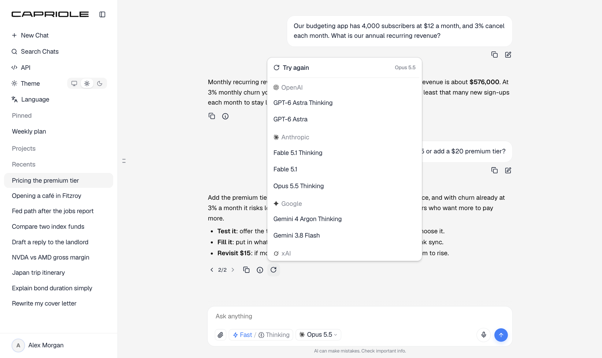
  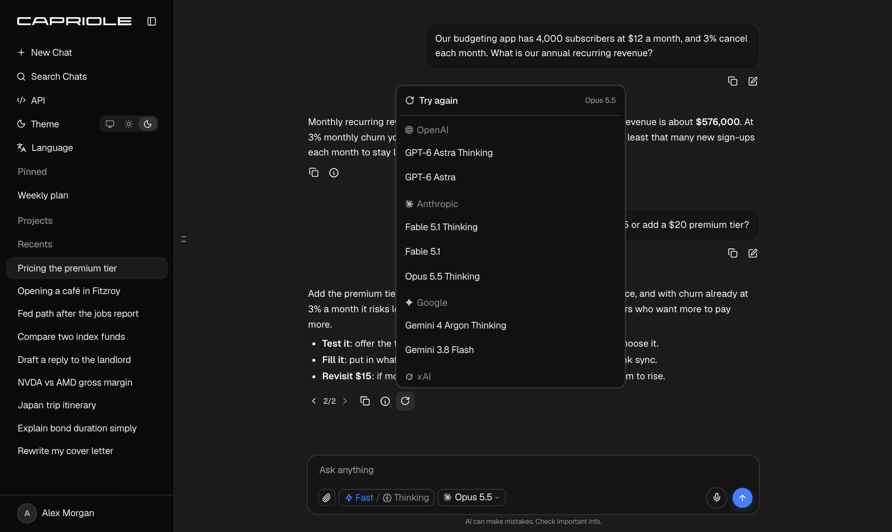
</Frame>

## In langen Chats zurückspringen

Lange Chats haben jetzt für jede deiner Nachrichten einen Strich, in einer Spalte links vom Chat. Zeige auf einen Strich, um die Nachricht und den Anfang der Antwort zu sehen, und wähle ihn aus, um direkt dorthin zu springen, egal wie weit zurück sie liegt. Mit der Tastatur erreichst du die Striche mit **Tab**, bewegst dich mit den Pfeiltasten und springst mit **Enter**. Die Striche erscheinen im Web, wenn das Fenster neben dem Chat Platz für sie hat.

<Frame>
  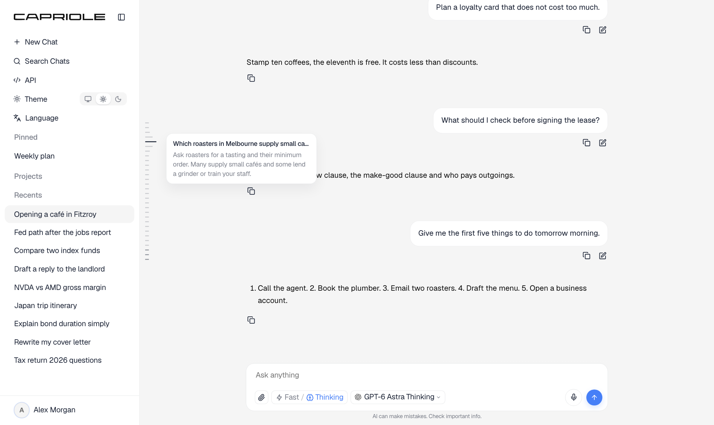
  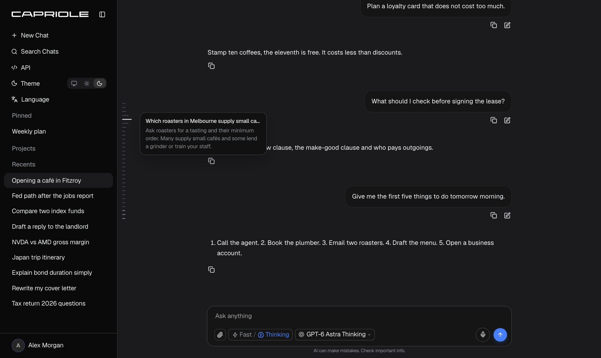
</Frame>

## Verbesserungen

- **Bilderzeugung**: Generierte Bilder behalten beim Laden ihre Größe, sodass ein Chat mit Bildern nicht mehr springt, wenn du ihn öffnest, nach jeder Antwort oder wenn du zwischen Antworten wechselst.

## Fehlerbehebungen

- **Nachrichten bearbeiten**: Wenn du nach dem Bearbeiten einer Nachricht die Antwort stoppst oder die Antwort fehlschlägt, kommen deine ursprüngliche Nachricht und ihre Antwort zurück.
- **Mitteilungen**: Wenn du in einer Mitteilung **Mehr erfahren** wählst, schließt sie sich nicht mehr, und die folgenden Mitteilungen bleiben verfügbar.
</Update>

<Update label="10. November 2026">
## Bilder bearbeiten

Du kannst jetzt Bilder in Capriole AI bearbeiten. Hänge im **Image**-Modus bis zu 10 PNG- oder JPEG-Bilder an, mit der Büroklammer, durch Einfügen oder durch Hineinziehen, und beschreibe dann die Änderung. Gib **@** ein, um auf ein Bild zu verweisen, zum Beispiel `@image1`. Wähle **Edit** bei einem erstellten Bild, um es zurück ins Nachrichtenfeld zu holen und daran weiterzuarbeiten.

Alle drei Bildmodelle (GPT Image 2.6, GPT Image 2.5 und Nano Banana 2.1) können Bilder bearbeiten, und Capriole AI verwendet das Modell, das du ausgewählt hast. Im **Text**-Modus kannst du auch das Chat-Modell bitten, ein Bild zu ändern; wenn es nicht erkennen kann, welches Bildmodell es verwenden soll, fragt es nach. [Zur Anleitung für die Bilderzeugung](/de/guides/files-web-search).

Das Menü für das Seitenverhältnis hat zwei neue Optionen. **Auto**, der neue Standard, behält die Form des Bildes bei, das du bearbeitest, und lässt bei einem neuen Bild das Modell die Form wählen. **21:9** ist für breite Bilder gedacht. Jedes bearbeitete Bild zählt zu deinem täglichen Bilderlimit.

<Frame>
  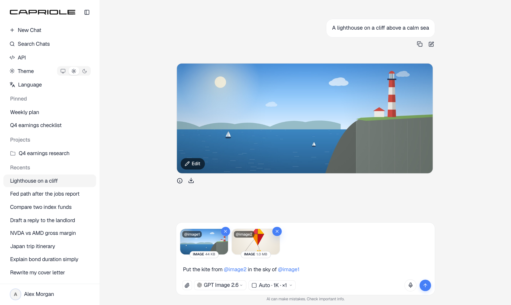
  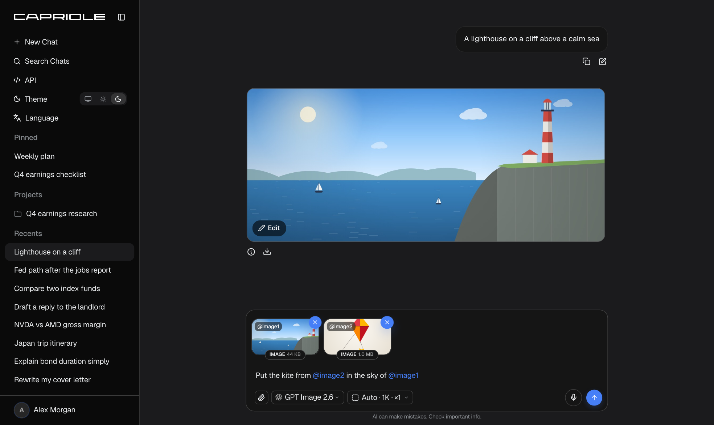
</Frame>

## GPT Image 2.6

<Frame>
  
</Frame>

GPT Image 2.6 von OpenAI ist jetzt verfügbar. Es ist das neueste Bildmodell von OpenAI und die Standardauswahl im **Image**-Modus. GPT Image 2.5 und Nano Banana 2.1 bleiben im Tab **Image** verfügbar. Der Tab zeigt die beiden GPT-Image-Modelle mit vollständigem Namen: **GPT Image 2.6 Sunburst** und **GPT Image 2.5 Sunburst**. [Zur Anleitung für die Bilderzeugung](/de/guides/files-web-search).

<Frame>
  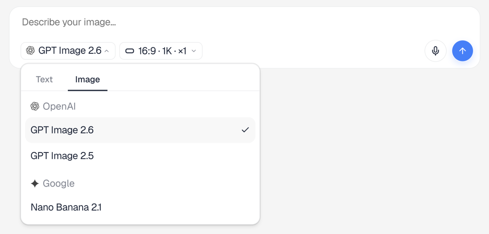
  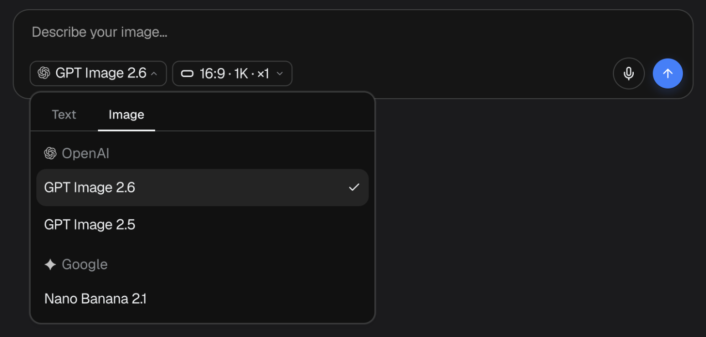
</Frame>

## Konto verwalten

Öffnen Sie **Konto** und wählen Sie **Konto verwalten**, um Namen und Foto zu ändern, ein Passwort festzulegen und die Geräte zu sehen, auf denen Sie angemeldet sind. Auf dem Tab **Sicherheit** können kostenlose Konten außerdem ihr Konto löschen. Das Löschen ist endgültig und entfernt auch Ihre Anmeldung bei [Capriole Quant](https://quant.capriole.com/), weil beide dasselbe Konto verwenden. Um ein Konto mit einem kostenpflichtigen Plan zu löschen, schreiben Sie an [info@capriole.ai](mailto:info@capriole.ai).

<Frame>
  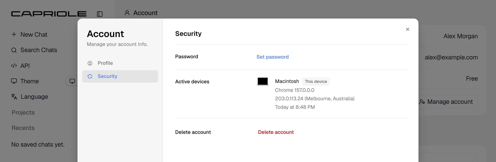
  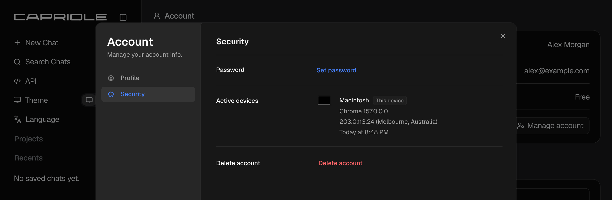
</Frame>

## Verbesserungen

- **Chat-Export**: Ein exportierter Chat zeigt für ein generiertes Bild jetzt denselben Modellnamen wie der Chat selbst.
</Update>

<Update label="9. November 2026">
## Premium-Preis

Neue Premium-Abos im Web kosten **USD 9 pro Monat**. Bestehende Abos für USD 8 verlängern sich weiter für **USD 8 pro Monat**, solange sie aktiv bleiben. [Tarife und Limits ansehen](/de/guides/plans-and-limits).

Seit April arbeiten wir daran, führende KI-Modelle für alle so erschwinglich wie möglich zu machen. Diese Preisanpassung hilft uns, weiterhin unbegrenzten Web-Chat mit GPT-6 Astra, Fable 5.1, Opus 5.5, Gemini 4 Argon und anderen führenden Modellen anzubieten.

## Chattitel und Chatstatus

Neue Textchats im Web erhalten einen kurzen Titel auf Basis deiner ersten Nachricht. Der Browser-Tab zeigt den Titel und aktualisiert ihn, wenn du den Chat wechselst oder umbenennst.

Mit **Server Storage** kannst du den Chat wechseln, während eine Antwort entsteht. Ein Ladekreis in der Seitenleiste zeigt, dass die Antwort noch erstellt wird. Ein blauer Punkt markiert eine fertige Antwort, die du noch nicht gesehen hast. Er verschwindet, sobald du die Antwort siehst.

<Frame>
  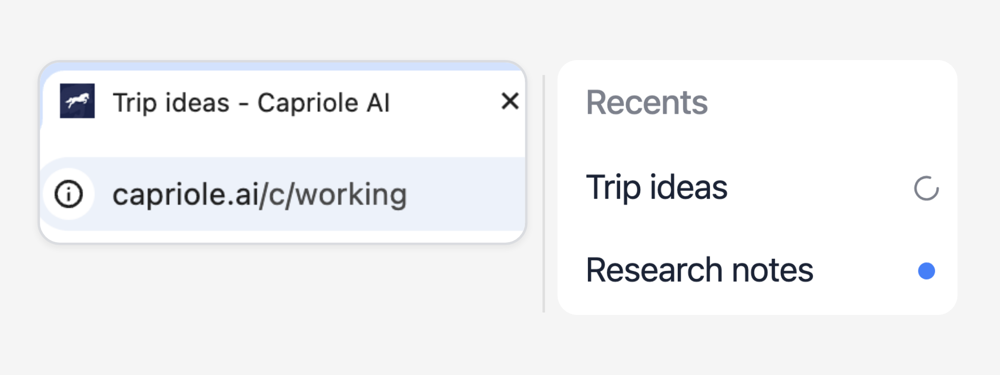
  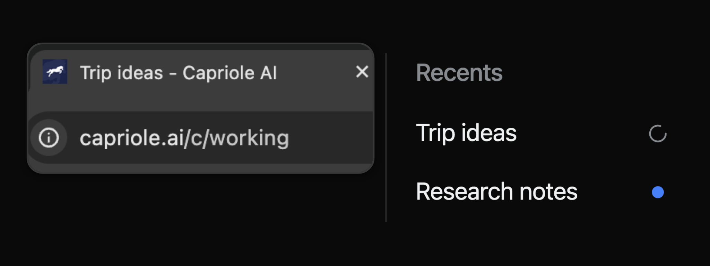
</Frame>
</Update>

<Update label="6. November 2026">
## Feedback

Sagen Sie uns direkt in Capriole AI, was wir verbessern oder bauen sollen. Wählen Sie unten in der Seitenleiste Ihren Namen und dann **Ressourcen** > **Feedback**. Wählen Sie **Problem**, **Funktionswunsch** oder **Frage**, beschreiben Sie Ihr Anliegen und hängen Sie bis zu 5 Dateien (insgesamt 4 MB) an oder fügen Sie einen Screenshot ein. Ihre Nachricht geht direkt an das Team von Capriole AI. Wenn Sie nicht angemeldet sind, wählen Sie unten in der Seitenleiste **Ressourcen** > **Feedback** und melden Sie sich zuerst an.

<Frame>
  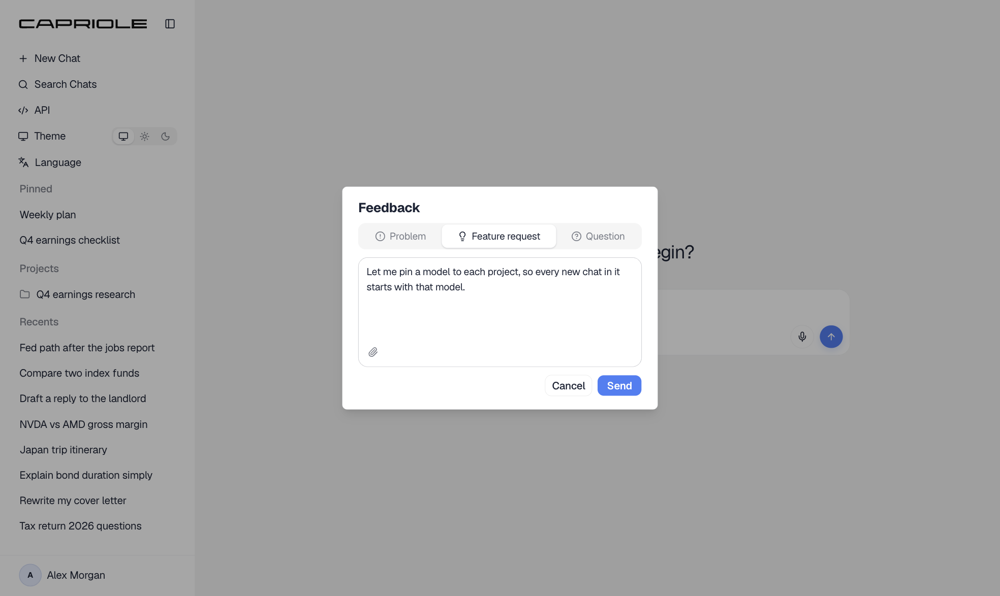
  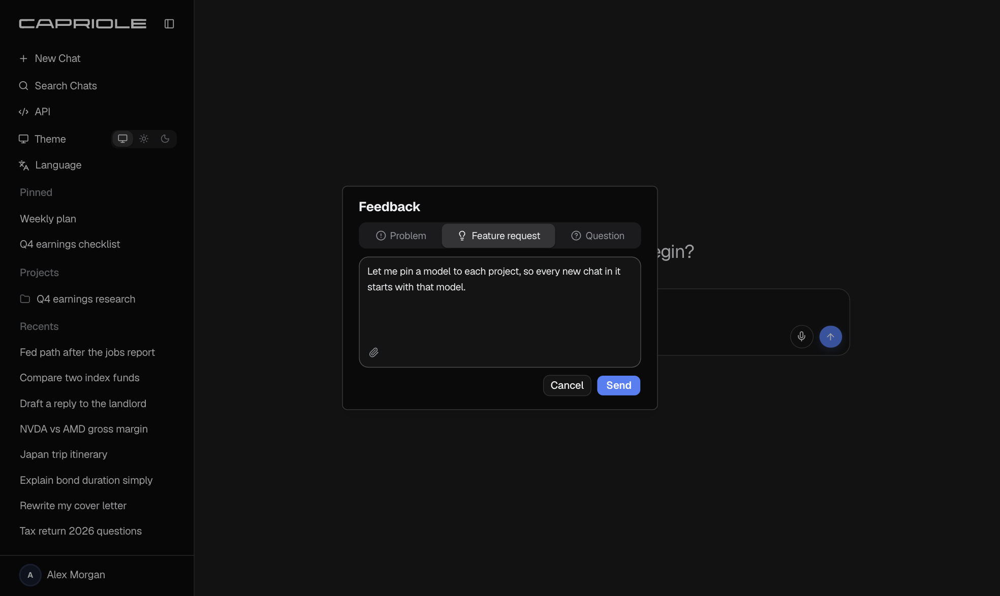
</Frame>

## Verbesserungen

- **OpenCode**: Die [OpenCode-Anleitung](/de/integrations/opencode) behandelt jetzt neben Version 1 auch OpenCode 2, und wir haben sie mit beiden getestet.
- **Projekte**: Ein neuer Chat in einem Projekt zeigt den Projektnamen nur noch einmal, über der Begrüßung.

## Fehlerbehebungen

- **Chat**: Lange Antworten von Claude Opus 5.5, Claude Fable 5.1 und Claude Opus 5 brechen nicht mehr mittendrin ab.
</Update>

<Update label="5. November 2026">
## Fehlerbehebungen

- **Spracheingabe**: Funktioniert wieder, auch wenn unser wichtigster Spracherkennungsdienst ausfällt.
</Update>

<Update label="30. Oktober 2026">
## Projektdateien und Export

Geben Sie einem Projekt die Dateien, die seine Chats brauchen. Öffnen Sie auf der Projektseite den neuen Tab **Dateien** und wählen Sie **Dateien hinzufügen**, oder ziehen Sie Dateien auf den Tab. Sie können dieselben Dokumente und Bilder hinzufügen wie bei Chat-Anhängen, bis zu 40 pro Projekt in jedem Plan. Jeder Chat im Projekt kann sie nutzen: Capriole AI liest eine Datei, wenn Ihre Frage sie braucht. Um ein Projekt mitzunehmen, öffnen Sie sein Menü und wählen Sie **Exportieren**: Sie erhalten ein ZIP mit seinen Chats, Anweisungen und Dateien. **Chatverlauf exportieren** auf Ihrer Seite **Konto** enthält jetzt auch die Anweisungen und Dateien Ihrer Projekte. [So nutzen Sie Projektdateien](/de/guides/projects).

<Frame>
  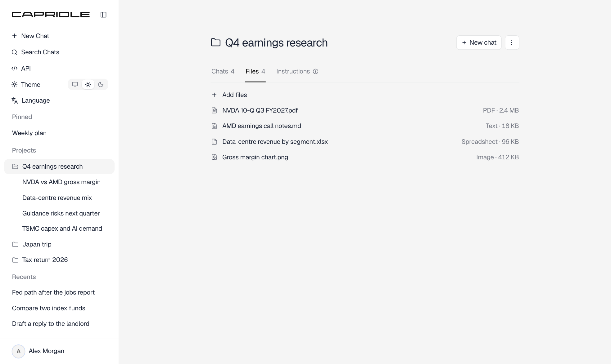
  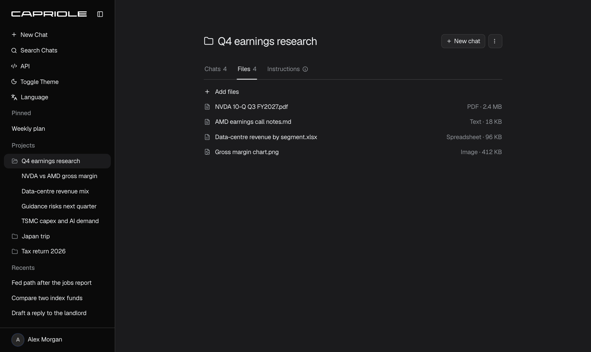
</Frame>

## Verbesserungen

- **Seitenleiste**: **Angeheftet** steht jetzt über **Projekte**, ein geöffnetes Projekt zeigt auch seine Chats darunter, und Listen klappen sanft auf und zu.
- **Design**: **System** ergänzt **Hell** und **Dunkel** in der Seitenleiste und folgt dem hellen oder dunklen Modus Ihres Geräts.
</Update>

<Update label="29. Oktober 2026">
## Projekte

Halten Sie zusammengehörige Arbeit beisammen. Legen Sie ein Projekt für einen Kunden, einen Kurs oder alles an, zu dem Sie zurückkehren, und seine Chats stehen in der Seitenleiste darunter. Schreiben Sie die Anweisungen des Projekts einmal, und jeder Chat im Projekt folgt ihnen zusätzlich zu Ihren Kontoanweisungen; widersprechen sich beide, haben die Projektanweisungen Vorrang. Um ein Projekt zu erstellen, zeigen Sie in der Seitenleiste auf **Projekte** und wählen Sie **+**. Beginnen Sie dann einen Chat darin, oder verschieben Sie einen Chat über sein Menü hinein oder ziehen Sie ihn auf das Projekt. Projekte gibt es in jedem Plan für angemeldete Nutzer, deren Chats auf dem Server gespeichert werden. [So nutzen Sie Projekte](/de/guides/projects).

<Frame>
  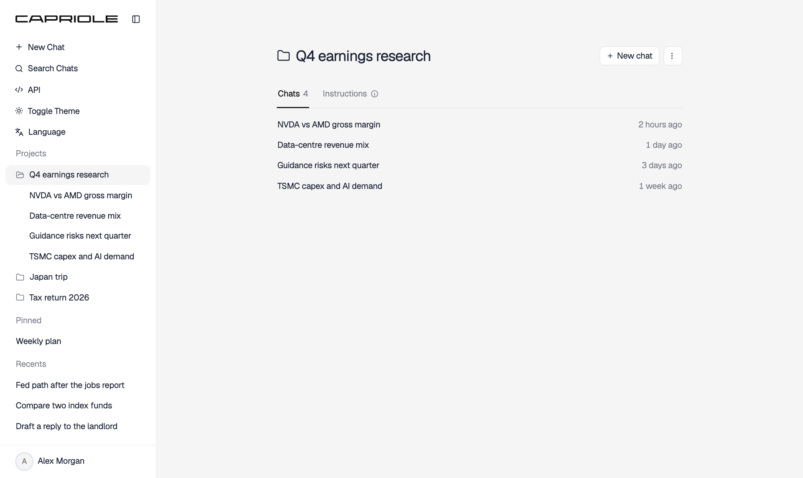
  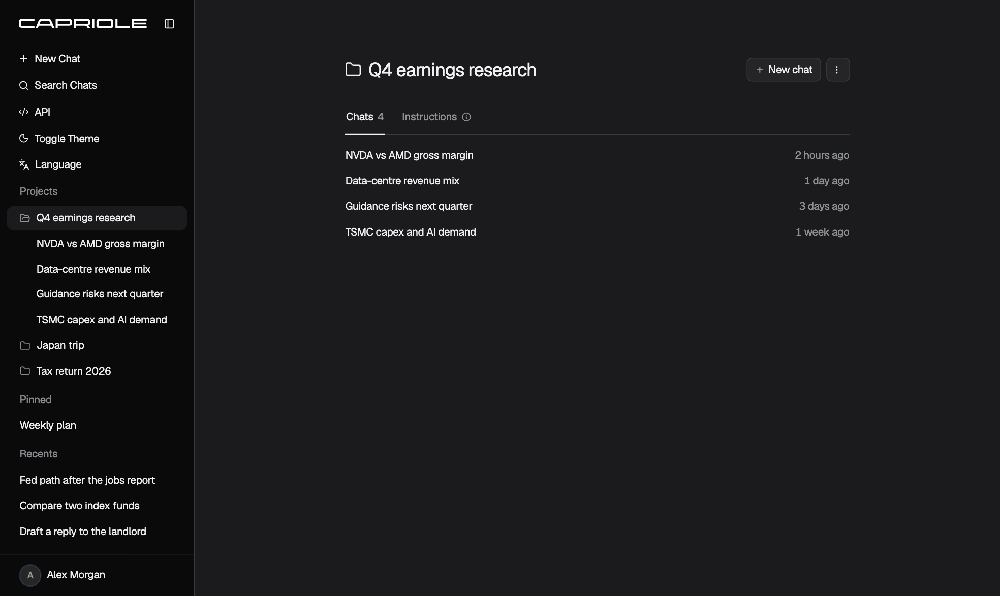
</Frame>

## Verbesserungen

- **Chats suchen**: Findet jeden Chat über seinen Titel, auch ältere Chats und Chats in Projekten.
</Update>

<Update label="28. Oktober 2026">
## Chatverlauf exportieren

Nehmen Sie Ihre Chats mit. Wählen Sie auf Ihrer Seite **Konto** unter **Einstellungen** die Option **Chatverlauf exportieren**. Capriole AI erstellt im Hintergrund ein ZIP, Sie können die Seite währenddessen verlassen, und der Download bleibt 24 Stunden verfügbar. Das ZIP enthält jeden Chat als Markdown-Datei, daneben Ihre angehängten Dateien und erstellten Bilder, sowie `conversations.json` mit allen Chats in einem Format, das Programme lesen können. Um einen einzelnen Chat zu exportieren, öffnen Sie sein Menü in der Seitenleiste und wählen Sie **Exportieren**. Chats im lokalen Speicher werden sofort heruntergeladen.

<Frame>
  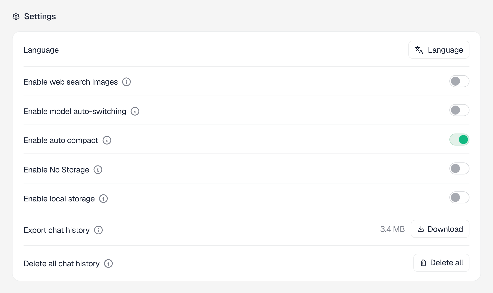
  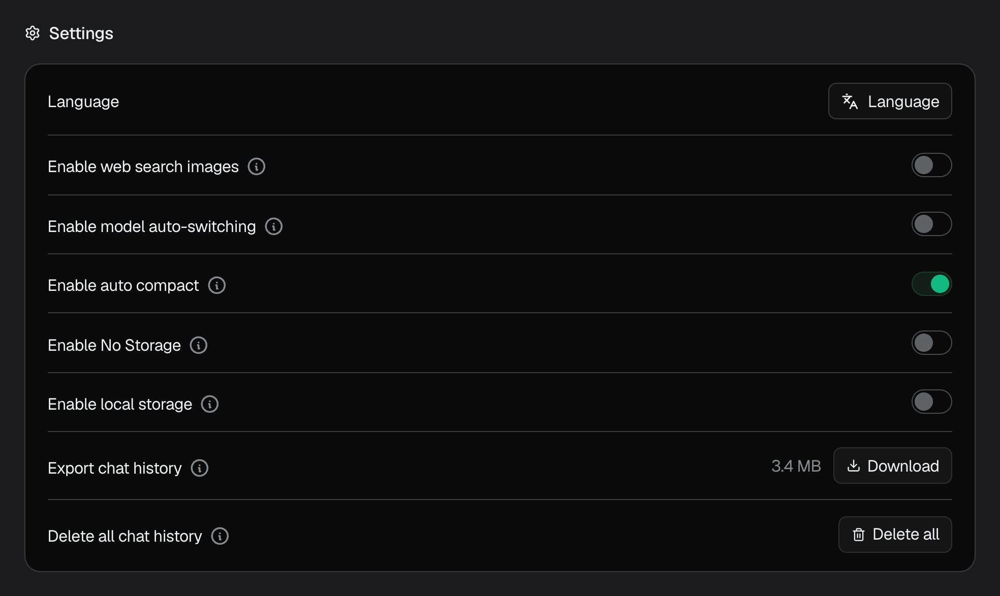
</Frame>

## Verbesserungen

- **Lange Chats**: Zeigen beim Öffnen sofort die neuesten Nachrichten. Ältere Nachrichten werden beim Hochscrollen geladen, und was Sie gerade lesen, bleibt an seinem Platz.
</Update>

<Update label="27. Oktober 2026">
## Personalisierung

Sagen Sie Capriole AI im neuen Bereich **Personalisierung** auf Ihrer Seite **Konto**, wie es Sie nennen soll, was Ihre Arbeit am besten beschreibt und wie Sie Antworten mögen. Jeder Chat folgt diesen Angaben ab Ihrer nächsten Nachricht, auch bestehende Chats. Anweisungen können bis zu 1.500 Zeichen lang sein. Sie gelten für den Web-Chat und die App, nicht für die API.

<Frame>
  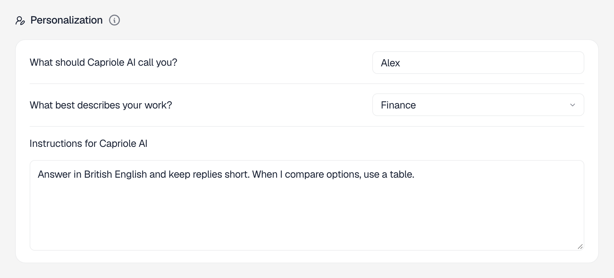
  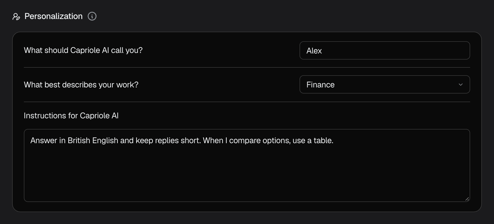
</Frame>

## Gastchats bleiben nach der Anmeldung erhalten

Starten Sie einen Chat ohne Konto und melden Sie sich dann im selben Tab an oder registrieren Sie sich. Der Chat öffnet sich als gespeicherter Chat in Ihrem Konto, mit allen Nachrichten, und die nächste Antwort berücksichtigt, was Sie zuvor gefragt haben. Das Speichern wird nicht auf Ihre Nutzung angerechnet.

<Frame>
  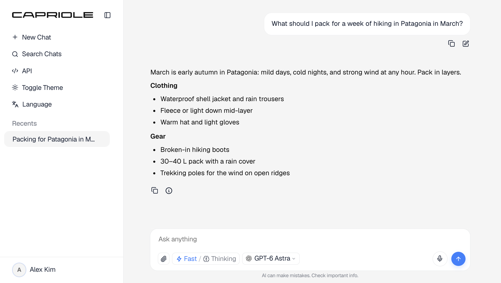
  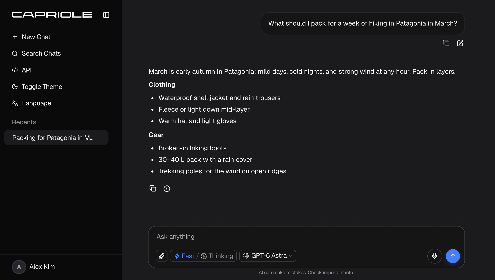
</Frame>

## Kimi K3.1 Pro

Kimi K3.1 Pro von Moonshot AI ist jetzt verfügbar. Es ist das leistungsfähigste Modell von Kimi, mit deutlichen Fortschritten beim Programmieren, bei der 3D-Erstellung und bei der Finanzrecherche sowie einem Kontextfenster von 1M Tokens. Wählen Sie im Web-Chat **Kimi K3.1 Pro Thinking** für anspruchsvollere Aufgaben oder **Kimi K3.1 Pro** für schnellere Antworten. Über die API rufen Sie `moonshot/kimi-k3.1-pro` mit [Chat Completions](/de/api-reference/endpoint/chat-completions) auf; auch die [Anleitungen für Coding-Agents](/de/integrations/opencode) führen das Modell auf. Kimi K3 bleibt unter **Weitere Modelle** verfügbar.

<Frame>
  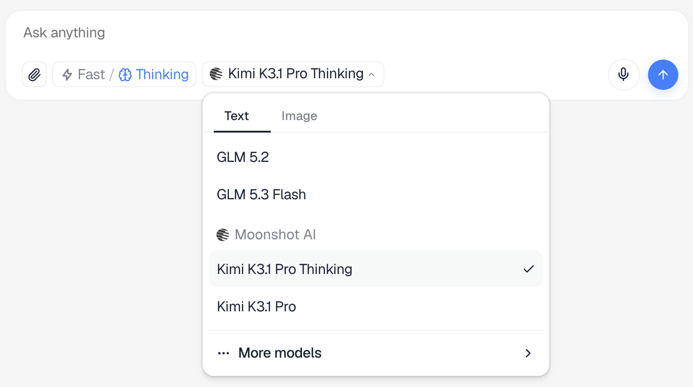
  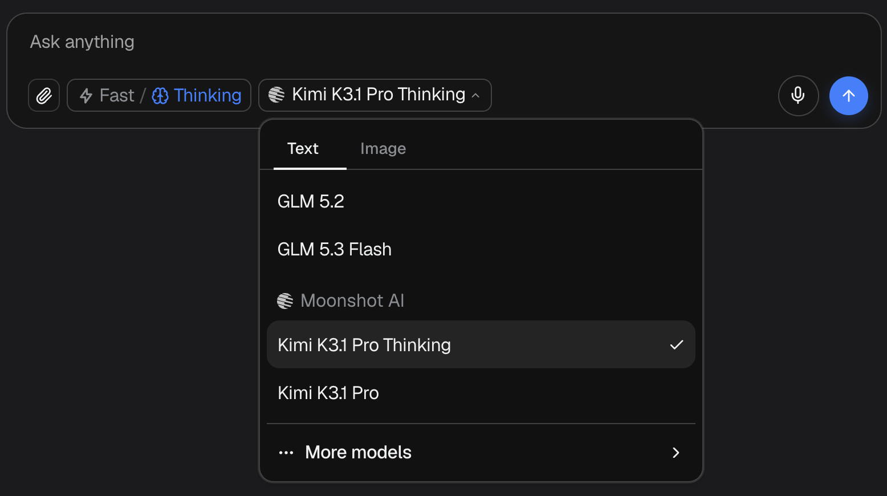
</Frame>
</Update>

<Update label="20. Oktober 2026">
## Das Änderungsprotokoll ist online

Neue Funktionen, Modell-Updates, API-Änderungen und Anleitungen für Coding-Agents von Capriole AI erscheinen jetzt auf dieser Seite, die neuesten zuerst. Öffnen Sie in der App **Ressourcen > Neueste Mitteilung**, um hierher zurückzukehren. Abonnieren Sie den RSS-Feed, um jede Änderung zu erhalten, sobald sie veröffentlicht ist.

<Frame>
  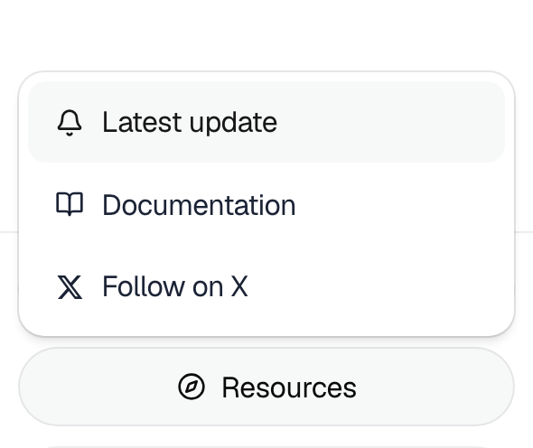
  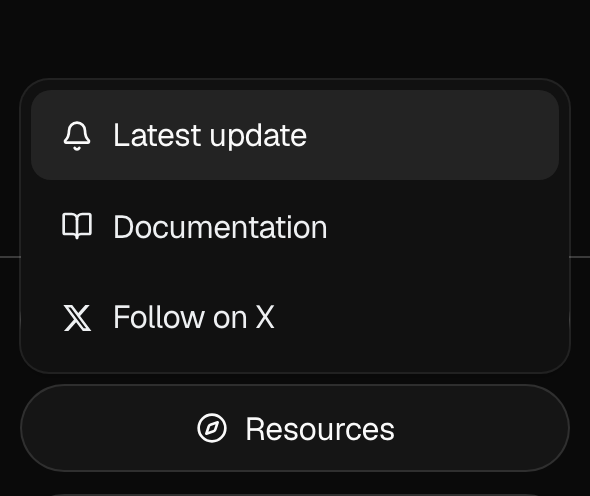
</Frame>

## Chats merken sich ihr Modell

Wenn Sie einen gespeicherten Chat öffnen, wählt Capriole AI das Modell der letzten Antwort aus, einschließlich der Einstellung Fast oder Thinking. Die Auswahl bleibt nach dem Neuladen, nach einer neuen Anmeldung und auf anderen Geräten erhalten. Wurde das Modell eingestellt, bleibt Ihre aktuelle Auswahl bestehen.

<Frame>
  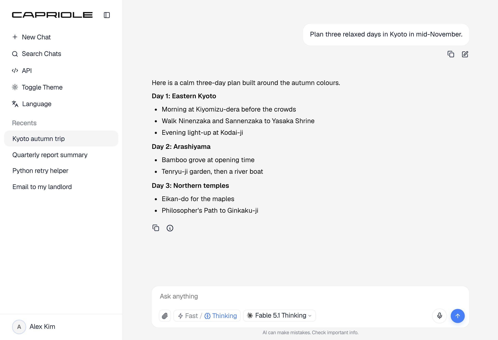
  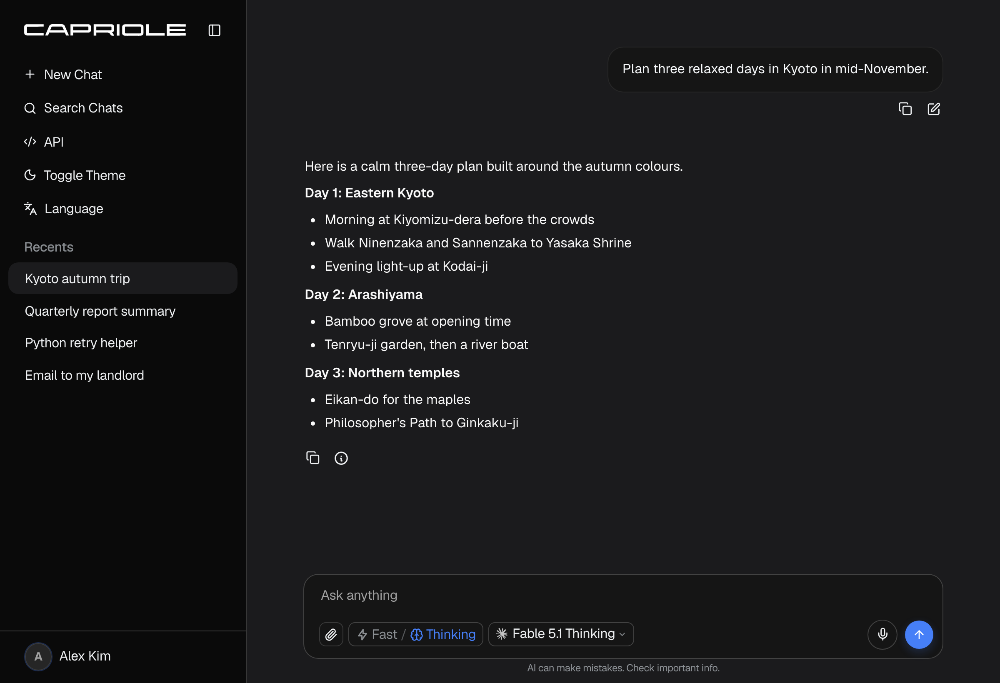
</Frame>

## Anleitungen für Coding-Agents neu getestet

Wir haben alle Anleitungen für Coding-Agents mit den aktuellen Modellen neu getestet und Anleitungen für [Cline](/de/integrations/cline), [Qwen Code](/de/integrations/qwen-code), [Crush](/de/integrations/crush) und [Pi](/de/integrations/pi) hinzugefügt. [OpenCode](/de/integrations/opencode) und [Kilo Code](/de/integrations/kilo-code) brauchen jetzt nur noch einen Provider und einen API-Schlüssel.

<Frame>
  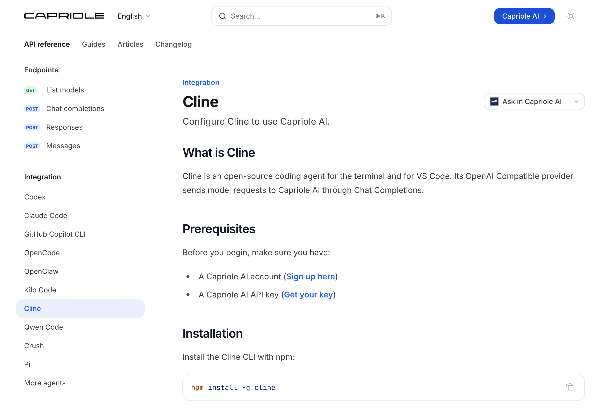
  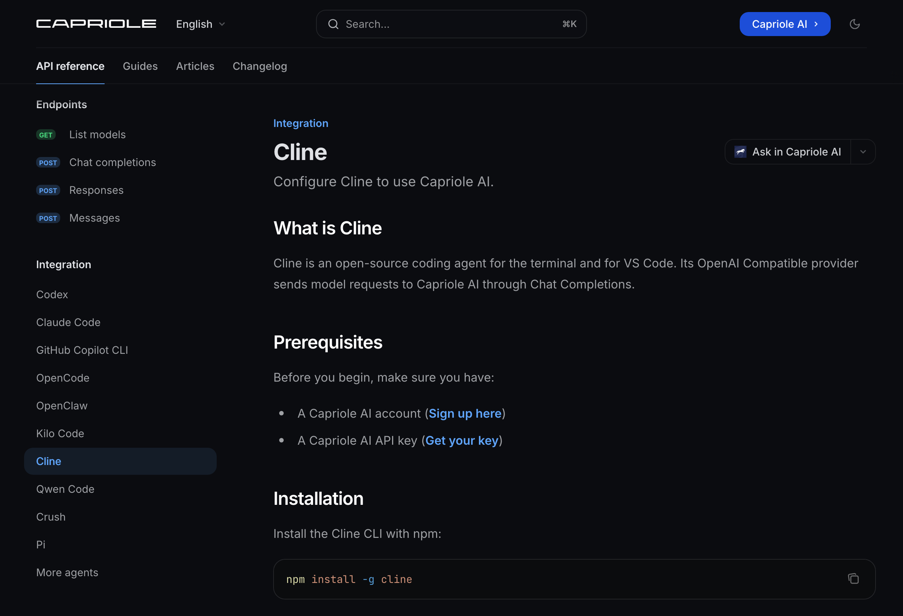
</Frame>
</Update>
