<Update label="27. November 2026">
## Fehlerbehebungen

- **Chat**: Wenn Sie im Web während einer Antwort zu einer anderen App oder einem anderen Tab wechseln, erscheint bei der Rückkehr kein Fehler mehr, sondern die Antwort.
</Update>

<Update label="26. November 2026">
## Gemini 4 Neon

<Frame>
  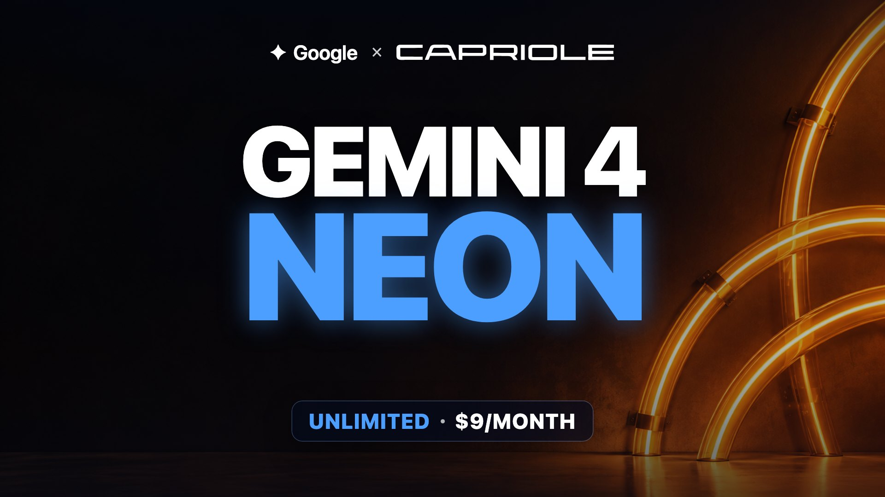
</Frame>

Wählen Sie **Gemini 4 Neon Thinking** in der Google-Gruppe im Web-Chat. Google hat Neon für komplexe Softwareentwicklung, analytische Aufgaben und wissenschaftliches Schlussfolgern entwickelt. Rufen Sie `google/gemini-4-neon` über [Chat Completions](/de/api-reference/endpoint/chat-completions) auf. `google-latest` verweist weiterhin auf Gemini 4 Carbon.

<Frame>
  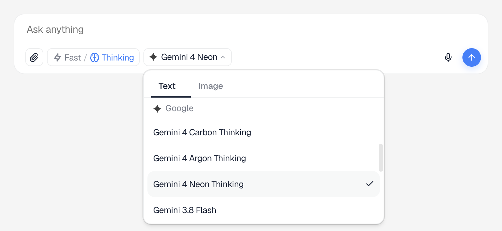
</Frame>
</Update>

<Update label="24. November 2026">
## Capriole AI für Android

Capriole AI gibt es jetzt für Android. Melden Sie sich an oder erstellen Sie kostenlos ein Konto, um auf Ihrem Smartphone mit allen Modellen zu chatten und Bilder zu erstellen. [Jetzt bei Google Play](https://play.google.com/store/apps/details?id=com.capriole.ai).

<Frame>
  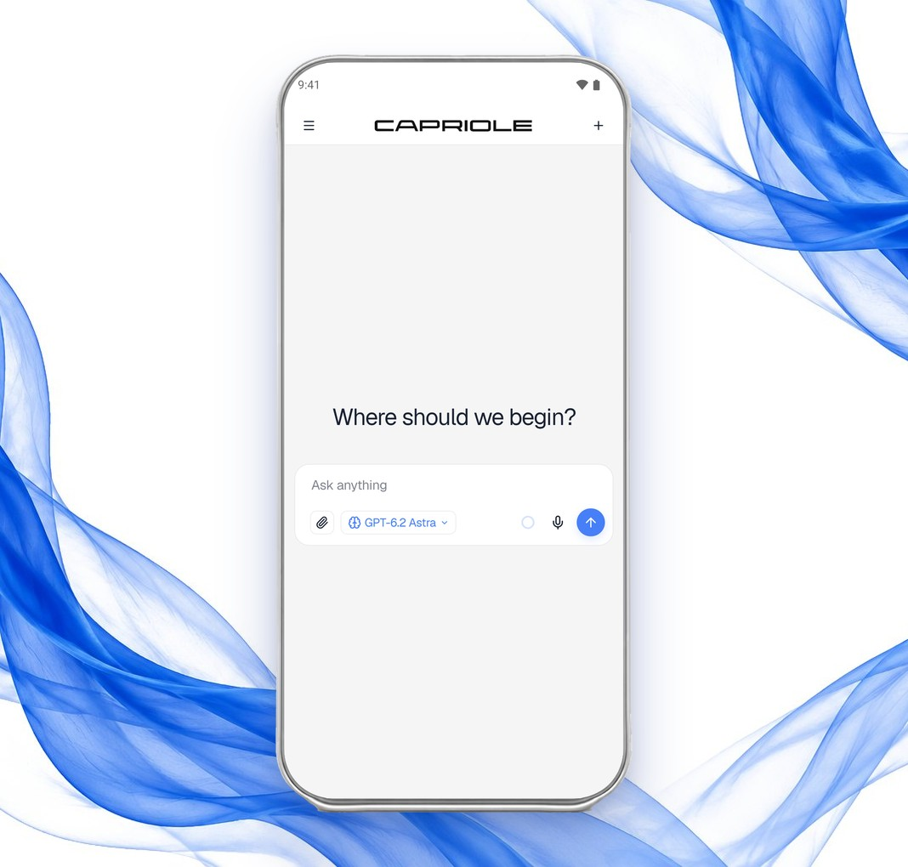
</Frame>

Die iPhone-App folgt bald. Wählen Sie im Web unten in der Seitenleiste Ihren Namen, dann **App laden**, und scannen Sie den QR-Code mit Ihrem Smartphone. Wenn Sie nicht angemeldet sind, wählen Sie unten in der Seitenleiste **App laden**.

## Claude Fable 5.2

<Frame>
  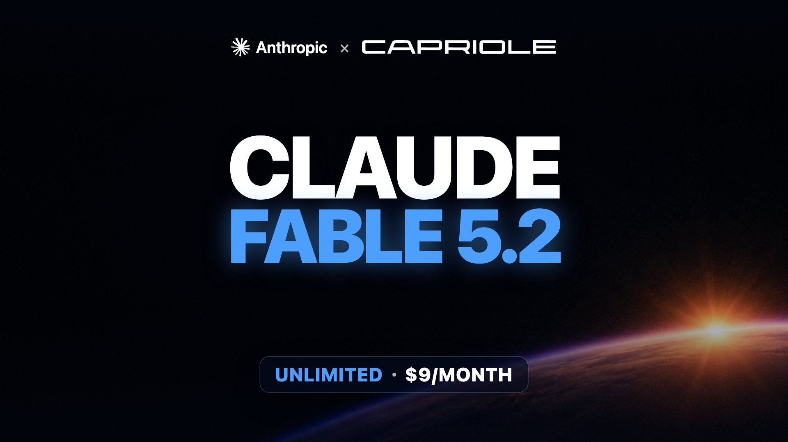
</Frame>

Claude Fable 5.2 löst Claude Fable 5.1 als Modell von Anthropic für die anspruchsvollste technische Arbeit ab. [Laut Anthropic](https://www.anthropic.com/claude-fable-and-mythos-5-2) ist es in Coding, Reasoning und Bildverständnis stärker als Fable 5.1, und Tester stellten fest, dass es klarer kommuniziert. Für die meisten Coding- und Wissensaufgaben empfiehlt Anthropic weiterhin, mit Claude Opus 5.5 zu beginnen.

**Fable 5.2 Thinking** und **Fable 5.2** stehen jetzt im Modellmenü des Web-Chats. Fable 5.1 steht jetzt unter **Weitere Modelle** und bleibt dort verfügbar. Über die API rufen Sie `anthropic/claude-fable-5-2` mit [Chat Completions](/de/api-reference/endpoint/chat-completions) oder `claude-fable-5-2` mit [Messages](/de/api-reference/endpoint/messages) auf; `claude-latest` verweist jetzt auf Fable 5.2, und Fable 5.1 bleibt als `anthropic/claude-fable-5-1` verfügbar. Der API-Preis von Anthropic liegt bei USD 8 Eingabe und USD 40 Ausgabe pro 1M Tokens, 20% unter Fable 5.1. [Modell wählen](/de/guides/choose-a-model) vergleicht es mit den anderen Flaggschiffen.

<Frame>
  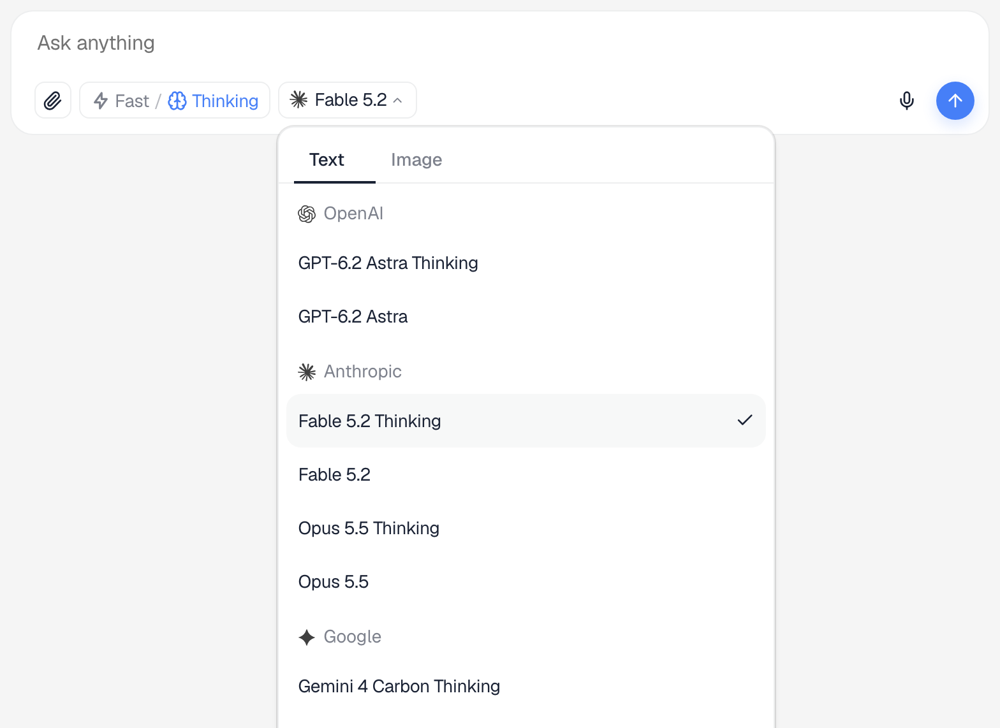
</Frame>
</Update>

<Update label="23. November 2026">
## Erinnerungen über Chats hinweg

Capriole AI merkt sich jetzt über alle Chats und Modelle hinweg den Kontext, der Ihnen wichtig ist. Erinnerungen sind standardmäßig aktiviert; unter **Konto** → **Erinnerungen** können Sie jederzeit jeden Fakt ansehen, hinzufügen, bearbeiten und löschen oder Erinnerungen ausschalten.

Jedes Projekt hat außerdem einen Tab **Erinnerungen**: Chats in einem Projekt nutzen Ihre allgemeinen Erinnerungen und die des Projekts und speichern neue Fakten im Projekt. Allgemeine Erinnerungen und die Erinnerungen jedes Projekts fassen jeweils bis zu 2,400 Zeichen.

Erinnerungen funktionieren in angemeldeten Chats, die mit **Server Storage** gespeichert werden, auch in der App; verwaltet werden sie im Web. [So funktionieren Erinnerungen](/de/guides/personalization-and-memory).

<Frame>
  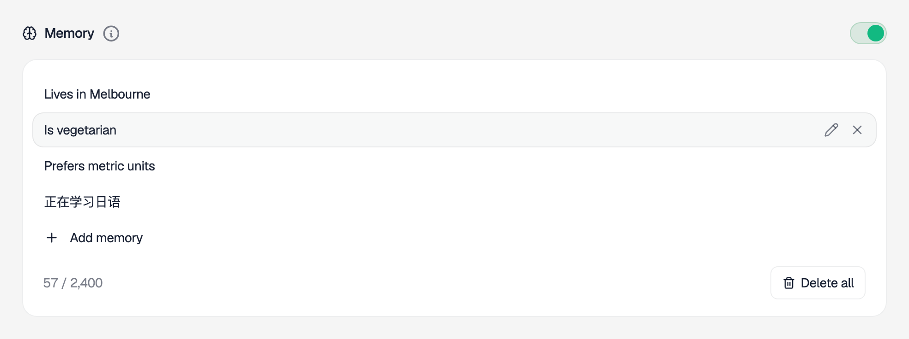
</Frame>

</Update>

<Update label="21. November 2026">
## Verbesserungen

- **Kopieren**: Bei Antworten mit Text und Bildern oder mit mehreren Bildern kopieren Sie über **Kopieren** jetzt den Text, ein einzelnes Bild oder alles auf einmal. Bilder werden sofort kopiert.

</Update>

<Update label="20. November 2026">
## GPT-5.5

Capriole AI hat die Unterstützung für GPT-5.5 eingestellt. Wechseln Sie zu GPT-6.2 Astra oder GPT-6.2 Sol. Verwenden Sie für API-Aufrufe `openai-latest` oder `openai/gpt-6.2-astra`.

## Antworten melden

Unter jeder Antwort steht jetzt eine Flagge. Damit melden Sie eine Antwort, die Sie für schädlich halten: Wählen Sie einen Grund, fügen Sie bei Bedarf Details hinzu und markieren Sie bei einer Antwort mit Bildern die betreffenden Bilder. Wir erhalten die Antwort und die Nachricht davor und prüfen jede Meldung. Ihr Chat bleibt unverändert, und Textantworten können Sie auch ohne Anmeldung melden.

<Frame>
  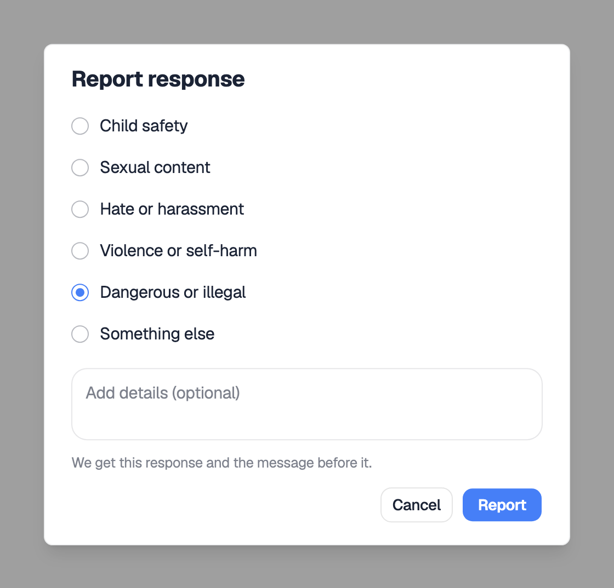
</Frame>

## Verbesserungen

- **Bildgenerierung**: Antworten, die nur aus Bildern bestehen, haben jetzt **Bild kopieren**: Ein Bild wird direkt kopiert, bei mehreren wählen Sie eines aus. Auf Touchscreens enthält das **…**-Menü eines Bildes ebenfalls **Bild kopieren**.

</Update>

<Update label="18. November 2026">
## GPT-6.2 Astra und Sol

<Frame>
  
</Frame>

GPT-6.2 Astra ist das neue Flaggschiff von OpenAI und löst GPT-6 Astra ab, und GPT-6.2 Sol löst GPT-6.1 Sol als Alltagsmodell von OpenAI ab. [OpenAI nennt](https://openai.com/index/introducing-gpt-6-2-astra-sol/) Astra „unser neues Frontier-Modell für Ihre schwierigsten Projekte“ und Sol „unser effizientes, vielseitiges Modell für die tägliche Arbeit“.

Im Modellmenü des Web-Chats steht GPT-6.2 Astra jetzt mit **Thinking** und **Fast** ganz oben in der Gruppe OpenAI, und Gäste und neue Konten starten mit **GPT-6.2 Astra Thinking**. GPT-6.2 Sol, ebenfalls mit **Thinking** und **Fast**, steht unter **Weitere Modelle** an erster Stelle der OpenAI-Modelle; dort bleiben GPT-6 Astra und GPT-6.1 Sol verfügbar. Über die API rufen Sie `openai/gpt-6.2-astra` oder `openai/gpt-6.2-sol` mit [Responses](/de/api-reference/endpoint/responses) oder [Chat Completions](/de/api-reference/endpoint/chat-completions) auf; `openai-latest` verweist jetzt auf GPT-6.2 Astra. Die API-Preise von OpenAI liegen für Astra bei USD 8 Eingabe und USD 40 Ausgabe pro 1M Tokens, 20% unter GPT-6 Astra, und für Sol bei USD 2 und USD 10, so viel wie bei GPT-6.1 Sol. [Modell wählen](/de/guides/choose-a-model) vergleicht sie mit den anderen Flaggschiffen.

<Frame>
  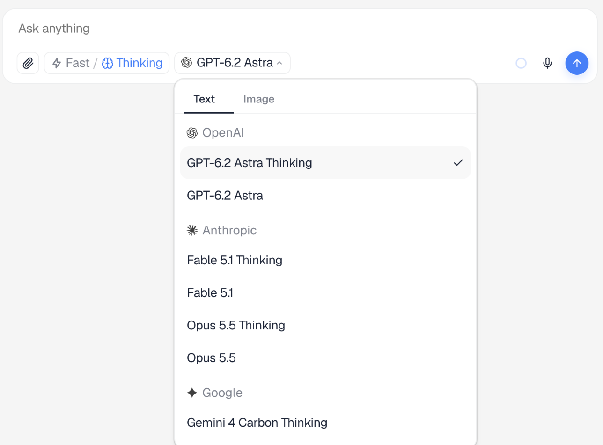
</Frame>

## Tags für Ihre Chats

Wählen Sie im Menü eines Chats in der Seitenleiste **Tags**, um ihm einen oder mehrere farbige Tags zu geben; sie erscheinen unter seinem Titel. Die Filterschaltfläche neben **Chats suchen** zeigt aus **Zuletzt** und allen Ihren Projekten jeden Chat, der einen der gewählten Tags trägt, und in **Chats suchen** können Sie ebenfalls Tags wählen, um nur in den Chats mit diesen Tags zu suchen. Tags stehen angemeldeten Konten mit **Server Storage** zur Verfügung. [So verwenden Sie Tags](/de/guides/projects#chats-mit-tags-versehen).

<Frame>
  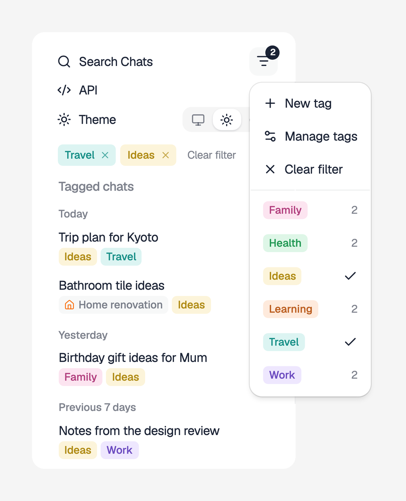
</Frame>

## Verbesserungen

- **Seitenleiste**: Mehr Chats passen auf den Bildschirm, **Zuletzt** ist nach Datum gruppiert, und Ihr Browser merkt sich, welche Bereiche und Projekte Sie aufgeklappt haben.
- **Sprache**: Wenn Sie angemeldet sind, finden Sie die Spracheinstellung jetzt unter **Konto** → **Einstellungen** statt in der Seitenleiste.
- **Projekte**: Jedes Projekt kann jetzt eine eigene Farbe und ein eigenes Symbol haben, die Sie beim Erstellen oder Bearbeiten festlegen. Wenn Sie den Namen eines Projekts wählen, werden seine Chats ein- oder ausgeblendet, und **Projekt verwalten** im Drei-Punkte-Menü öffnet die Projektseite.
- **Neue Antwort**: Schlägt Ihre letzte Antwort fehl, erscheint darunter jetzt **Erneut versuchen**, sodass Sie Ihre Nachricht mit demselben oder einem anderen Modell noch einmal senden können.

## Fehlerbehebungen

- **Chat-Titel**: Neue Chats erhalten einen Titel, der das Thema der ersten Nachricht in Ihrer Sprache benennt, statt sie zu beantworten.
- **Anhänge**: GPT-Modelle lesen jetzt Markdown-Dateien, die manche Browser anders kennzeichnen.
- **Bilderzeugung**: Wenn Sie eine Antwort stoppen, während sie ein Bild startet, erscheint kein Fehler mehr.
</Update>

<Update label="17. November 2026">
## Gemini 4 Carbon

<Frame>
  
</Frame>

Gemini 4 Carbon, das stärkste Modell von Google, ist jetzt verfügbar. Google hat es für Aufgaben entwickelt, die die Grenzen der Intelligenz eines Modells ausloten, etwa komplexes mehrstufiges Coding und Debugging, agentische Arbeit über lange Zeiträume und wissenschaftliches Reasoning. Wählen Sie im Modellmenü des Web-Chats ganz oben in der Gruppe Google **Gemini 4 Carbon Thinking**, oder rufen Sie `google/gemini-4-carbon` mit [Chat Completions](/de/api-reference/endpoint/chat-completions) auf; `google-latest` verweist jetzt auf Carbon, und bei Chat Completions können Sie für leichtere Aufrufe [`thinking_level` von Google](/de/guides/choose-a-model#modell-ids-für-die-api) auf `low` setzen. Gemini 4 Argon bleibt als **Gemini 4 Argon Thinking** im Web-Chat und als `google/gemini-4-argon` über die API verfügbar.

<Frame>
  
</Frame>

## Seedream 5.5

<Frame>
  
</Frame>

Seedream 5.5 von ByteDance Seed ist jetzt im Modus **Bild** verfügbar. Laut ByteDance Seed nimmt es [über mehrere Bearbeitungen hinweg präzise, gezielte Änderungen vor und lässt nicht bearbeitete Bereiche unverändert](https://seed.bytedance.com/en/seedream5_5), mit natürlicherem Licht, feineren Materialien und detaillierteren Hauttexturen. Wählen Sie im Tab **Bild** des Modellmenüs unter **ByteDance** das Modell **Seedream 5.5**, um Bilder zu erstellen oder angehängte Bilder zu bearbeiten, in 1K oder 2K und in jedem Seitenverhältnis, auch **Auto**. Wie die anderen Bildmodelle ist es für angemeldete Konten mit **Server Storage** kostenlos. GPT Image 2.6 bleibt die Standardauswahl. Im Modus **Text** verwendet der Text Agent das Bildmodell, das Sie nennen, sonst das Modell des neuesten Bildes im Chat und andernfalls GPT Image 2.6; er fragt nicht mehr, welches er nehmen soll. [Zur Anleitung für die Bilderzeugung](/de/guides/files-web-search).

<Frame>
  
</Frame>

## Verbesserungen

- **Lange Chats**: Die Kontextkomprimierung von GPT-6 Astra ist schneller und effizienter.

## Fehlerbehebungen

- **Chat**: Claude-Modelle verarbeiten jetzt Nachrichten mit mehr Bildern.
- **Gemini**: Antworten sind zuverlässiger.
- **Bildmodus**: Im Web zeigt die Seitenleiste den Fortschritt, während ein Bild entsteht, und ein Chat zeigt den blauen Punkt, wenn sein Bild fertig wird, während Sie woanders sind.
</Update>

<Update label="16. November 2026">
## Mit Strg/⌘ + Eingabe senden

Die Eingabetaste kann jetzt auch am Computer eine neue Zeile beginnen. Schalten Sie auf Ihrer **Konto**-Seite unter **Einstellungen** **Mit Strg/⌘ + Eingabe senden** ein. Dann beginnt die Eingabetaste eine neue Zeile, und Strg+Eingabe (auf dem Mac ⌘+Eingabe) sendet. Die Einstellung wird in Ihrem Konto gespeichert und gilt so auf jedem Computer.

<Frame>
  
</Frame>

## Ganze Chattitel sehen

Zeigen Sie in der Seitenleiste auf einen Chat, dessen Titel abgeschnitten ist, und der ganze Titel erscheint neben der Seitenleiste. So finden Sie den richtigen Chat, ohne ihn zu öffnen.

<Frame>
  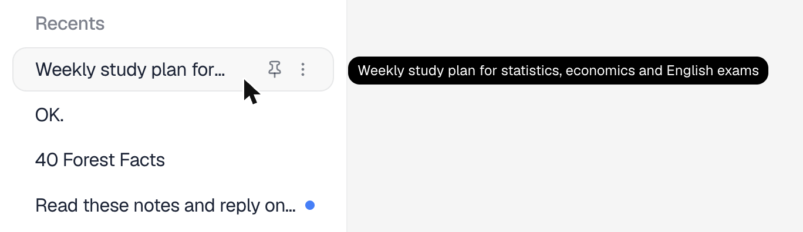
</Frame>

## Verbesserungen

- **Nachrichtenfeld auf dem Handy**: Die Eingabetaste beginnt jetzt eine neue Zeile, gesendet wird mit der Senden-Schaltfläche. Eine lange Nachricht scrollt in einem niedrigeren Feld, sodass der Chat über der Tastatur sichtbar bleibt.

## Fehlerbehebungen

- **Chat**: Der Pfeil, der zur neuesten Nachricht zurückführt, verdeckt in einem hohen Nachrichtenfeld nicht mehr, was Sie gerade schreiben.
</Update>

<Update label="12. November 2026">
## Ihre Nutzung auf einen Blick

Ein kleiner Ring im Nachrichtenfeld zeigt, wie viel Kontext in diesem Chat noch übrig ist. Wählen Sie ihn aus, um die Details zu sehen. Im Free-Plan sehen Sie dort auch Ihr Kontingent für diesen Monat.

Auf Ihrer Seite **Konto** unter **Einstellungen** schalten Sie **Nutzung anzeigen** aus, um den Ring auszublenden, und mit **Nutzungsbalken zeigen** wechseln Sie die Balken zwischen **Verbleibend** und **Genutzt**.

<Frame>
  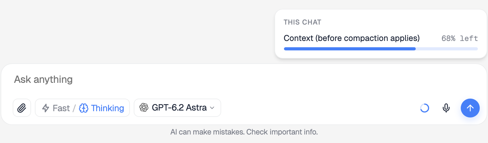
  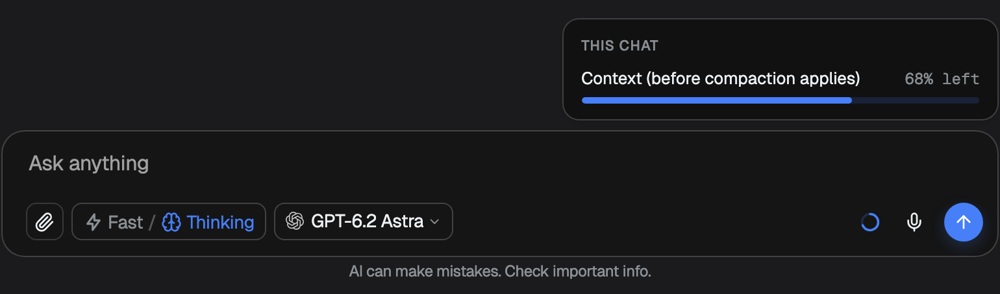
</Frame>

## Verbesserungen

- **Neue Antwort**: Das Wechseln zwischen Antworten geht jetzt sofort.
- **Bilderzeugung**: Wenn ein Bild nicht erstellt werden kann, sagt Ihnen das Chatmodell jetzt in seiner nächsten Antwort, warum.
- **Neue Chats**: Ein neuer Chat startet jetzt mit dem Modell, das Sie zuletzt ausgewählt haben, statt mit GPT-6 Astra Thinking oder dem Modell des zuletzt geöffneten Chats.
- **Nachrichtenfeld**: Auf dem Handy zeigt die Modellschaltfläche jetzt den Modellnamen, statt ihn abzuschneiden, und das Nachrichtenfeld ist breiter; die Mikrofon- und Senden-Schaltflächen sind kleiner.

## Fehlerbehebungen

- **Spracheingabe**: Die Transkription ist schneller und schlägt seltener fehl. Enthält eine Aufnahme keine Sprache, werden Sie statt einer Fehlermeldung gebeten, erneut aufzunehmen.
- **Anhänge**: Bei einer PDF, deren Text sich nicht auslesen lässt, steht jetzt, dass die Datei nicht gelesen werden kann, statt dass die Unterhaltung zu lang sei.
- **Lange Chats**: Lange Chats werden jetzt passend zum Kontextfenster jedes Modells zusammengefasst, sodass Modelle mit kleinerem Fenster und lange Chats auf Chinesisch, Japanisch oder Koreanisch nicht mehr mit dem Fehler „Unterhaltung zu lang“ abbrechen.
</Update>

<Update label="11. November 2026">
## Mit einem anderen Modell neu antworten lassen

Wählen Sie unter der neuesten Antwort **Erneut versuchen**, um eine neue Antwort zu bekommen. Ganz oben im Menü nutzt **Erneut versuchen** dasselbe Modell; darunter können Sie jedes Modell aus dem Nachrichtenfeld wählen, nach Anbieter gruppiert. Die neue Antwort ersetzt die alte an derselben Stelle, und mit den Pfeilen neben **2/2** wechseln Sie zwischen den Antworten. Die Info-Schaltfläche zeigt, welches Modell die angezeigte Antwort geschrieben hat, und das Nachrichtenfeld wechselt zu dem Modell, das Sie gewählt haben.

Nur Ihre neueste Nachricht behält mehrere Antworten: Wenn Sie eine neue Nachricht senden oder Ihre Nachricht bearbeiten, fallen die Antworten weg, die gerade nicht angezeigt werden. Das funktioniert mit Server Storage, Local Storage und No Storage. Jede neue Antwort zählt wie eine gesendete Nachricht; das Wechseln zwischen den Antworten ist kostenlos.

<Frame>
  
  
</Frame>

## In langen Chats zurückspringen

Lange Chats haben jetzt für jede Ihrer Nachrichten einen Strich, in einer Spalte links vom Chat. Zeigen Sie auf einen Strich, um die Nachricht und den Anfang der Antwort zu sehen, und wählen Sie ihn aus, um direkt dorthin zu springen, egal wie weit zurück sie liegt. Mit der Tastatur erreichen Sie die Striche mit **Tab**, bewegen sich mit den Pfeiltasten und springen mit **Enter**. Die Striche erscheinen im Web, wenn das Fenster neben dem Chat Platz für sie hat.

<Frame>
  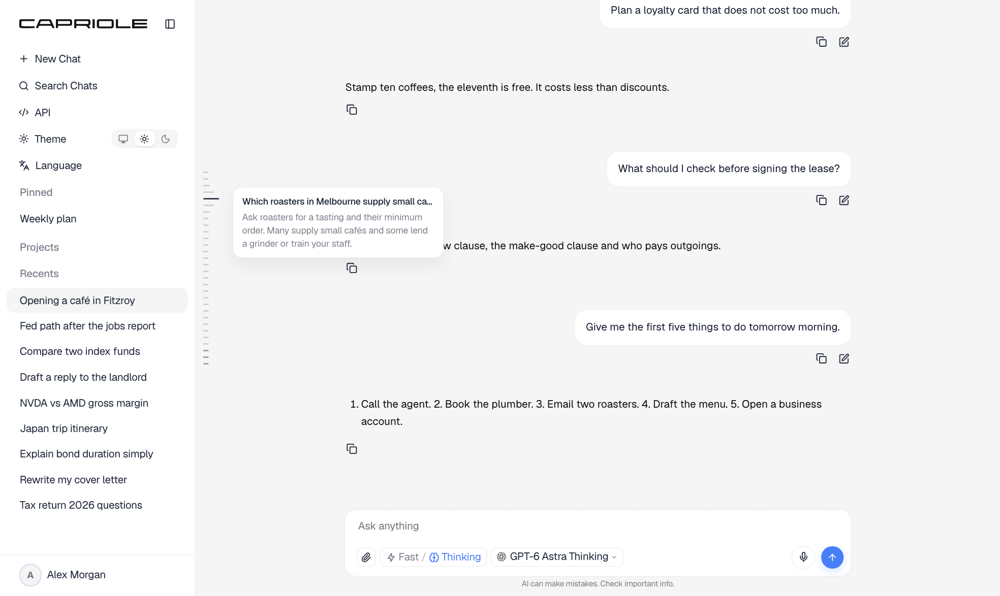
  
</Frame>

## Verbesserungen

- **Bilderzeugung**: Generierte Bilder behalten beim Laden ihre Größe, sodass ein Chat mit Bildern nicht mehr springt, wenn Sie ihn öffnen, nach jeder Antwort oder wenn Sie zwischen Antworten wechseln.

## Fehlerbehebungen

- **Nachrichten bearbeiten**: Wenn Sie nach dem Bearbeiten einer Nachricht die Antwort stoppen oder die Antwort fehlschlägt, kommen Ihre ursprüngliche Nachricht und ihre Antwort zurück.
- **Mitteilungen**: Wenn Sie in einer Mitteilung **Mehr erfahren** wählen, schließt sie sich nicht mehr, und die folgenden Mitteilungen bleiben verfügbar.
</Update>

<Update label="10. November 2026">
## Bilder bearbeiten

Sie können jetzt Bilder in Capriole AI bearbeiten. Hängen Sie im Modus **Bild** bis zu 10 PNG- oder JPEG-Bilder an, mit der Büroklammer, durch Einfügen oder durch Hineinziehen, und beschreiben Sie dann die Änderung. Geben Sie **@** ein, um auf ein Bild zu verweisen, zum Beispiel `@image1`. Wählen Sie **Bearbeiten** bei einem erstellten Bild, um es zurück ins Nachrichtenfeld zu holen und daran weiterzuarbeiten.

Alle drei Bildmodelle (GPT Image 2.6, GPT Image 2.5 und Nano Banana 2.1) können Bilder bearbeiten, und Capriole AI verwendet das Modell, das Sie ausgewählt haben. Im Modus **Text** können Sie auch das Chat-Modell bitten, ein Bild zu ändern; wenn es nicht erkennen kann, welches Bildmodell es verwenden soll, fragt es nach. [Zur Anleitung für die Bilderzeugung](/de/guides/files-web-search).

Das Menü für das Seitenverhältnis hat zwei neue Optionen. **Auto**, der neue Standard, behält die Form des Bildes bei, das Sie bearbeiten, und lässt bei einem neuen Bild das Modell die Form wählen. **21:9** ist für breite Bilder gedacht.

<Frame>
  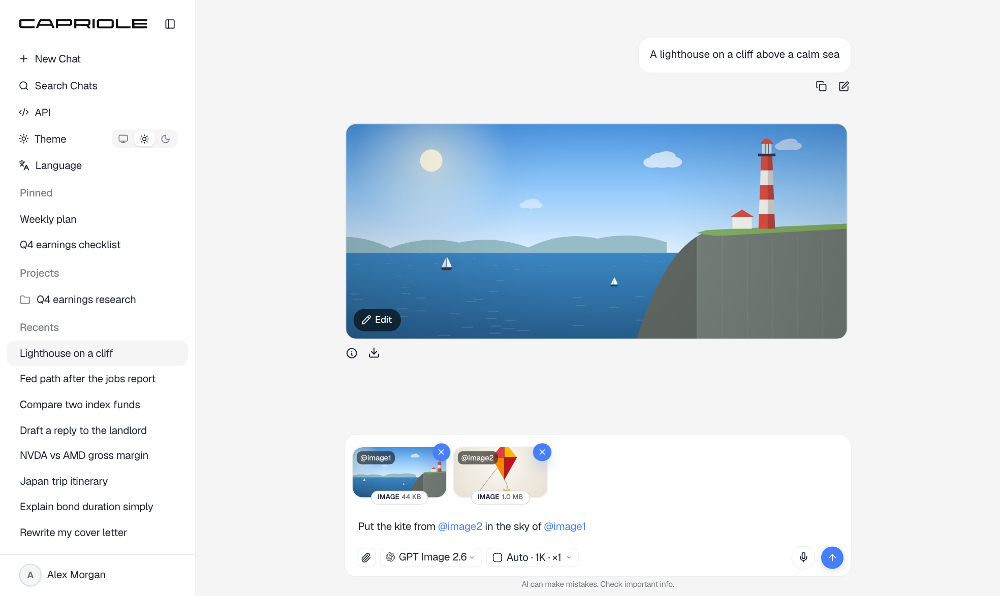
  
</Frame>

## GPT Image 2.6

<Frame>
  
</Frame>

GPT Image 2.6 von OpenAI ist jetzt verfügbar. Es ist das neueste Bildmodell von OpenAI und die Standardauswahl im Modus **Bild**. GPT Image 2.5 und Nano Banana 2.1 bleiben im Tab **Bild** verfügbar. Der Tab zeigt die beiden GPT-Image-Modelle mit vollständigem Namen: **GPT Image 2.6 Sunburst** und **GPT Image 2.5 Sunburst**. [Zur Anleitung für die Bilderzeugung](/de/guides/files-web-search).

<Frame>
  
  
</Frame>

## Konto verwalten

Öffnen Sie **Konto** und wählen Sie **Konto verwalten**, um Namen und Foto zu ändern, ein Passwort festzulegen und die Geräte zu sehen, auf denen Sie angemeldet sind. Auf dem Tab **Sicherheit** können kostenlose Konten außerdem ihr Konto löschen. Das Löschen ist endgültig und entfernt auch Ihre Anmeldung bei [Capriole Quant](https://quant.capriole.com/), weil beide dasselbe Konto verwenden. Um ein Konto mit einem kostenpflichtigen Plan zu löschen, schreiben Sie an [info@capriole.ai](mailto:info@capriole.ai).

<Frame>
  
  
</Frame>

## Verbesserungen

- **Chat-Export**: Ein exportierter Chat zeigt für ein generiertes Bild jetzt denselben Modellnamen wie der Chat selbst.
</Update>

<Update label="9. November 2026">
## Premium-Preis

Neue Premium-Abos im Web kosten **USD 9 pro Monat**. Bestehende Abos für USD 8 verlängern sich weiter für **USD 8 pro Monat**, solange sie aktiv bleiben. [Tarife und Limits ansehen](/de/guides/plans-and-limits).

Seit April arbeiten wir daran, führende KI-Modelle für alle so erschwinglich wie möglich zu machen. Diese Preisanpassung hilft uns, weiterhin unbegrenzten Web-Chat mit GPT-6 Astra, Fable 5.1, Opus 5.5, Gemini 4 Argon und anderen führenden Modellen anzubieten.

## Chattitel und Chatstatus

Neue Textchats im Web erhalten einen kurzen Titel auf Basis Ihrer ersten Nachricht. Der Browser-Tab zeigt den Titel und aktualisiert ihn, wenn Sie den Chat wechseln oder umbenennen.

Mit **Server Storage** können Sie den Chat wechseln, während eine Antwort entsteht. Ein Ladekreis in der Seitenleiste zeigt, dass die Antwort noch erstellt wird. Ein blauer Punkt markiert eine fertige Antwort, die Sie noch nicht gesehen haben. Er verschwindet, sobald Sie die Antwort sehen.

<Frame>
  
  
</Frame>
</Update>

<Update label="6. November 2026">
## Feedback

Sagen Sie uns direkt in Capriole AI, was wir verbessern oder bauen sollen. Wählen Sie unten in der Seitenleiste Ihren Namen und dann **Ressourcen** > **Feedback**. Wählen Sie **Problem**, **Funktionswunsch** oder **Frage**, beschreiben Sie Ihr Anliegen und hängen Sie bis zu 5 Dateien (insgesamt 4 MB) an oder fügen Sie einen Screenshot ein. Ihre Nachricht geht direkt an das Team von Capriole AI. Wenn Sie nicht angemeldet sind, wählen Sie unten in der Seitenleiste **Ressourcen** > **Feedback** und melden Sie sich zuerst an.

<Frame>
  
  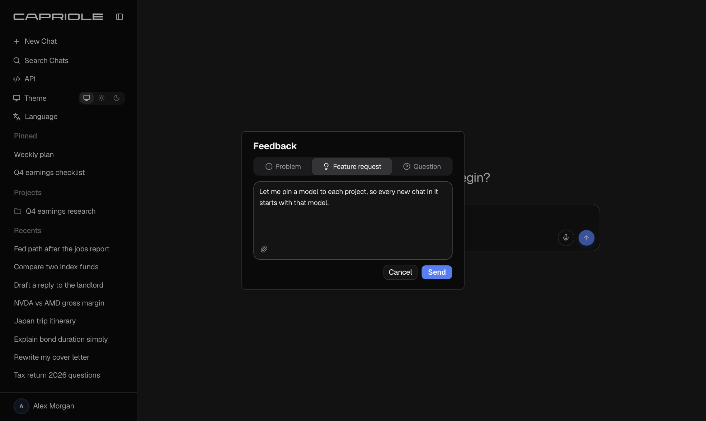
</Frame>

## Verbesserungen

- **OpenCode**: Die [OpenCode-Anleitung](/de/integrations/opencode) behandelt jetzt neben Version 1 auch OpenCode 2, und wir haben sie mit beiden getestet.
- **Projekte**: Ein neuer Chat in einem Projekt zeigt den Projektnamen nur noch einmal, über der Begrüßung.

## Fehlerbehebungen

- **Chat**: Lange Antworten von Claude Opus 5.5, Claude Fable 5.1 und Claude Opus 5 brechen nicht mehr mittendrin ab.
</Update>

<Update label="5. November 2026">
## Fehlerbehebungen

- **Spracheingabe**: Funktioniert wieder, auch wenn unser wichtigster Spracherkennungsdienst ausfällt.
</Update>

<Update label="30. Oktober 2026">
## Projektdateien und Export

Geben Sie einem Projekt die Dateien, die seine Chats brauchen. Öffnen Sie auf der Projektseite den neuen Tab **Dateien** und wählen Sie **Dateien hinzufügen**, oder ziehen Sie Dateien auf den Tab. Sie können dieselben Dokumente und Bilder hinzufügen wie bei Chat-Anhängen, bis zu 40 pro Projekt in jedem Plan. Jeder Chat im Projekt kann sie nutzen: Capriole AI liest eine Datei, wenn Ihre Frage sie braucht. Um ein Projekt mitzunehmen, öffnen Sie sein Menü und wählen Sie **Exportieren**: Sie erhalten ein ZIP mit seinen Chats, Anweisungen und Dateien. **Chatverlauf exportieren** auf Ihrer Seite **Konto** enthält jetzt auch die Anweisungen und Dateien Ihrer Projekte. [So nutzen Sie Projektdateien](/de/guides/projects).

<Frame>
  
  
</Frame>

## Verbesserungen

- **Seitenleiste**: **Angeheftet** steht jetzt über **Projekte**, ein geöffnetes Projekt zeigt auch seine Chats darunter, und Listen klappen sanft auf und zu.
- **Design**: **System** ergänzt **Hell** und **Dunkel** in der Seitenleiste und folgt dem hellen oder dunklen Modus Ihres Geräts.
</Update>

<Update label="29. Oktober 2026">
## Projekte

Halten Sie zusammengehörige Arbeit beisammen. Legen Sie ein Projekt für einen Kunden, einen Kurs oder alles an, zu dem Sie zurückkehren, und seine Chats stehen in der Seitenleiste darunter. Schreiben Sie die Anweisungen des Projekts einmal, und jeder Chat im Projekt folgt ihnen zusätzlich zu Ihren Kontoanweisungen; widersprechen sich beide, haben die Projektanweisungen Vorrang. Um ein Projekt zu erstellen, zeigen Sie in der Seitenleiste auf **Projekte** und wählen Sie **+**. Beginnen Sie dann einen Chat darin, oder verschieben Sie einen Chat über sein Menü hinein oder ziehen Sie ihn auf das Projekt. Projekte gibt es in jedem Plan für angemeldete Nutzer, deren Chats auf dem Server gespeichert werden. [So nutzen Sie Projekte](/de/guides/projects).

<Frame>
  
  
</Frame>

## Verbesserungen

- **Chats suchen**: Findet jeden Chat über seinen Titel, auch ältere Chats und Chats in Projekten.
</Update>

<Update label="28. Oktober 2026">
## Chatverlauf exportieren

Nehmen Sie Ihre Chats mit. Wählen Sie auf Ihrer Seite **Konto** unter **Einstellungen** die Option **Chatverlauf exportieren**. Capriole AI erstellt im Hintergrund ein ZIP, Sie können die Seite währenddessen verlassen, und der Download bleibt 24 Stunden verfügbar. Das ZIP enthält jeden Chat als Markdown-Datei, daneben Ihre angehängten Dateien und erstellten Bilder, sowie `conversations.json` mit allen Chats in einem Format, das Programme lesen können. Um einen einzelnen Chat zu exportieren, öffnen Sie sein Menü in der Seitenleiste und wählen Sie **Exportieren**. Chats im lokalen Speicher werden sofort heruntergeladen.

<Frame>
  
  
</Frame>

## Verbesserungen

- **Lange Chats**: Zeigen beim Öffnen sofort die neuesten Nachrichten. Ältere Nachrichten werden beim Hochscrollen geladen, und was Sie gerade lesen, bleibt an seinem Platz.
</Update>

<Update label="27. Oktober 2026">
## Personalisierung

Sagen Sie Capriole AI im neuen Bereich **Personalisierung** auf Ihrer Seite **Konto**, wie es Sie nennen soll, was Ihre Arbeit am besten beschreibt und wie Sie Antworten mögen. Jeder Chat folgt diesen Angaben ab Ihrer nächsten Nachricht, auch bestehende Chats. Anweisungen können bis zu 1,500 Zeichen lang sein. Sie gelten für den Web-Chat und die App, nicht für die API.

<Frame>
  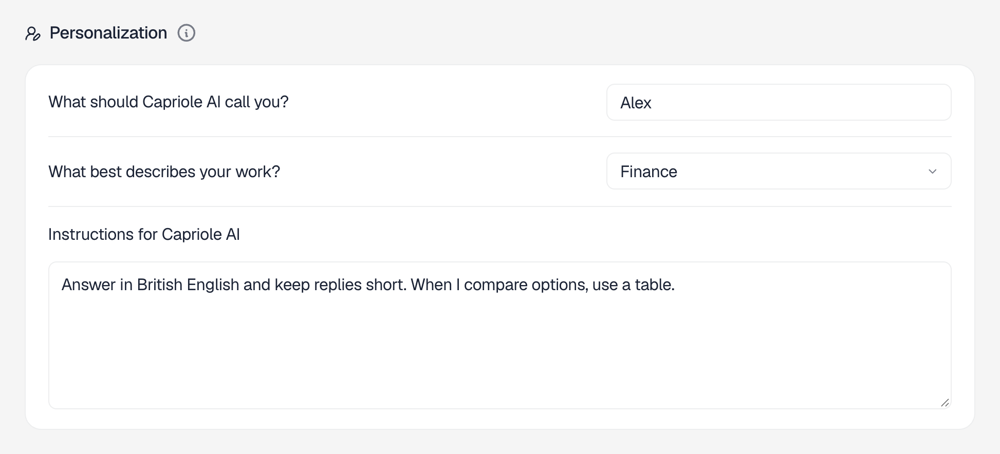
  
</Frame>

## Gastchats bleiben nach der Anmeldung erhalten

Starten Sie einen Chat ohne Konto und melden Sie sich dann im selben Tab an oder registrieren Sie sich. Der Chat öffnet sich als gespeicherter Chat in Ihrem Konto, mit allen Nachrichten, und die nächste Antwort berücksichtigt, was Sie zuvor gefragt haben. Das Speichern wird nicht auf Ihre Nutzung angerechnet.

<Frame>
  
  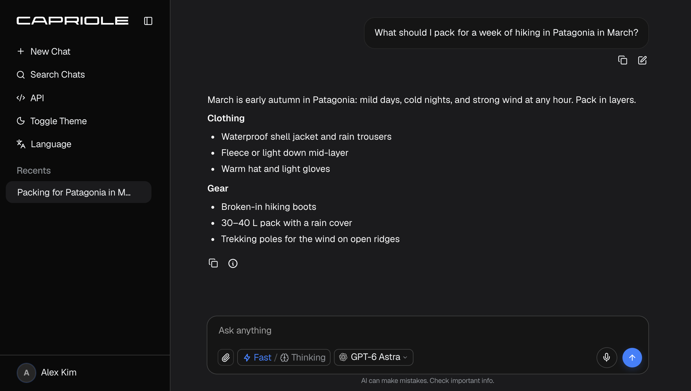
</Frame>

## Kimi K3.1 Pro

Kimi K3.1 Pro von Moonshot AI ist jetzt verfügbar. Es ist das leistungsfähigste Modell von Kimi, mit deutlichen Fortschritten beim Programmieren, bei der 3D-Erstellung und bei der Finanzrecherche sowie einem Kontextfenster von 1M Tokens. Wählen Sie im Web-Chat **Kimi K3.1 Pro Thinking** für anspruchsvollere Aufgaben oder **Kimi K3.1 Pro** für schnellere Antworten. Über die API rufen Sie `moonshot/kimi-k3.1-pro` mit [Chat Completions](/de/api-reference/endpoint/chat-completions) auf; auch die [Anleitungen für Coding-Agents](/de/integrations/opencode) führen das Modell auf. Kimi K3 bleibt unter **Weitere Modelle** verfügbar.

<Frame>
  
  
</Frame>
</Update>

<Update label="20. Oktober 2026">
## Das Änderungsprotokoll ist online

Neue Funktionen, Modell-Updates, API-Änderungen und Anleitungen für Coding-Agents von Capriole AI erscheinen jetzt auf dieser Seite, die neuesten zuerst. Öffnen Sie in der App **Ressourcen > Neueste Mitteilung**, um hierher zurückzukehren. Abonnieren Sie den RSS-Feed, um jede Änderung zu erhalten, sobald sie veröffentlicht ist.

<Frame>
  
  
</Frame>

## Chats merken sich ihr Modell

Wenn Sie einen gespeicherten Chat öffnen, wählt Capriole AI das Modell der letzten Antwort aus, einschließlich der Einstellung Fast oder Thinking. Die Auswahl bleibt nach dem Neuladen, nach einer neuen Anmeldung und auf anderen Geräten erhalten. Wurde das Modell eingestellt, bleibt Ihre aktuelle Auswahl bestehen.

<Frame>
  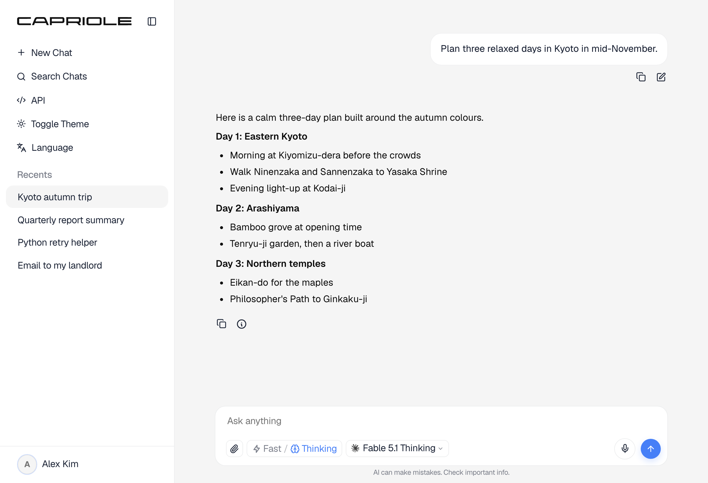
  
</Frame>

## Anleitungen für Coding-Agents neu getestet

Wir haben alle Anleitungen für Coding-Agents mit den aktuellen Modellen neu getestet und Anleitungen für [Cline](/de/integrations/cline), [Qwen Code](/de/integrations/qwen-code), [Crush](/de/integrations/crush) und [Pi](/de/integrations/pi) hinzugefügt. [OpenCode](/de/integrations/opencode) und [Kilo Code](/de/integrations/kilo-code) brauchen jetzt nur noch einen Provider und einen API-Schlüssel.

<Frame>
  
  
</Frame>
</Update>
