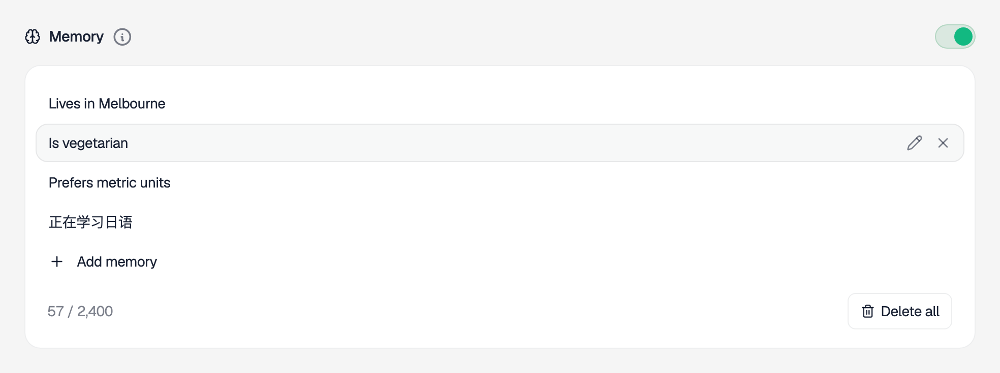
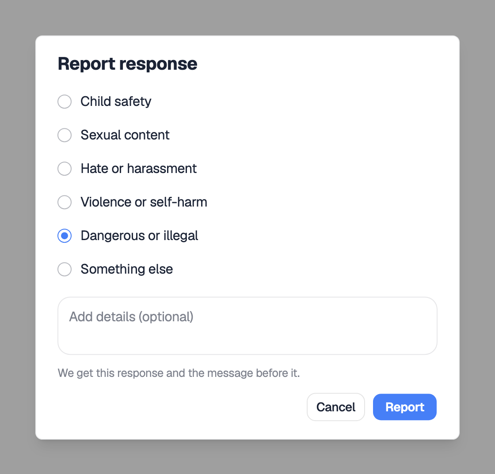
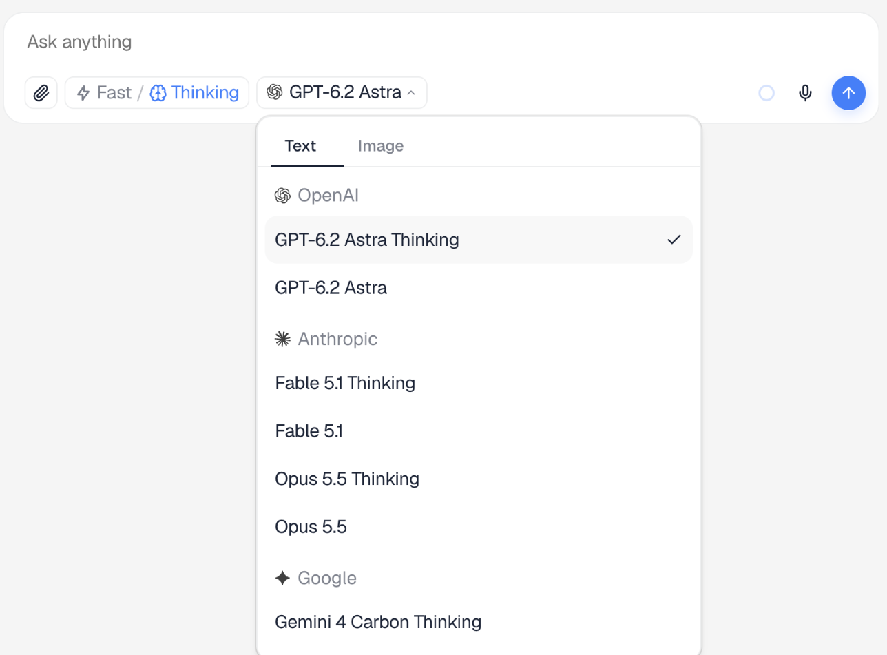
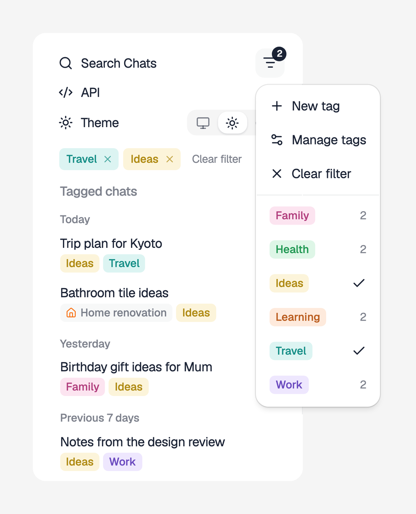
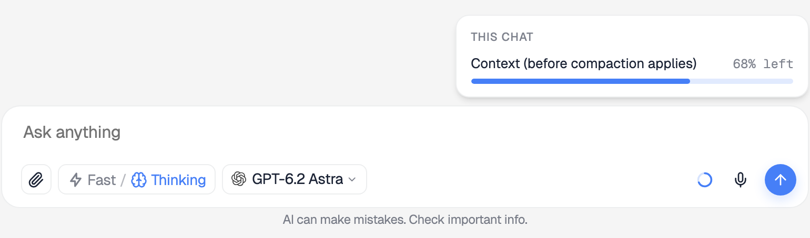
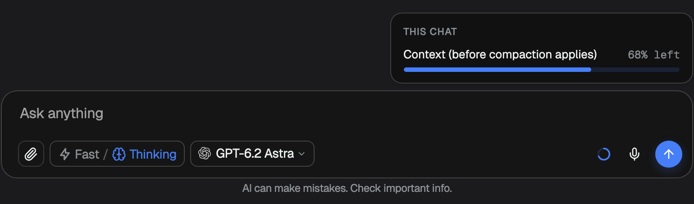
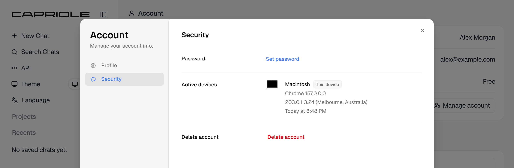
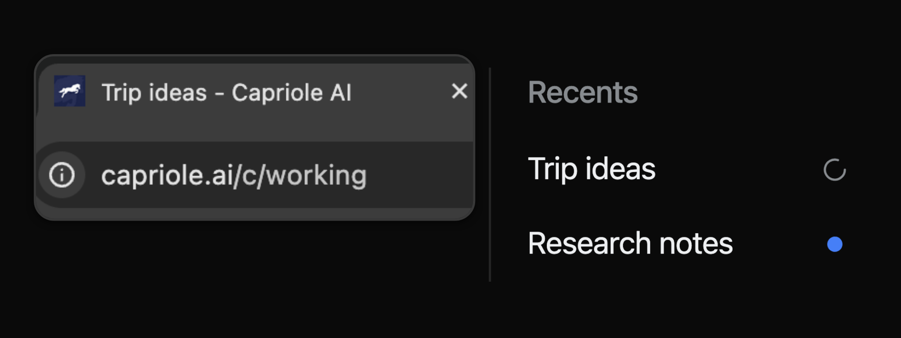
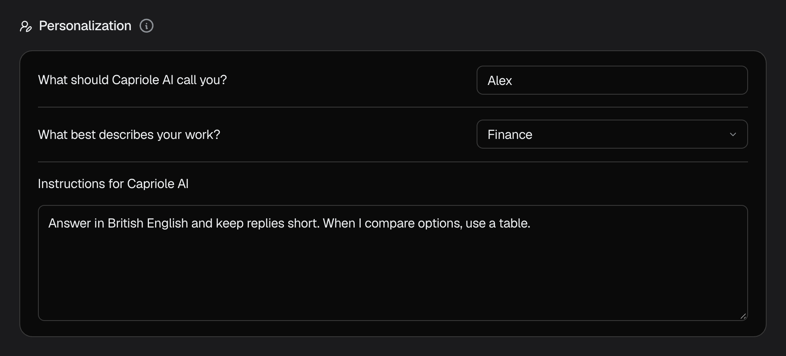
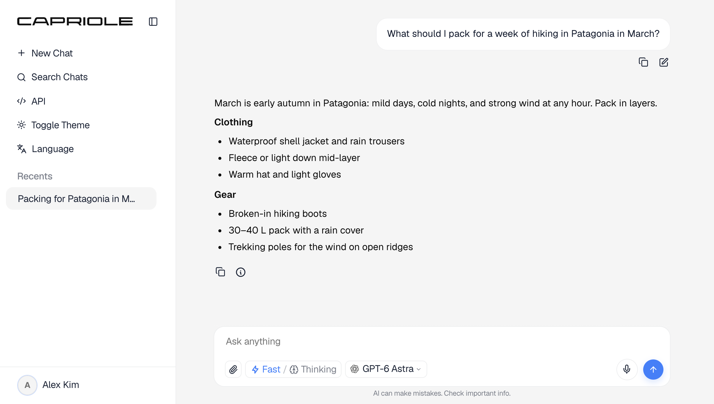

<Update label="23 de noviembre de 2026">
## Memoria entre chats

Capriole AI ahora recuerda el contexto que te importa en todos tus chats y modelos. Activa **Memoria** en **Cuenta** → **Memoria**, donde puedes revisar, añadir, editar o eliminar cada dato en cualquier momento.

Cada proyecto también tiene una pestaña **Memoria**: los chats de un proyecto usan tu memoria general y la del proyecto, y guardan los datos nuevos en el proyecto. La memoria general admite hasta 2,400 caracteres, y cada proyecto hasta 1,200.

La memoria está desactivada por defecto y funciona en los chats con sesión iniciada guardados con **Server Storage**, también en la app; se gestiona en la web. [Descubre cómo funciona la memoria](/es/guides/personalization-and-memory).

<Frame>
  
</Frame>

</Update>

<Update label="21 de noviembre de 2026">
## Mejoras

- **Copiar**: En las respuestas con texto e imágenes, o con varias imágenes, **Copiar** ahora te deja copiar el texto, cualquier imagen o todo a la vez, y las imágenes se copian al instante.

</Update>

<Update label="20 de noviembre de 2026">
## GPT-5.5

Capriole AI ha dejado de ofrecer soporte para GPT-5.5. Cambia a GPT-6.2 Astra o GPT-6.2 Sol. Para las llamadas a la API, usa `openai-latest` u `openai/gpt-6.2-astra`.

## Denunciar una respuesta

Ahora cada respuesta tiene una bandera debajo. Úsala para denunciar una respuesta que te parezca dañina: elige un motivo, añade detalles si quieres y, en una respuesta con imágenes, marca las imágenes que quieras incluir. Recibimos la respuesta y el mensaje anterior, y revisamos todas las denuncias. Tu chat sigue igual, y puedes denunciar una respuesta de texto sin iniciar sesión.

<Frame>
  
</Frame>

## Mejoras

- **Generación de imágenes**: Las respuestas con solo imágenes ahora tienen **Copiar imagen**: copia la imagen directamente o te deja elegir una cuando hay varias. En pantallas táctiles, el menú **…** de cada imagen también tiene **Copiar imagen**.

</Update>

<Update label="18 de noviembre de 2026">
## GPT-6.2 Astra y Sol

<Frame>
  
</Frame>

GPT-6.2 Astra es el nuevo modelo insignia de OpenAI y sustituye a GPT-6 Astra, y GPT-6.2 Sol sustituye a GPT-6.1 Sol como el modelo de OpenAI para el trabajo cotidiano. [OpenAI describe](https://openai.com/index/introducing-gpt-6-2-astra-sol/) Astra como «nuestro nuevo modelo de frontera para tus proyectos más difíciles» y Sol como «nuestro modelo eficiente y versátil para el trabajo cotidiano».

En el selector de modelos del chat web, GPT-6.2 Astra ahora encabeza el grupo OpenAI con **Thinking** y **Fast**, y los invitados y las cuentas nuevas empiezan en **GPT-6.2 Astra Thinking**. GPT-6.2 Sol, también con **Thinking** y **Fast**, aparece primero entre los modelos de OpenAI en **Más modelos**, donde GPT-6 Astra y GPT-6.1 Sol siguen disponibles. En la API, llama a `openai/gpt-6.2-astra` o `openai/gpt-6.2-sol` en [Responses](/es/api-reference/endpoint/responses) o [Chat Completions](/es/api-reference/endpoint/chat-completions); `openai-latest` ahora apunta a GPT-6.2 Astra. Los precios de la API de OpenAI son USD 8 de entrada y USD 40 de salida por 1M de tokens para Astra, un 20% menos que GPT-6 Astra, y USD 2 y USD 10 para Sol, lo mismo que GPT-6.1 Sol. [Elige un modelo](/es/guides/choose-a-model) los compara con los demás modelos insignia.

<Frame>
  
</Frame>

## Etiqueta tus chats

Elige **Etiquetas** en el menú de un chat de la barra lateral para ponerle una o varias etiquetas de color, que aparecen bajo su título. El botón de filtro junto a **Buscar chats** muestra todos los chats que tienen cualquiera de las etiquetas que elijas, de **Recientes** y de todos tus proyectos, y en **Buscar chats** también puedes elegir etiquetas para buscar solo en los chats que las tienen. Las etiquetas están disponibles para las cuentas con sesión iniciada que usan **Server Storage**. [Consulta cómo usar las etiquetas](/es/guides/projects#etiqueta-tus-chats).

<Frame>
  
</Frame>

## Mejoras

- **Barra lateral**: Caben más chats en pantalla, **Recientes** se agrupa por fecha y tu navegador recuerda qué secciones y proyectos dejaste abiertos.
- **Idioma**: Con la sesión iniciada, el ajuste de idioma pasa de la barra lateral a **Cuenta** → **Ajustes**.
- **Proyectos**: Ahora cada proyecto puede tener su propio color e icono, que eliges al crearlo o editarlo. Al seleccionar el nombre de un proyecto, se muestran u ocultan sus chats, y **Gestionar proyecto**, en su menú de tres puntos, abre la página del proyecto.
- **Otra respuesta**: Cuando tu última respuesta falla, ahora aparece **Reintentar** debajo, para que puedas volver a enviar tu mensaje con el mismo modelo o con otro.

## Correcciones

- **Títulos de chat**: Los chats nuevos reciben un título que resume el tema del primer mensaje en el idioma en que lo escribiste, en lugar de responderlo.
- **Archivos adjuntos**: Los modelos GPT ahora leen los archivos Markdown que algunos navegadores etiquetan de otra forma.
- **Generación de imágenes**: Detener una respuesta justo cuando empieza una imagen ya no muestra un error.
</Update>

<Update label="17 de noviembre de 2026">
## Gemini 4 Carbon

<Frame>
  
</Frame>

Ya está disponible Gemini 4 Carbon, el modelo más potente de Google. Google lo creó para tareas que ponen a prueba los límites de la inteligencia de un modelo, como la programación y la depuración complejas de varios pasos, el trabajo agéntico de largo horizonte y el razonamiento científico. Elige **Gemini 4 Carbon Thinking** al principio del grupo Google en el selector de modelos del chat web, o llama a `google/gemini-4-carbon` en [Chat Completions](/es/api-reference/endpoint/chat-completions); `google-latest` ahora apunta a Carbon, y en Chat Completions puedes [establecer el `thinking_level` de Google](/es/guides/choose-a-model#ids-de-modelo-para-la-api) en `low` para llamadas más ligeras. Gemini 4 Argon sigue disponible como **Gemini 4 Argon Thinking** en el chat web y como `google/gemini-4-argon` en la API.

<Frame>
  
</Frame>

## Seedream 5.5

<Frame>
  
</Frame>

Seedream 5.5 de ByteDance Seed ya está disponible en el modo **Imagen**. Según ByteDance Seed, hace [cambios precisos y específicos a lo largo de varias ediciones sin alterar las zonas no editadas](https://seed.bytedance.com/en/seedream5_5), con una iluminación más natural, materiales más finos y texturas de piel más refinadas. Elige **Seedream 5.5** en **ByteDance**, en la pestaña **Imagen** del selector de modelos, para crear imágenes o editar las que adjuntes, en 1K o 2K y en cualquier relación de aspecto, incluida **Auto**. Como los demás modelos de imagen, es gratis para las cuentas con sesión iniciada que usan **Server Storage**. GPT Image 2.6 sigue siendo el predeterminado. En el modo **Texto**, el Text Agent usa el modelo de imagen que nombres; si no nombras ninguno, el de la última imagen del chat; y si no hay ninguna, GPT Image 2.6. Ya no te pregunta cuál usar. [Consulta la guía de generación de imágenes](/es/guides/files-web-search).

<Frame>
  
</Frame>

## Mejoras

- **Chats largos**: La compactación del contexto de GPT-6 Astra es más rápida y eficiente.

## Correcciones

- **Chat**: Los modelos de Claude ahora admiten mensajes con más imágenes.
- **Gemini**: Las respuestas son más fiables.
- **Modo Imagen**: En la web, la barra lateral muestra el progreso mientras se crea una imagen, y el chat muestra el punto azul si la imagen termina mientras no estás.
</Update>

<Update label="16 de noviembre de 2026">
## Enviar con Ctrl/⌘ + Intro

Ahora Intro también puede empezar una línea nueva en la computadora. En tu página de **Cuenta**, en **Ajustes**, activa **Enviar con Ctrl/⌘ + Intro**. Así Intro empieza una línea nueva y Ctrl+Intro (⌘+Intro en Mac) envía. El ajuste se guarda en tu cuenta, así que se aplica en cualquier computadora.

<Frame>
  
</Frame>

## Ve el título completo de los chats

Pasa el puntero por un chat de la barra lateral cuyo título esté cortado y el título completo aparece junto a la barra lateral. Así encuentras el chat que buscas sin abrirlo.

<Frame>
  
</Frame>

## Mejoras

- **Cuadro de mensaje en el móvil**: Intro ahora empieza una línea nueva y el botón Enviar envía. Un mensaje largo se desplaza dentro de un cuadro más bajo, así que el chat sigue a la vista encima del teclado.

## Correcciones

- **Chat**: La flecha que te lleva al último mensaje ya no tapa lo que escribes cuando el cuadro de mensaje está alto.
</Update>

<Update label="12 de noviembre de 2026">
## Tu uso de un vistazo

Un pequeño anillo en el cuadro de mensaje muestra cuánto contexto le queda a este chat. Selecciónalo para ver los detalles y, en el plan Free, la asignación de este mes.

En tu página **Cuenta**, dentro de **Ajustes**, desactiva **Mostrar uso** para ocultar el anillo, y con **Las barras de uso muestran** eliges si las barras indican **Restante** o **Usado**.

<Frame>
  
  
</Frame>

## Mejoras

- **Otra respuesta**: Pasar de una respuesta a otra ahora es instantáneo.
- **Generación de imágenes**: Cuando no se puede crear una imagen, el modelo de chat ahora te explica por qué en su siguiente respuesta.
- **Chats nuevos**: Un chat nuevo ahora empieza con el último modelo que elegiste, en lugar de GPT-6 Astra Thinking o el modelo del último chat que abriste.
- **Cuadro de mensaje**: En el móvil, el botón del modelo ahora muestra el nombre del modelo en lugar de cortarlo y el cuadro de mensaje es más ancho; los botones de micrófono y Enviar son más pequeños.

## Correcciones

- **Entrada de voz**: La transcripción es más rápida y falla menos. Si una grabación no tiene voz, ahora te pide que vuelvas a grabar en lugar de mostrar un error.
- **Archivos adjuntos**: Un PDF cuyo texto no se puede extraer ahora indica que no se puede leer el archivo, en lugar de decir que la conversación es demasiado larga.
- **Chats largos**: Los chats largos ahora se resumen en el momento adecuado para la ventana de contexto de cada modelo, así que los modelos con ventanas más pequeñas y los chats largos en chino, japonés o coreano ya no se detienen con el error «conversación demasiado larga».
</Update>

<Update label="11 de noviembre de 2026">
## Pide otra respuesta a otro modelo

Selecciona **Reintentar** debajo de la última respuesta para obtener una nueva. En el menú, **Reintentar**, arriba del todo, usa el mismo modelo, y debajo puedes elegir cualquier modelo del cuadro de mensaje, agrupado por proveedor. La nueva respuesta sustituye a la anterior en el mismo lugar, y las flechas junto a **2/2** te llevan de una respuesta a otra. El botón de información muestra qué modelo escribió la respuesta en pantalla, y el cuadro de mensaje cambia al modelo que elegiste.

Solo tu último mensaje conserva más de una respuesta: al enviar un mensaje nuevo o editar tu mensaje, se descartan las respuestas que no están en pantalla. Funciona con Server Storage, Local Storage y No Storage. Cada respuesta nueva cuenta como un mensaje enviado, y pasar de una respuesta a otra es gratis.

<Frame>
  
  
</Frame>

## Vuelve atrás en chats largos

Los chats largos ahora tienen una marca por cada mensaje que enviaste, en una columna a la izquierda del chat. Pasa el puntero por una marca para ver el mensaje y el comienzo de su respuesta, y selecciónala para ir directo a él, por muy atrás que esté. Con el teclado, pulsa **Tab** para llegar a las marcas, muévete con las flechas y pulsa **Intro**. Las marcas aparecen en la web cuando la ventana tiene espacio para ellas junto al chat.

<Frame>
  
  
</Frame>

## Mejoras

- **Generación de imágenes**: Las imágenes generadas mantienen su tamaño mientras cargan, así que un chat con imágenes ya no salta al abrirlo, después de cada respuesta ni al pasar de una respuesta a otra.

## Correcciones

- **Edición de mensajes**: Si detienes la respuesta después de editar un mensaje, o si la respuesta falla, vuelven tu mensaje original y su respuesta.
- **Novedades**: Seleccionar **Más información** en una novedad ya no la cierra, así que las novedades que vienen después siguen disponibles.
</Update>

<Update label="10 de noviembre de 2026">
## Edita imágenes

Ya puedes editar imágenes en Capriole AI. En el modo **Imagen**, adjunta hasta 10 imágenes PNG o JPEG con el clip, pegándolas o arrastrándolas, y describe el cambio. Escribe **@** para referirte a una imagen, por ejemplo `@image1`. Selecciona **Editar** en una imagen generada para devolverla al cuadro de mensaje y seguir trabajando en ella.

Tanto GPT Image 2.6 como GPT Image 2.5 y Nano Banana 2.1 editan imágenes, y Capriole AI usa el modelo que hayas seleccionado. En el modo **Texto**, también puedes pedirle al modelo de chat que cambie una imagen; cuando no puede saber qué modelo de imagen usar, te lo pregunta. [Consulta la guía de generación de imágenes](/es/guides/files-web-search).

El menú de relación de aspecto tiene dos novedades. **Auto**, la nueva opción predeterminada, mantiene la forma de la imagen que editas y deja que el modelo elija la forma de una imagen nueva. **21:9** está pensada para imágenes anchas.

<Frame>
  
  
</Frame>

## GPT Image 2.6

<Frame>
  
</Frame>

GPT Image 2.6 de OpenAI ya está disponible. Es el modelo de imagen más reciente de OpenAI y el predeterminado en el modo **Imagen**. GPT Image 2.5 y Nano Banana 2.1 siguen disponibles en la pestaña **Imagen**. La pestaña muestra los dos modelos GPT Image con su nombre completo: **GPT Image 2.6 Sunburst** y **GPT Image 2.5 Sunburst**. [Consulta la guía de generación de imágenes](/es/guides/files-web-search).

<Frame>
  
  
</Frame>

## Administra tu cuenta

Abre **Cuenta** y selecciona **Administrar cuenta** para actualizar tu nombre y tu foto, establecer una contraseña y ver los dispositivos en los que has iniciado sesión. En la pestaña **Seguridad**, las cuentas gratuitas también pueden eliminar su cuenta. La eliminación es permanente y también quita tu acceso a [Capriole Quant](https://quant.capriole.com/), porque ambos usan la misma cuenta. Para eliminar una cuenta con un plan de pago, escribe a [info@capriole.ai](mailto:info@capriole.ai).

<Frame>
  
  
</Frame>

## Mejoras

- **Exportación de chats**: Un chat exportado ahora muestra, para cada imagen generada, el mismo nombre de modelo que el propio chat.
</Update>

<Update label="9 de noviembre de 2026">
## Precio de Premium

Las nuevas suscripciones web de Premium cuestan **USD 9 al mes**. Las suscripciones existentes de USD 8 se siguen renovando por **USD 8 al mes** mientras permanezcan activas. [Consulta los planes y límites](/es/guides/plans-and-limits).

Desde abril, hemos trabajado para que la IA de vanguardia sea lo más asequible posible para todos. Este ajuste de precio nos ayuda a seguir ofreciendo chat web ilimitado con GPT-6 Astra, Fable 5.1, Opus 5.5, Gemini 4 Argon y otros modelos de vanguardia.

## Títulos y estado de los chats

Los nuevos chats de texto en la web reciben un título breve basado en tu primer mensaje. La pestaña del navegador muestra el título y se actualiza al cambiar de chat o renombrarlo.

Con **Server Storage**, puedes cambiar de chat mientras se genera una respuesta. Un indicador giratorio en la barra lateral muestra que está en curso. Un punto azul marca una respuesta terminada que aún no has visto y desaparece cuando la ves.

<Frame>
  
  
</Frame>
</Update>

<Update label="6 de noviembre de 2026">
## Comentarios

Dinos qué arreglar o crear sin salir de Capriole AI. Selecciona tu nombre en la parte inferior de la barra lateral y luego **Recursos** > **Comentarios**. Elige **Problema**, **Sugerencia** o **Pregunta**, escribe lo que tienes en mente y adjunta hasta 5 archivos (4 MB en total) o pega una captura de pantalla. Tu mensaje llega directamente al equipo de Capriole AI. Si no has iniciado sesión, selecciona **Recursos** > **Comentarios** en la parte inferior de la barra lateral e inicia sesión primero.

<Frame>
  
  
</Frame>

## Mejoras

- **OpenCode**: La [guía de OpenCode](/es/integrations/opencode) ahora cubre OpenCode 2 además de la versión 1, y la probamos con ambas.
- **Proyectos**: Un chat nuevo en un proyecto muestra el nombre del proyecto una sola vez, encima del saludo.

## Correcciones

- **Chat**: Las respuestas largas de Claude Opus 5.5, Claude Fable 5.1 y Claude Opus 5 ya no se detienen a la mitad.
</Update>

<Update label="5 de noviembre de 2026">
## Correcciones

- **Entrada de voz**: Vuelve a funcionar y sigue funcionando aunque nuestro proveedor principal de voz a texto no esté disponible.
</Update>

<Update label="30 de octubre de 2026">
## Archivos y exportación en proyectos

Dale a un proyecto los archivos que necesitan sus chats. En la página del proyecto, abre la nueva pestaña **Archivos** y selecciona **Añadir archivos**, o suelta archivos en la pestaña. Puedes añadir los mismos documentos e imágenes que se aceptan como adjuntos del chat, hasta 40 por proyecto en todos los planes. Todos los chats del proyecto pueden usarlos: Capriole AI lee un archivo cuando tu pregunta lo necesita. Para llevarte un proyecto, abre su menú y elige **Exportar**: obtienes un ZIP con sus chats, instrucciones y archivos. **Exportar historial de chat**, en tu página **Cuenta**, ahora también incluye las instrucciones y los archivos de tus proyectos. [Aprende a usar los archivos de proyecto](/es/guides/projects).

<Frame>
  
  
</Frame>

## Mejoras

- **Barra lateral**: **Fijados** ahora va antes de **Proyectos**, al abrir un proyecto también se muestran sus chats debajo y las listas se abren y cierran con suavidad.
- **Tema**: **Sistema** se suma a **Claro** y **Oscuro** en la barra lateral y sigue el modo claro u oscuro de tu dispositivo.
</Update>

<Update label="29 de octubre de 2026">
## Proyectos

Mantén juntos los trabajos relacionados. Crea un proyecto para un cliente, un curso o cualquier cosa a la que vuelvas, y sus chats quedan debajo de él en la barra lateral. Escribe una vez las instrucciones del proyecto y cada chat del proyecto las sigue, además de las instrucciones de tu cuenta; si entran en conflicto, prevalecen las del proyecto. Para crear un proyecto, coloca el puntero sobre **Proyectos** en la barra lateral y selecciona **+**. Después, empieza un chat en él o mueve un chat desde su menú o arrastrándolo hasta el proyecto. Los proyectos están disponibles en todos los planes para usuarios con sesión iniciada que guardan sus chats en el servidor. [Aprende a usar los proyectos](/es/guides/projects).

<Frame>
  
  
</Frame>

## Mejoras

- **Buscar chats**: encuentra cualquier chat por su título, incluidos los chats más antiguos y los chats de proyectos.
</Update>

<Update label="28 de octubre de 2026">
## Exporta tu historial de chat

Llévate tus chats. En tu página **Cuenta**, dentro de **Ajustes**, elige **Exportar historial de chat**. Capriole AI prepara un ZIP en segundo plano, así que puedes salir de la página mientras tanto, y la descarga está disponible durante 24 horas. El ZIP contiene cada chat como archivo Markdown, junto con los archivos que adjuntaste y las imágenes que generaste, además de `conversations.json` con todos tus chats en un formato que los programas pueden leer. Para exportar un solo chat, abre su menú en la barra lateral y elige **Exportar**. Los chats guardados en el almacenamiento local se descargan al instante.

<Frame>
  
  
</Frame>

## Mejoras

- **Chats largos**: al abrirlos, muestran al instante los mensajes más recientes. Los mensajes anteriores se cargan al desplazarte hacia arriba, y lo que estás leyendo no se mueve.
</Update>

<Update label="27 de octubre de 2026">
## Personalización

Dile a Capriole AI cómo llamarte, qué describe mejor tu trabajo y cómo prefieres las respuestas, en la nueva sección **Personalización** de tu página **Cuenta**. Todos los chats lo siguen a partir de tu próximo mensaje, incluidos los que ya tienes. Las instrucciones admiten hasta 1500 caracteres. Se aplican al chat web y a la app, no a la API.

<Frame>
  
  
</Frame>

## Los chats de invitado se conservan al iniciar sesión

Empieza un chat sin cuenta y, después, inicia sesión o regístrate en la misma pestaña. El chat se abre como un chat guardado en tu cuenta, con todos los mensajes, y la siguiente respuesta recuerda lo que preguntaste antes. Guardarlo no cuenta para tu uso.

<Frame>
  
  
</Frame>

## Kimi K3.1 Pro

Kimi K3.1 Pro de Moonshot AI ya está disponible. Es el modelo más capaz de Kimi, con mejoras sustanciales en programación, creación 3D e investigación financiera, y una ventana de contexto de 1M de tokens. En el chat web, elige **Kimi K3.1 Pro Thinking** para el trabajo más exigente o **Kimi K3.1 Pro** para respuestas más rápidas. Desde la API, llama a `moonshot/kimi-k3.1-pro` en [Chat Completions](/es/api-reference/endpoint/chat-completions); las [guías de agentes de programación](/es/integrations/opencode) también lo incluyen. Kimi K3 sigue disponible en **Más modelos**.

<Frame>
  
  
</Frame>
</Update>

<Update label="20 de octubre de 2026">
## El registro de cambios ya está disponible

Las nuevas funciones, las actualizaciones de modelos, los cambios en la API y las guías de agentes de programación de Capriole AI aparecen ahora en esta página, de la más reciente a la más antigua. En la app, abre **Recursos > Última novedad** para volver aquí. Suscríbete al feed RSS para recibir cada actualización cuando se publique.

<Frame>
  
  
</Frame>

## Los chats recuerdan su modelo

Al abrir un chat guardado, Capriole AI selecciona el modelo de su última respuesta, incluido el ajuste Fast o Thinking. La elección se mantiene al recargar la página, al volver a iniciar sesión o en otro dispositivo. Si ese modelo se ha retirado, se mantiene tu selección actual.

<Frame>
  
  
</Frame>

## Guías de agentes de programación, probadas de nuevo

Volvimos a probar todas las guías de agentes de programación con los modelos actuales y añadimos guías para [Cline](/es/integrations/cline), [Qwen Code](/es/integrations/qwen-code), [Crush](/es/integrations/crush) y [Pi](/es/integrations/pi). [OpenCode](/es/integrations/opencode) y [Kilo Code](/es/integrations/kilo-code) ahora solo necesitan un proveedor y una clave API.

<Frame>
  
  
</Frame>
</Update>
