<Update label="11 de noviembre de 2026">
## Pide otra respuesta a otro modelo

Selecciona **Reintentar** debajo de la última respuesta para obtener una nueva. En el menú, **Reintentar**, arriba del todo, usa el mismo modelo, y debajo puedes elegir cualquier modelo del cuadro de mensaje, agrupado por proveedor. La nueva respuesta sustituye a la anterior en el mismo lugar, y las flechas junto a **2/2** te llevan de una respuesta a otra. El botón de información muestra qué modelo escribió la respuesta en pantalla, y el cuadro de mensaje cambia al modelo que elegiste.

Solo tu último mensaje conserva más de una respuesta: al enviar un mensaje nuevo o editar tu mensaje, se descartan las respuestas que no están en pantalla. Funciona con Server Storage, Local Storage y No Storage. Cada respuesta nueva cuenta como un mensaje enviado, y pasar de una respuesta a otra es gratis.

<Frame>
  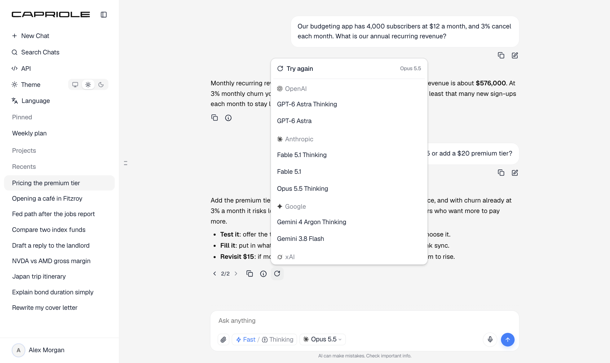
  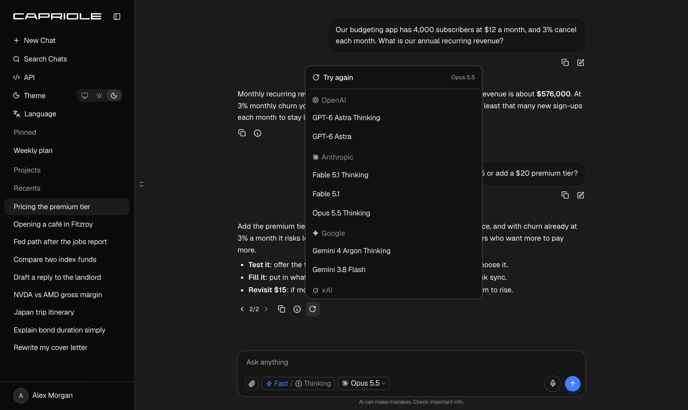
</Frame>

## Vuelve atrás en chats largos

Los chats largos ahora tienen una marca por cada mensaje que enviaste, en una columna a la izquierda del chat. Pasa el puntero por una marca para ver el mensaje y el comienzo de su respuesta, y selecciónala para ir directo a él, por muy atrás que esté. Con el teclado, pulsa **Tab** para llegar a las marcas, muévete con las flechas y pulsa **Intro**. Las marcas aparecen en la web cuando la ventana tiene espacio para ellas junto al chat.

<Frame>
  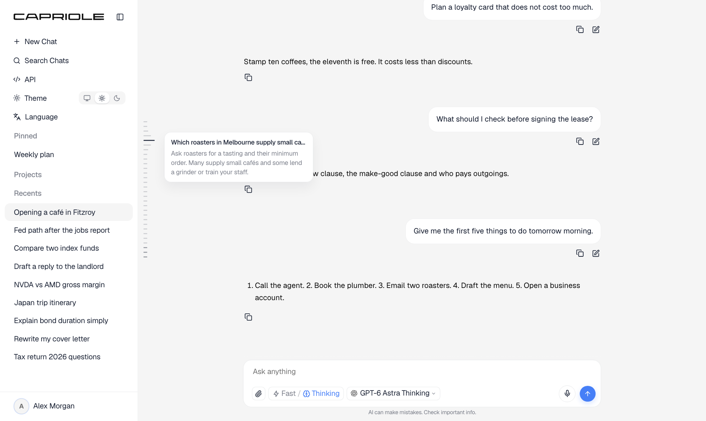
  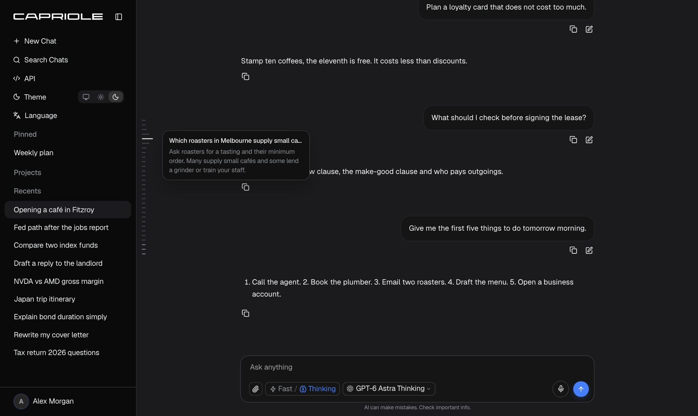
</Frame>

## Mejoras

- **Generación de imágenes**: Las imágenes generadas mantienen su tamaño mientras cargan, así que un chat con imágenes ya no salta al abrirlo, después de cada respuesta ni al pasar de una respuesta a otra.

## Correcciones

- **Edición de mensajes**: Si detienes la respuesta después de editar un mensaje, o si la respuesta falla, vuelven tu mensaje original y su respuesta.
</Update>

<Update label="10 de noviembre de 2026">
## Edita imágenes

Ya puedes editar imágenes en Capriole AI. En el modo **Image**, adjunta hasta 10 imágenes PNG o JPEG con el clip, pegándolas o arrastrándolas, y describe el cambio. Escribe **@** para referirte a una imagen, por ejemplo `@image1`. Selecciona **Edit** en una imagen generada para devolverla al cuadro de mensaje y seguir trabajando en ella.

Tanto GPT Image 2.6 como GPT Image 2.5 y Nano Banana 2.1 editan imágenes, y Capriole AI usa el modelo que hayas seleccionado. En el modo **Text**, también puedes pedirle al modelo de chat que cambie una imagen; cuando no puede saber qué modelo de imagen usar, te lo pregunta. [Consulta la guía de generación de imágenes](/es/guides/files-web-search).

El menú de relación de aspecto tiene dos novedades. **Auto**, la nueva opción predeterminada, mantiene la forma de la imagen que editas y deja que el modelo elija la forma de una imagen nueva. **21:9** está pensada para imágenes anchas. Cada imagen editada cuenta para tu límite diario de imágenes.

<Frame>
  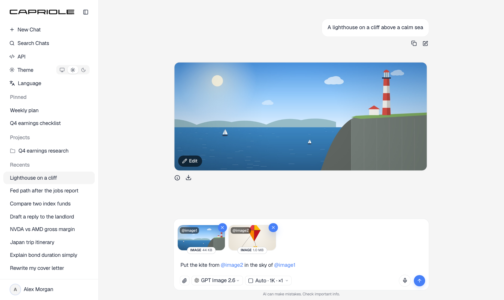
  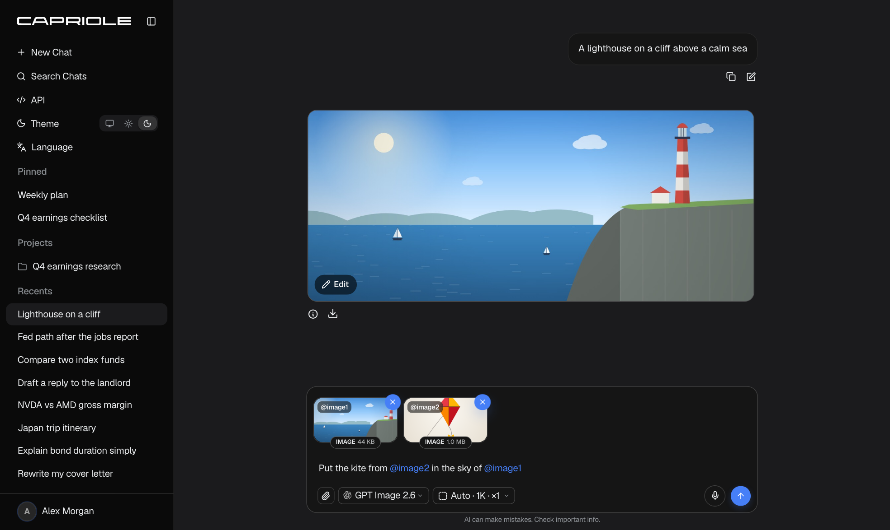
</Frame>

## GPT Image 2.6

<Frame>
  
</Frame>

GPT Image 2.6 de OpenAI ya está disponible. Es el modelo de imagen más reciente de OpenAI y el predeterminado en el modo **Image**. GPT Image 2.5 y Nano Banana 2.1 siguen disponibles en la pestaña **Image**. La pestaña muestra los dos modelos GPT Image con su nombre completo: **GPT Image 2.6 Sunburst** y **GPT Image 2.5 Sunburst**. [Consulta la guía de generación de imágenes](/es/guides/files-web-search).

<Frame>
  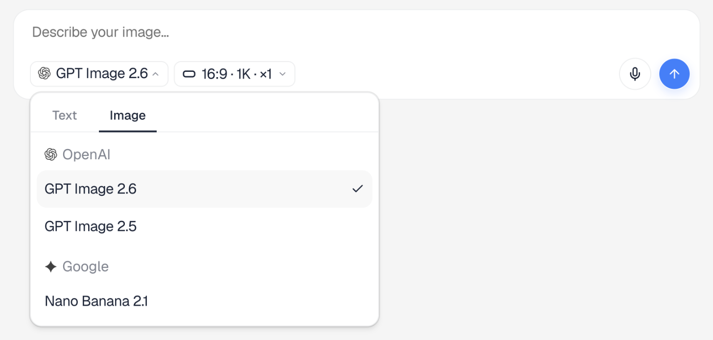
  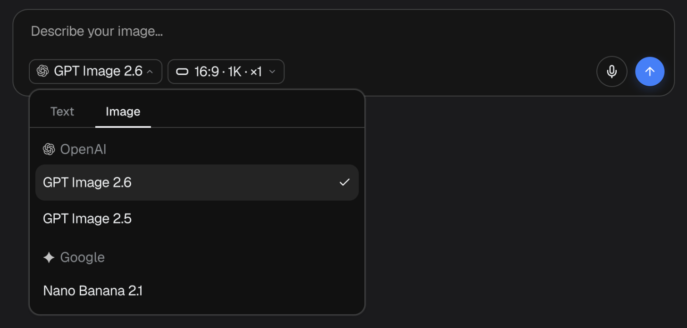
</Frame>

## Administra tu cuenta

Abre **Cuenta** y selecciona **Administrar cuenta** para actualizar tu nombre y tu foto, establecer una contraseña y ver los dispositivos en los que has iniciado sesión. En la pestaña **Seguridad**, las cuentas gratuitas también pueden eliminar su cuenta. La eliminación es permanente y también quita tu acceso a [Capriole Quant](https://quant.capriole.com/), porque ambos usan la misma cuenta. Para eliminar una cuenta con un plan de pago, escribe a [info@capriole.ai](mailto:info@capriole.ai).

<Frame>
  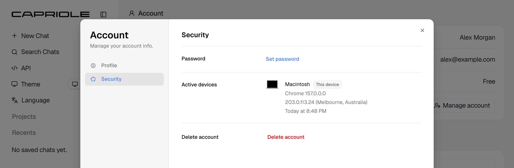
  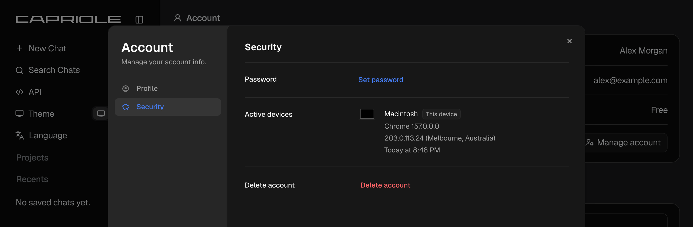
</Frame>

## Mejoras

- **Exportación de chats**: Un chat exportado ahora muestra, para cada imagen generada, el mismo nombre de modelo que el propio chat.
</Update>

<Update label="9 de noviembre de 2026">
## Precio de Premium

Las nuevas suscripciones web de Premium cuestan **USD 9 al mes**. Las suscripciones existentes de USD 8 se siguen renovando por **USD 8 al mes** mientras permanezcan activas. [Consulta los planes y límites](/es/guides/plans-and-limits).

Desde abril, hemos trabajado para que la IA de vanguardia sea lo más asequible posible para todos. Este ajuste de precio nos ayuda a seguir ofreciendo chat web ilimitado con GPT-6 Astra, Fable 5.1, Opus 5.5, Gemini 4 Argon y otros modelos de vanguardia.

## Títulos y estado de los chats

Los nuevos chats de texto en la web reciben un título breve basado en tu primer mensaje. La pestaña del navegador muestra el título y se actualiza al cambiar de chat o renombrarlo.

Con **Server Storage**, puedes cambiar de chat mientras se genera una respuesta. Un indicador giratorio en la barra lateral muestra que está en curso. Un punto azul marca una respuesta terminada que aún no has visto y desaparece cuando la ves.

<Frame>
  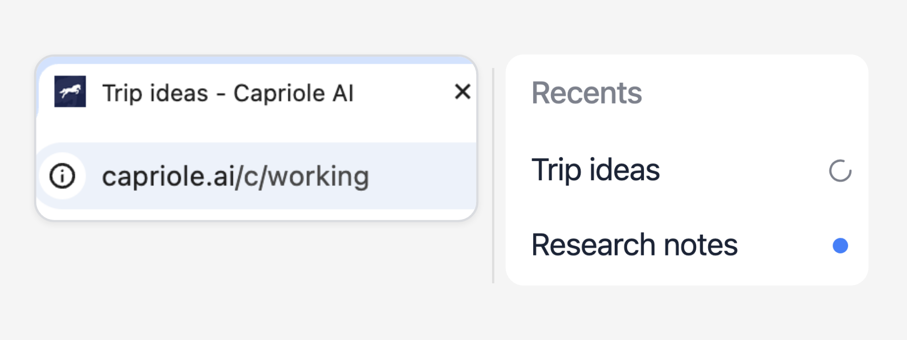
  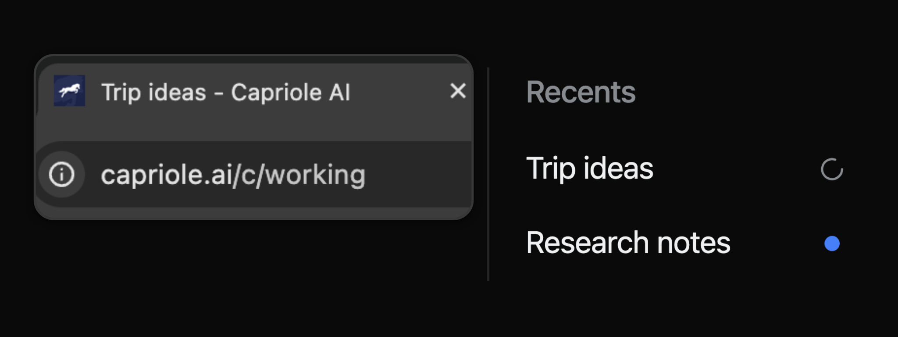
</Frame>
</Update>

<Update label="6 de noviembre de 2026">
## Comentarios

Dinos qué arreglar o crear sin salir de Capriole AI. Selecciona tu nombre en la parte inferior de la barra lateral y luego **Recursos** > **Comentarios**. Elige **Problema**, **Sugerencia** o **Pregunta**, escribe lo que tienes en mente y adjunta hasta 5 archivos (4 MB en total) o pega una captura de pantalla. Tu mensaje llega directamente al equipo de Capriole AI. Si no has iniciado sesión, selecciona **Recursos** > **Comentarios** en la parte inferior de la barra lateral e inicia sesión primero.

<Frame>
  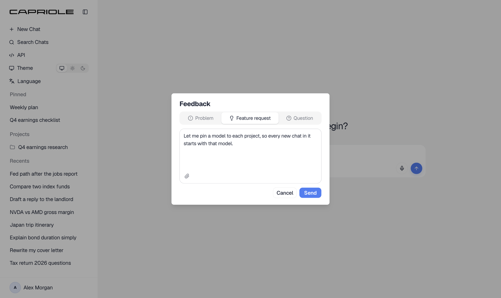
  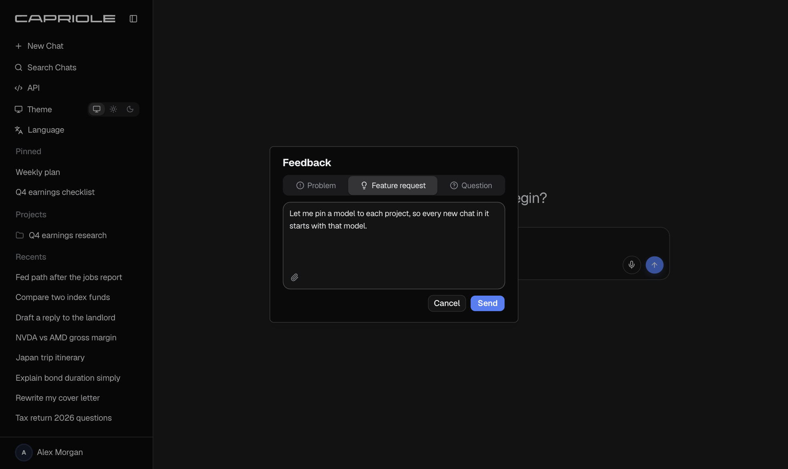
</Frame>

## Mejoras

- **OpenCode**: La [guía de OpenCode](/es/integrations/opencode) ahora cubre OpenCode 2 además de la versión 1, y la probamos con ambas.
- **Proyectos**: Un chat nuevo en un proyecto muestra el nombre del proyecto una sola vez, encima del saludo.

## Correcciones

- **Chat**: Las respuestas largas de Claude Opus 5.5, Claude Fable 5.1 y Claude Opus 5 ya no se detienen a la mitad.
</Update>

<Update label="5 de noviembre de 2026">
## Correcciones

- **Entrada de voz**: Vuelve a funcionar y sigue funcionando aunque nuestro proveedor principal de voz a texto no esté disponible.
</Update>

<Update label="30 de octubre de 2026">
## Archivos y exportación en proyectos

Dale a un proyecto los archivos que necesitan sus chats. En la página del proyecto, abre la nueva pestaña **Archivos** y selecciona **Añadir archivos**, o suelta archivos en la pestaña. Puedes añadir los mismos documentos e imágenes que se aceptan como adjuntos del chat, hasta 40 por proyecto en todos los planes. Todos los chats del proyecto pueden usarlos: Capriole AI lee un archivo cuando tu pregunta lo necesita. Para llevarte un proyecto, abre su menú y elige **Exportar**: obtienes un ZIP con sus chats, instrucciones y archivos. **Exportar historial de chat**, en tu página **Cuenta**, ahora también incluye las instrucciones y los archivos de tus proyectos. [Aprende a usar los archivos de proyecto](/es/guides/projects).

<Frame>
  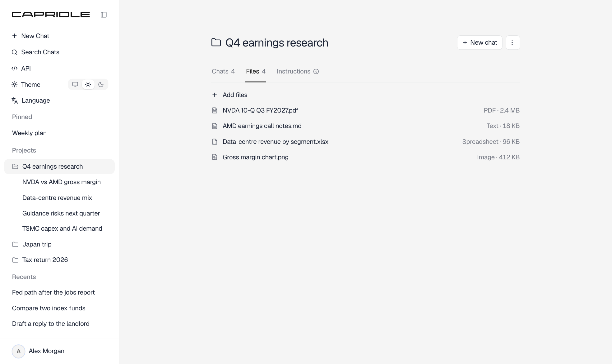
  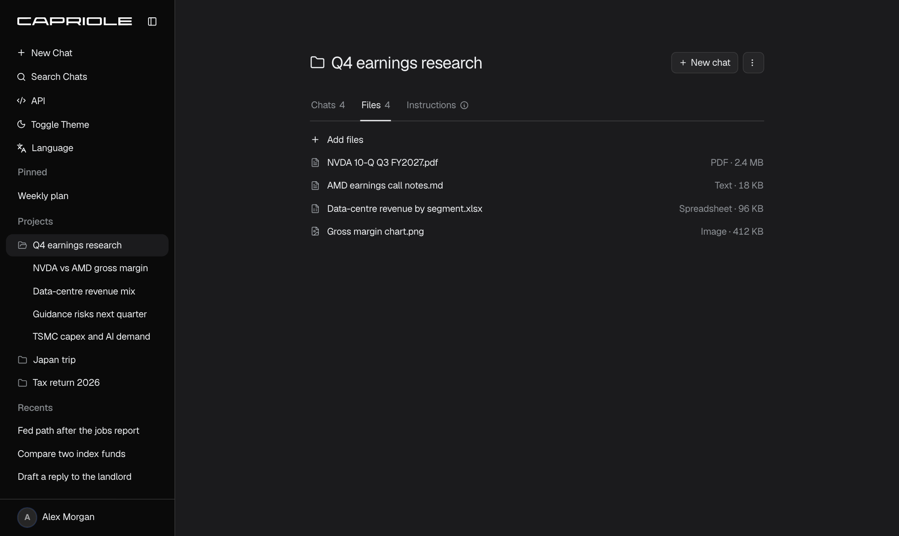
</Frame>

## Mejoras

- **Barra lateral**: **Fijados** ahora va antes de **Proyectos**, al abrir un proyecto también se muestran sus chats debajo y las listas se abren y cierran con suavidad.
- **Tema**: **Sistema** se suma a **Claro** y **Oscuro** en la barra lateral y sigue el modo claro u oscuro de tu dispositivo.
</Update>

<Update label="29 de octubre de 2026">
## Proyectos

Mantén juntos los trabajos relacionados. Crea un proyecto para un cliente, un curso o cualquier cosa a la que vuelvas, y sus chats quedan debajo de él en la barra lateral. Escribe una vez las instrucciones del proyecto y cada chat del proyecto las sigue, además de las instrucciones de tu cuenta; si entran en conflicto, prevalecen las del proyecto. Para crear un proyecto, coloca el puntero sobre **Proyectos** en la barra lateral y selecciona **+**. Después, empieza un chat en él o mueve un chat desde su menú o arrastrándolo hasta el proyecto. Los proyectos están disponibles en todos los planes para usuarios con sesión iniciada que guardan sus chats en el servidor. [Aprende a usar los proyectos](/es/guides/projects).

<Frame>
  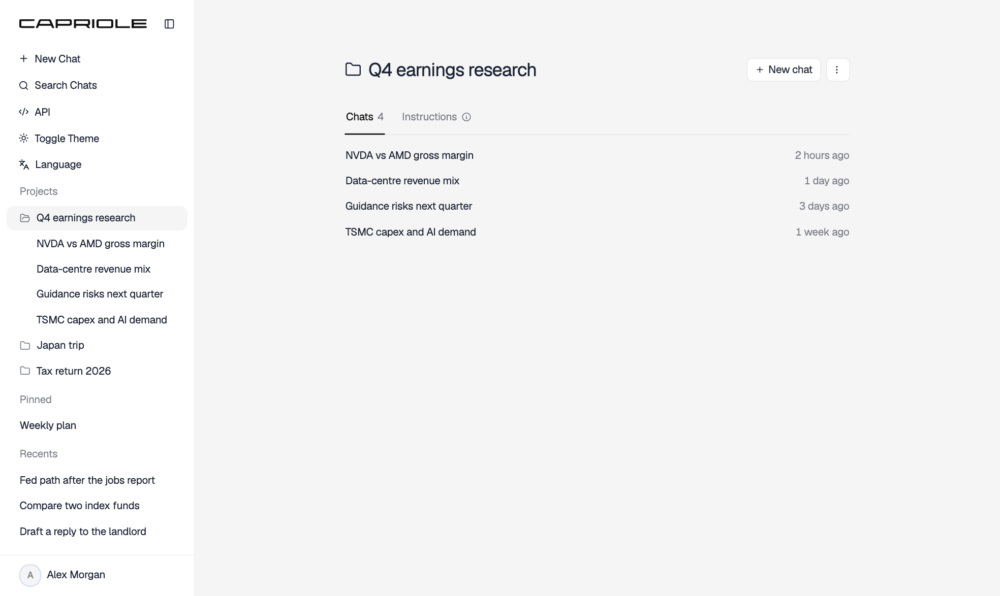
  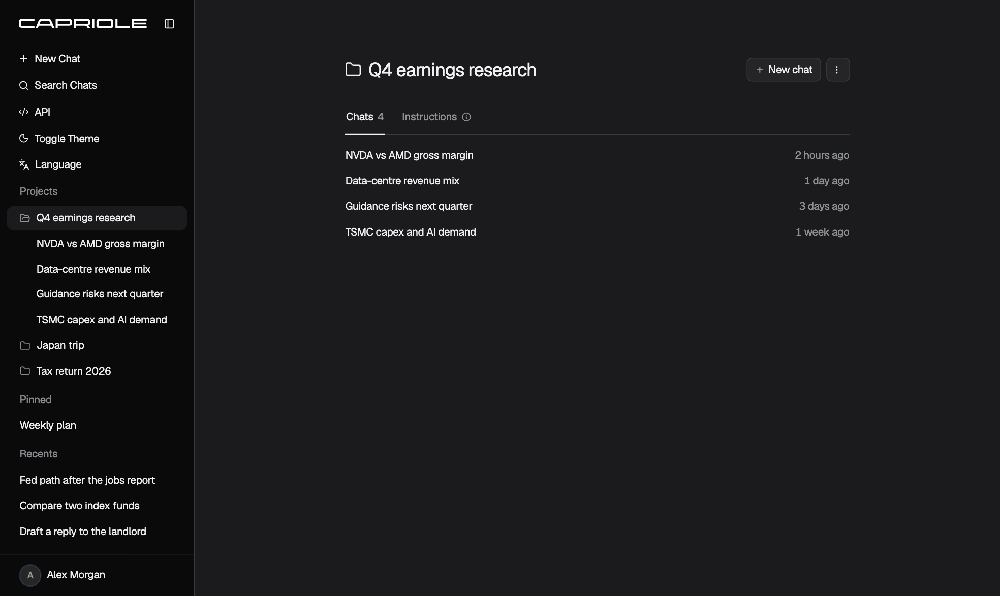
</Frame>

## Mejoras

- **Buscar chats**: encuentra cualquier chat por su título, incluidos los chats más antiguos y los chats de proyectos.
</Update>

<Update label="28 de octubre de 2026">
## Exporta tu historial de chat

Llévate tus chats. En tu página **Cuenta**, dentro de **Ajustes**, elige **Exportar historial de chat**. Capriole AI prepara un ZIP en segundo plano, así que puedes salir de la página mientras tanto, y la descarga está disponible durante 24 horas. El ZIP contiene cada chat como archivo Markdown, junto con los archivos que adjuntaste y las imágenes que generaste, además de `conversations.json` con todos tus chats en un formato que los programas pueden leer. Para exportar un solo chat, abre su menú en la barra lateral y elige **Exportar**. Los chats guardados en el almacenamiento local se descargan al instante.

<Frame>
  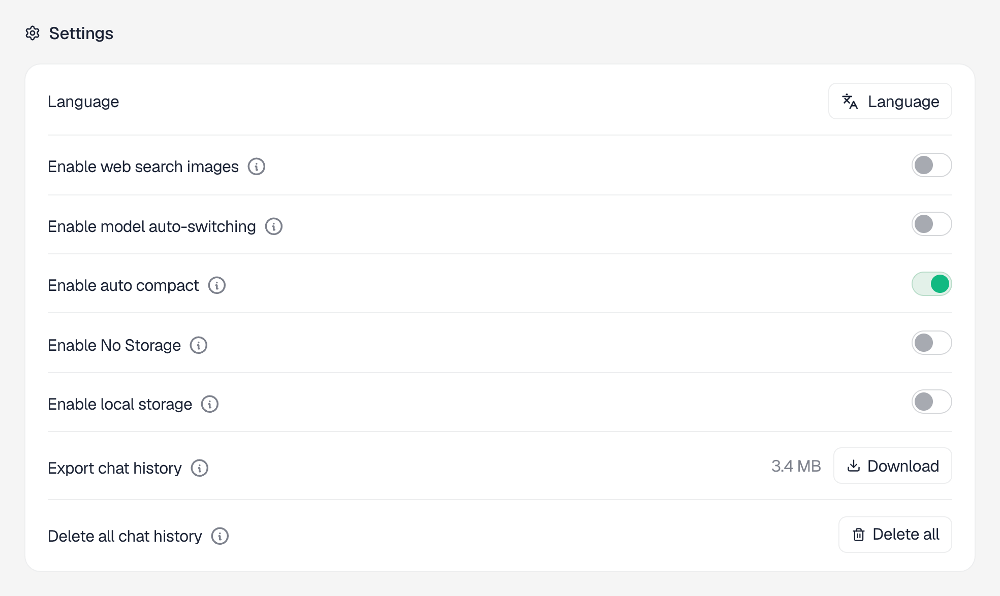
  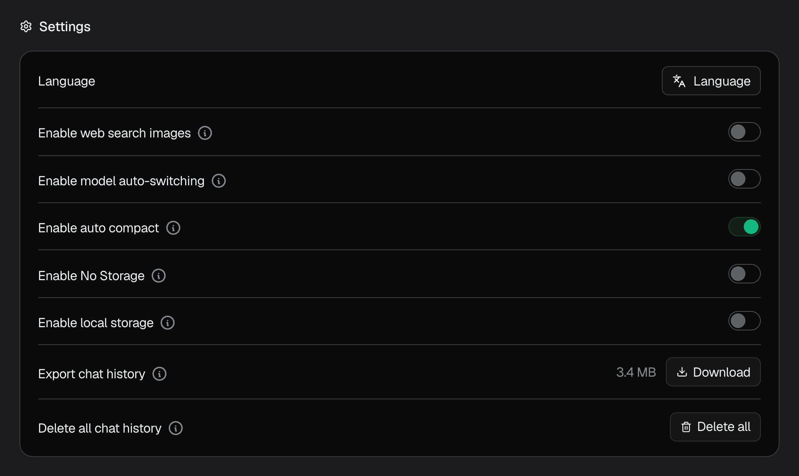
</Frame>

## Mejoras

- **Chats largos**: al abrirlos, muestran al instante los mensajes más recientes. Los mensajes anteriores se cargan al desplazarte hacia arriba, y lo que estás leyendo no se mueve.
</Update>

<Update label="27 de octubre de 2026">
## Personalización

Dile a Capriole AI cómo llamarte, qué describe mejor tu trabajo y cómo prefieres las respuestas, en la nueva sección **Personalización** de tu página **Cuenta**. Todos los chats lo siguen a partir de tu próximo mensaje, incluidos los que ya tienes. Las instrucciones admiten hasta 1500 caracteres. Se aplican al chat web y a la app, no a la API.

<Frame>
  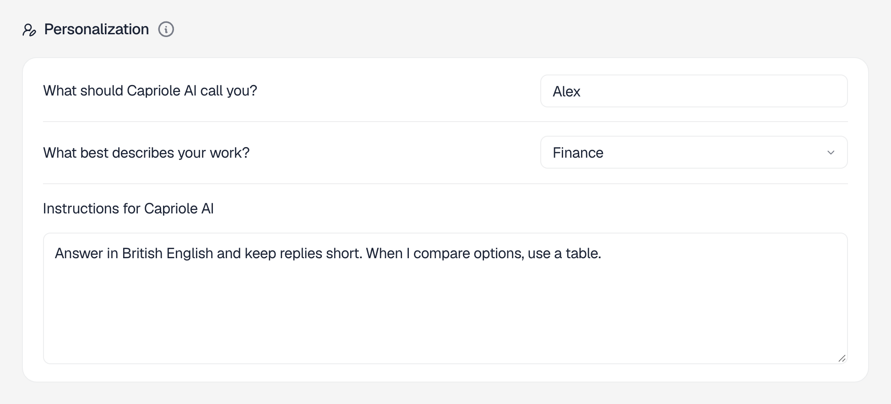
  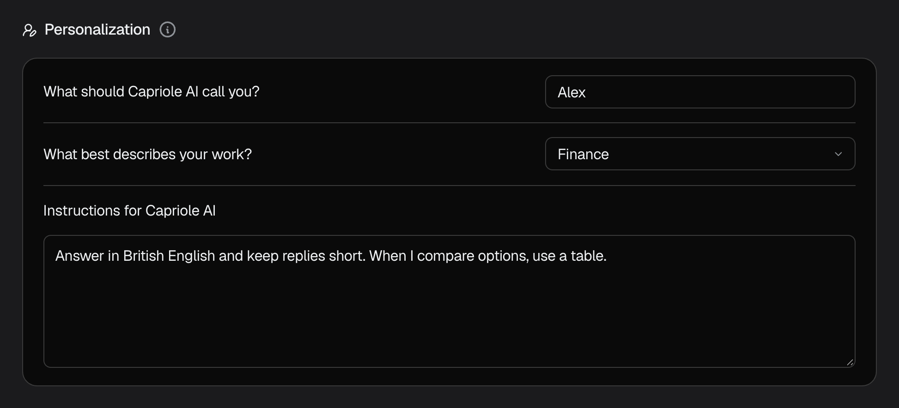
</Frame>

## Los chats de invitado se conservan al iniciar sesión

Empieza un chat sin cuenta y, después, inicia sesión o regístrate en la misma pestaña. El chat se abre como un chat guardado en tu cuenta, con todos los mensajes, y la siguiente respuesta recuerda lo que preguntaste antes. Guardarlo no cuenta para tu uso.

<Frame>
  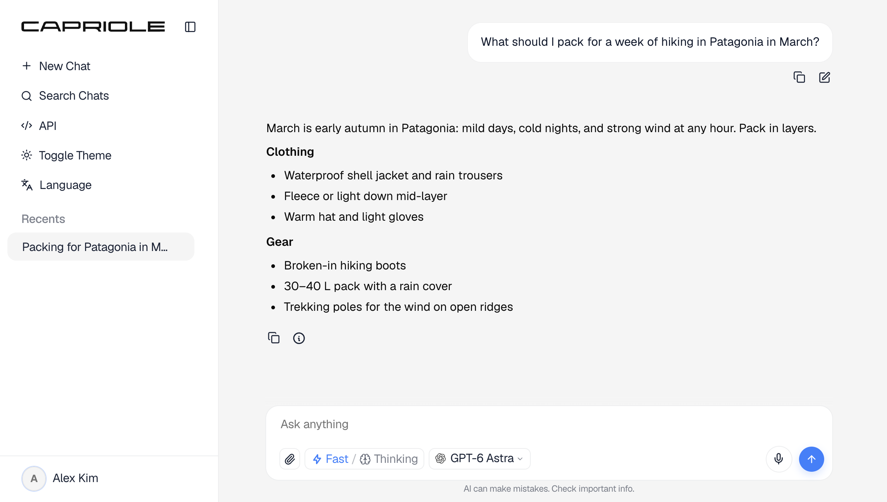
  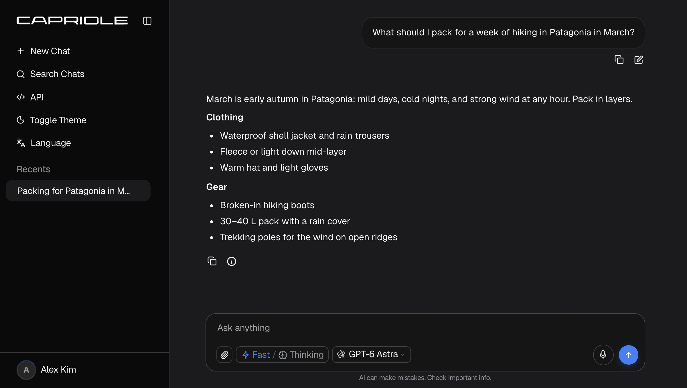
</Frame>

## Kimi K3.1 Pro

Kimi K3.1 Pro de Moonshot AI ya está disponible. Es el modelo más capaz de Kimi, con mejoras sustanciales en programación, creación 3D e investigación financiera, y una ventana de contexto de 1M de tokens. En el chat web, elige **Kimi K3.1 Pro Thinking** para el trabajo más exigente o **Kimi K3.1 Pro** para respuestas más rápidas. Desde la API, llama a `moonshot/kimi-k3.1-pro` en [Chat Completions](/es/api-reference/endpoint/chat-completions); las [guías de agentes de programación](/es/integrations/opencode) también lo incluyen. Kimi K3 sigue disponible en **Más modelos**.

<Frame>
  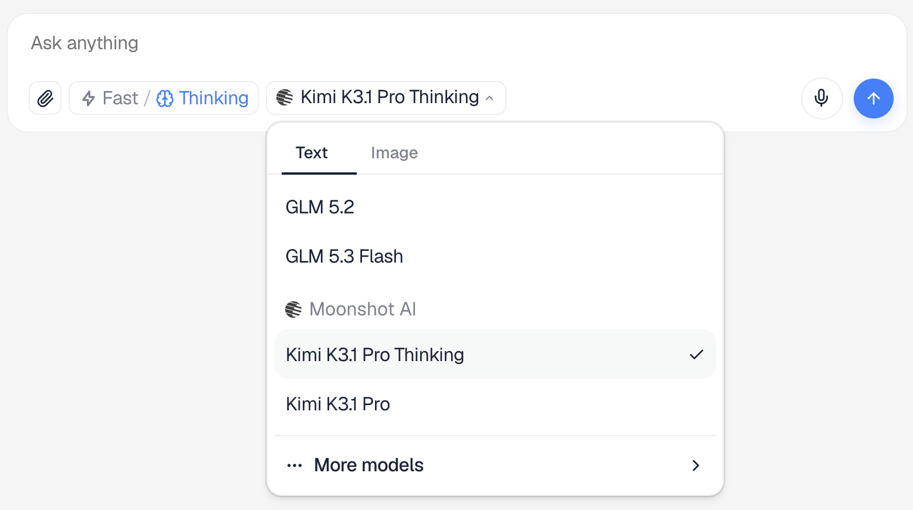
  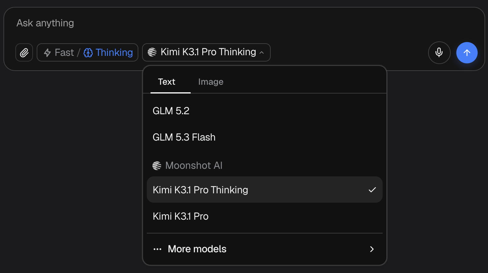
</Frame>
</Update>

<Update label="20 de octubre de 2026">
## El registro de cambios ya está disponible

Las nuevas funciones, las actualizaciones de modelos, los cambios en la API y las guías de agentes de programación de Capriole AI aparecen ahora en esta página, de la más reciente a la más antigua. En la app, abre **Recursos > Última novedad** para volver aquí. Suscríbete al feed RSS para recibir cada actualización cuando se publique.

<Frame>
  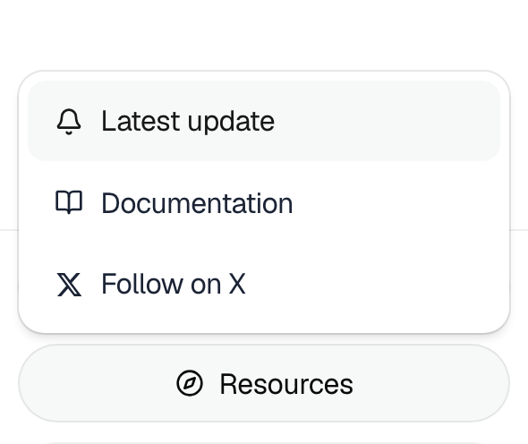
  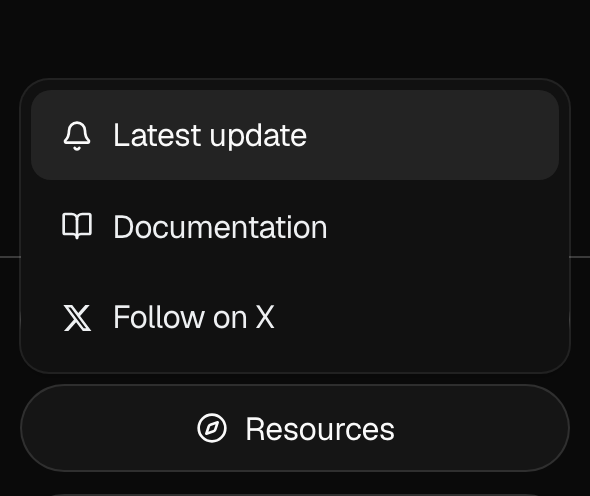
</Frame>

## Los chats recuerdan su modelo

Al abrir un chat guardado, Capriole AI selecciona el modelo de su última respuesta, incluido el ajuste Fast o Thinking. La elección se mantiene al recargar la página, al volver a iniciar sesión o en otro dispositivo. Si ese modelo se ha retirado, se mantiene tu selección actual.

<Frame>
  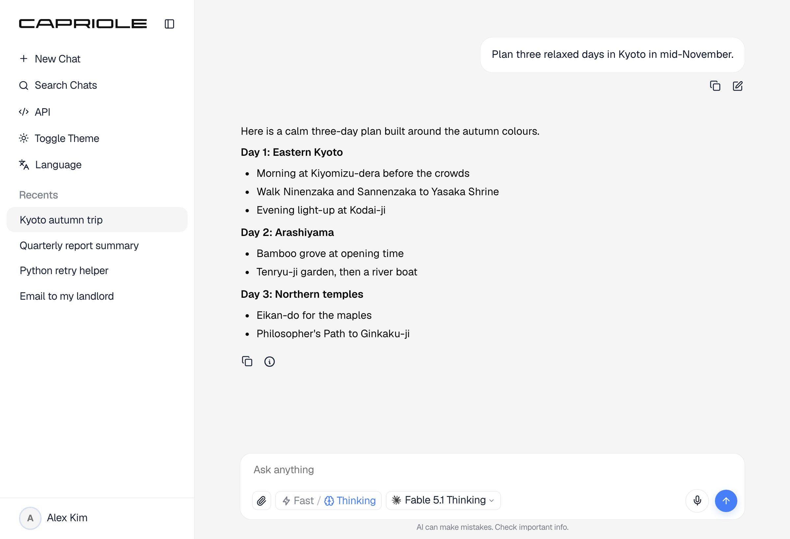
  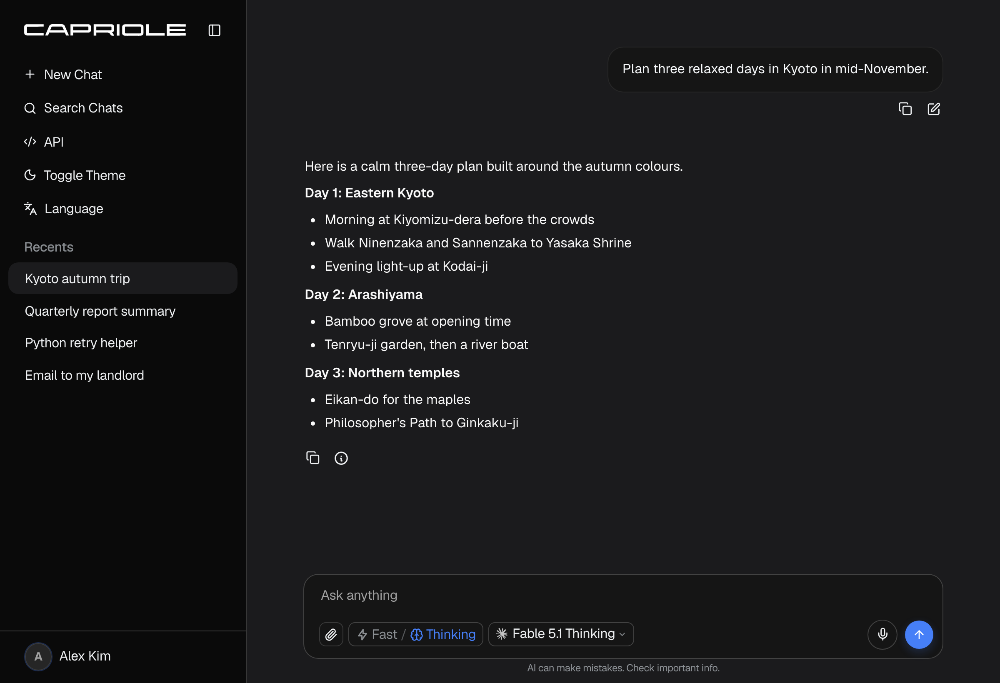
</Frame>

## Guías de agentes de programación, probadas de nuevo

Volvimos a probar todas las guías de agentes de programación con los modelos actuales y añadimos guías para [Cline](/es/integrations/cline), [Qwen Code](/es/integrations/qwen-code), [Crush](/es/integrations/crush) y [Pi](/es/integrations/pi). [OpenCode](/es/integrations/opencode) y [Kilo Code](/es/integrations/kilo-code) ahora solo necesitan un proveedor y una clave API.

<Frame>
  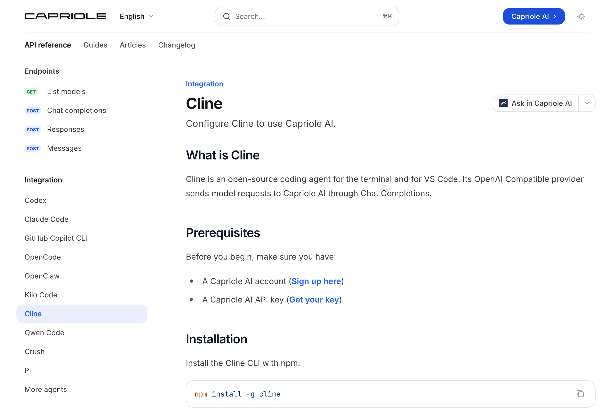
  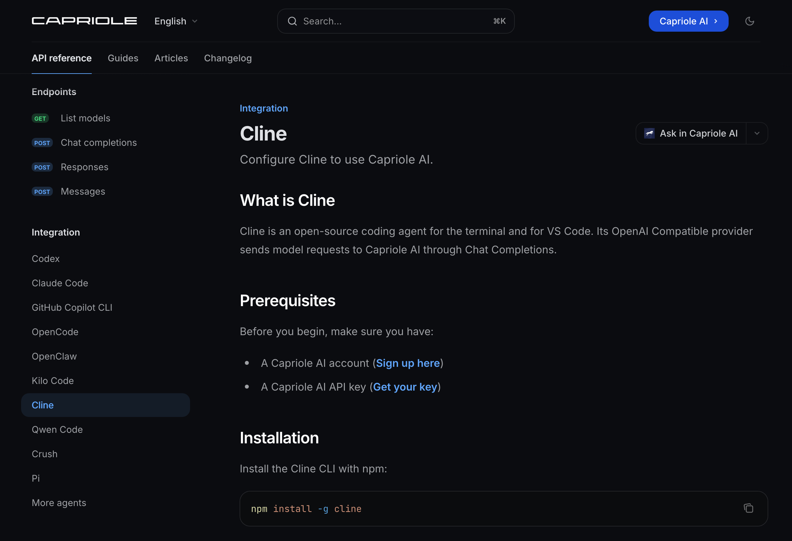
</Frame>
</Update>
