<Update label="2026年11月21日">
## 改善

- **コピー**：テキストと画像がある応答や画像が複数ある応答では、**コピー** からテキスト、任意の画像、またはすべてをコピーできるようになりました。画像はすぐにコピーされます。

</Update>

<Update label="2026年11月20日">
## GPT-5.5

Capriole AI は GPT-5.5 のサポートを終了しました。GPT-6.2 Astra または GPT-6.2 Sol に切り替えてください。API では `openai-latest` または `openai/gpt-6.2-astra` を使用してください。

## 応答を報告

すべての応答の下に旗のアイコンが付きました。有害だと思う応答はここから報告できます。理由を 1 つ選び、必要なら詳細を書き添えてください。画像のある応答では、報告する画像を選べます。当社にはその応答と直前のメッセージが届き、すべての報告を確認します。チャットはそのまま続けられ、テキストの応答はサインインしなくても報告できます。

<Frame>
  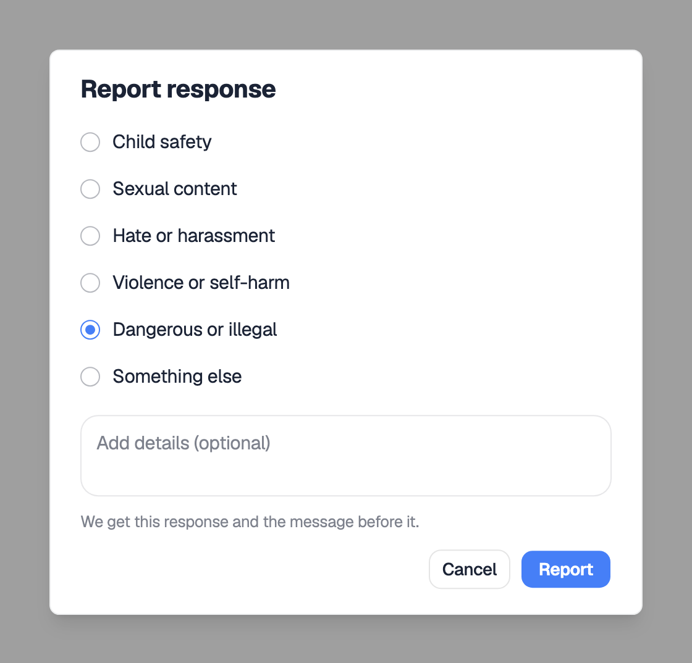
</Frame>

## 改善

- **画像生成**：画像だけの応答にも **画像をコピー** が付きました。1 枚ならそのままコピーし、複数あるときは選べます。タッチスクリーンでは、画像の **…** メニューにも **画像をコピー** があります。

</Update>

<Update label="2026年11月18日">
## GPT-6.2 Astra と Sol

<Frame>
  
</Frame>

OpenAI の新しい旗艦モデル GPT-6.2 Astra が GPT-6 Astra に代わり、GPT-6.2 Sol が GPT-6.1 Sol に代わって OpenAI の日常向けモデルになりました。[OpenAI は](https://openai.com/index/introducing-gpt-6-2-astra-sol/) Astra を「最も難しいプロジェクトのための新しいフロンティア モデル」、Sol を「日常の作業のための、効率的で汎用性の高いモデル」と呼んでいます。

ウェブチャットのモデル メニューでは、GPT-6.2 Astra が **Thinking** と **Fast** を備えて OpenAI グループの一番上に並び、ゲストと新規アカウントは **GPT-6.2 Astra Thinking** で始まります。同じく **Thinking** と **Fast** を備えた GPT-6.2 Sol は **その他のモデル** で OpenAI のモデルの先頭にあり、GPT-6 Astra と GPT-6.1 Sol も引き続きそこで利用できます。API では、[Responses](/ja/api-reference/endpoint/responses) または [Chat Completions](/ja/api-reference/endpoint/chat-completions) で `openai/gpt-6.2-astra` または `openai/gpt-6.2-sol` を呼び出してください。`openai-latest` は GPT-6.2 Astra を指すようになりました。OpenAI の API 価格は 100 万トークンあたり、Astra が入力 USD 8・出力 USD 40 で GPT-6 Astra より 20% 安く、Sol が入力 USD 2・出力 USD 10 で GPT-6.1 Sol と同じです。[モデルの選び方](/ja/guides/choose-a-model)で、ほかの旗艦モデルと比較しています。

<Frame>
  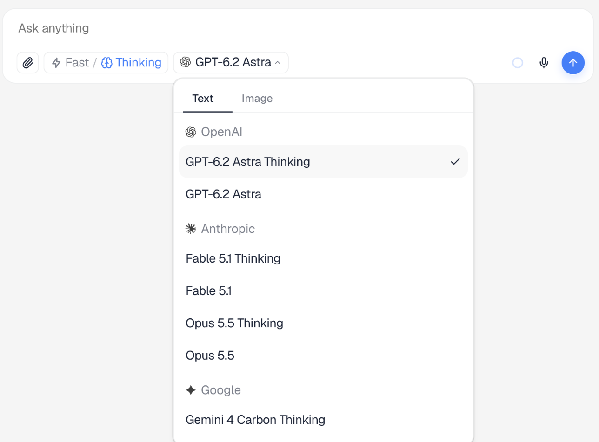
</Frame>

## チャットにタグを付ける

サイドバーでチャットのメニューを開いて **タグ** を選ぶと、色付きのタグを 1 つ以上付けられます。タグはチャットのタイトルの下に表示されます。**チャットを検索** の横にある絞り込みボタンを使うと、選んだタグのどれかが付いたチャットが **最近** とすべてのプロジェクトから表示されます。**チャットを検索** でタグを選び、そのタグが付いたチャットだけを検索することもできます。タグは、ログインして **Server Storage** を使うアカウントで利用できます。[タグの使い方を見る](/ja/guides/projects#チャットにタグを付ける)。

<Frame>
  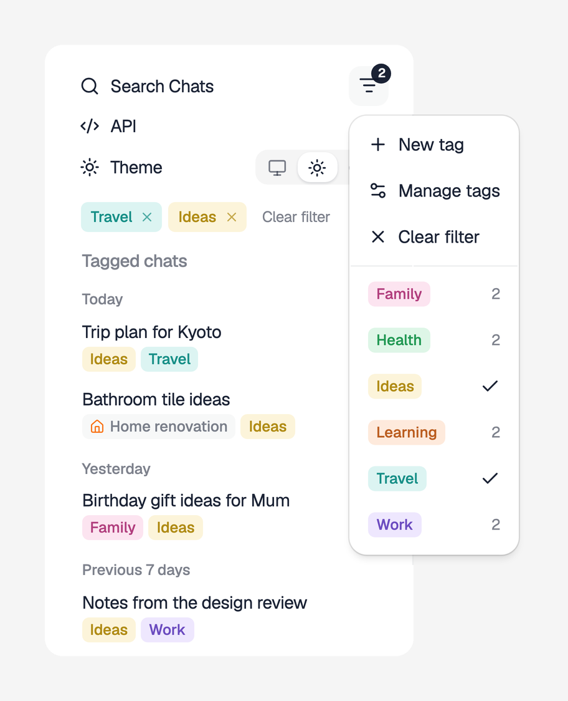
</Frame>

## 改善

- **サイドバー**：一度に表示できるチャットが増え、**最近** は日付ごとにまとめて表示されます。開いたままにしたセクションとプロジェクトはブラウザが覚えています。
- **言語**：ログイン中は、言語の設定がサイドバーから **アカウント** → **設定** に移りました。
- **プロジェクト**：プロジェクトごとに色とアイコンを設定できるようになりました。プロジェクトの作成時や編集時に選べます。プロジェクト名を選ぶとチャットの表示と非表示が切り替わるようになり、三点メニューの **プロジェクトを管理** でプロジェクト ページが開きます。
- **もう一度回答**：最新の回答が失敗したときも、その下に **再試行** が表示されるようになりました。同じモデルまたは別のモデルで、メッセージをもう一度送れます。

## 修正

- **チャットのタイトル**：新しいチャットのタイトルは、最初のメッセージに答えるのではなく、その話題を書いた言語で表すようになりました。
- **添付ファイル**：一部のブラウザから添付した Markdown ファイルを、GPT モデルが読み込めるようになりました。
- **画像生成**：画像の生成を始めたところで返信を停止してもエラーが出なくなりました。
</Update>

<Update label="2026年11月17日">
## Gemini 4 Carbon

<Frame>
  
</Frame>

Google の Gemini 4 Carbon を利用できるようになりました。Google で最も強力なモデルで、複雑な多段階のコーディングとデバッグ、長時間のエージェント作業、科学的推論など、モデルの知能の限界が試されるタスク向けです。ウェブチャットのモデル メニューで Google グループの一番上にある **Gemini 4 Carbon Thinking** を選ぶか、[Chat Completions](/ja/api-reference/endpoint/chat-completions) で `google/gemini-4-carbon` を呼び出してください。`google-latest` は Carbon を指すようになり、Chat Completions では軽い呼び出し向けに [Google の `thinking_level` を `low` に設定](/ja/guides/choose-a-model#api-のモデル-id)できます。Gemini 4 Argon は、ウェブチャットでは **Gemini 4 Argon Thinking**、API では `google/gemini-4-argon` として引き続き利用できます。

<Frame>
  
</Frame>

## Seedream 5.5

<Frame>
  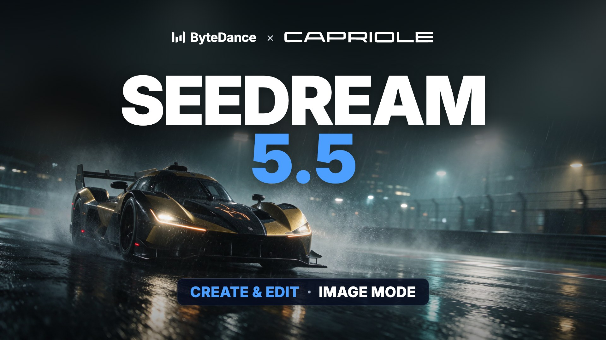
</Frame>

ByteDance Seed の Seedream 5.5 を **画像** モードで利用できるようになりました。ByteDance Seed によると、[複数回の編集にわたって狙った箇所だけを正確に変更し、編集していない部分はそのまま保てる](https://seed.bytedance.com/en/seedream5_5)うえ、光の表現はより自然に、素材はより精細に、肌の質感はより繊細になったとのことです。モデル メニューの **画像** タブで **ByteDance** の下にある **Seedream 5.5** を選ぶと、新しい画像の作成や、添付した画像の編集ができます。解像度は 1K と 2K で、**自動** を含むすべてのアスペクト比に対応します。ほかの画像モデルと同じく、ログインして **Server Storage** を使うアカウントは無料で利用できます。既定のモデルは引き続き GPT Image 2.6 です。**テキスト** モードの Text Agent は、あなたが指定した画像モデルを使い、指定がなければチャット内の最新の画像のモデル、それもなければ GPT Image 2.6 を使います。どのモデルを使うかを確認することはなくなりました。[画像生成ガイドを見る](/ja/guides/files-web-search)。

<Frame>
  
</Frame>

## 改善

- **長いチャット**：GPT-6 Astra のコンテキスト圧縮を最適化し、より速く効率的になりました。

## 修正

- **チャット**：Claude モデルが、より多くの画像を含むメッセージを扱えるようになりました。
- **Gemini**：回答がより安定しました。
- **画像モード**：Web 版では、画像の生成中にサイドバーに進行状況が表示され、離れている間に生成が終わったチャットには青い点が表示されます。
</Update>

<Update label="2026年11月16日">
## Ctrl/⌘ + Enter で送信

パソコンでも Enter キーで改行できるようになりました。**アカウント** ページの **設定** で **Ctrl/⌘ + Enter で送信** をオンにすると、Enter キーで改行し、Ctrl+Enter（Mac では ⌘+Enter）で送信します。設定はアカウントに保存されるので、どのパソコンでも同じように使えます。

<Frame>
  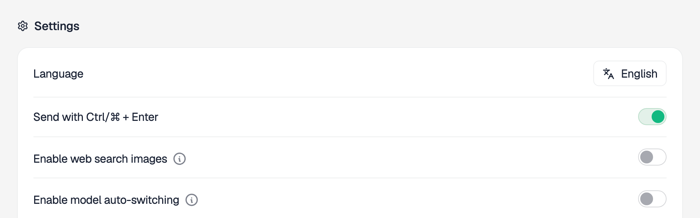
</Frame>

## チャットのタイトルを全部表示

サイドバーで途中で切れたチャットのタイトルにポインターを合わせると、サイドバーの横にタイトル全体が表示されます。チャットを開かなくても目的のチャットを見つけられます。

<Frame>
  
</Frame>

## 改善

- **スマートフォンのメッセージ ボックス**：Enter キーで改行し、送信ボタンで送信するようになりました。長いメッセージは低めのボックスの中でスクロールするので、キーボードの上でもチャットが見えます。

## 修正

- **チャット**：最新のメッセージに戻る矢印ボタンが、高くなったメッセージ ボックスで入力中の文字に重ならなくなりました。
</Update>

<Update label="2026年11月12日">
## 使用量をひと目で確認

メッセージ ボックスの小さなリングに、このチャットのコンテキストがどれだけ残っているかが表示されます。リングを選ぶと詳細を確認でき、Free プランでは今月の利用枠も確認できます。

**アカウント** ページの **設定** で **使用量を表示** をオフにするとリングが非表示になり、**使用量バーの表示** でバーを **残り** と **使用済み** のどちらで表示するか選べます。

<Frame>
  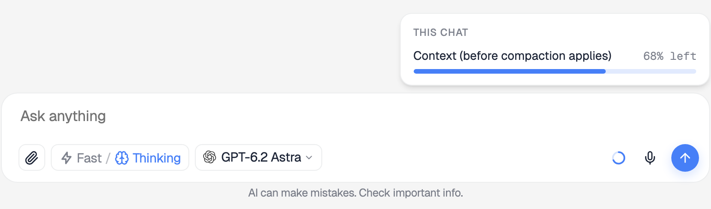
  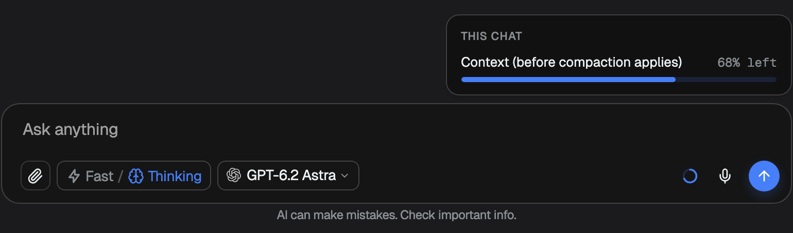
</Frame>

## 改善

- **もう一度回答**：回答の切り替えがすぐに終わるようになりました。
- **画像生成**：画像を作成できなかったとき、チャットモデルが次の返信でその理由を伝えるようになりました。
- **新しいチャット**：新しいチャットは、GPT-6 Astra Thinking や最後に開いたチャットのモデルではなく、最後に自分で選んだモデルで始まるようになりました。
- **メッセージ ボックス**：スマートフォンでモデル ボタンにモデル名が途切れずに表示され、メッセージ ボックスも広くなりました。マイクと送信ボタンは小さくなりました。

## 修正

- **音声入力**：文字起こしが速くなり、失敗が減りました。話し声が入っていない録音では、エラーではなく録音し直すよう案内します。
- **添付ファイル**：文字を読み取れない PDF は、会話が長すぎるという表示ではなく、ファイルを読み取れないと表示されるようになりました。
- **長いチャット**：長いチャットはモデルごとのコンテキスト ウィンドウに合わせて要約されるようになり、ウィンドウの小さいモデルや中国語・日本語・韓国語の長いチャットでも「会話が長すぎます」というエラーで止まらなくなりました。
</Update>

<Update label="2026年11月11日">
## 別のモデルでもう一度回答

最新の回答の下にある **再試行** を選ぶと、新しい回答を得られます。メニューの一番上の **再試行** は同じモデルを使い、その下ではメッセージ ボックスのモデルからプロバイダー別に選べます。新しい回答は元の回答と同じ場所に置き換わり、**2/2** の両側の矢印で回答を切り替えられます。情報ボタンには表示中の回答を書いたモデルが表示され、メッセージ ボックスも選んだモデルに切り替わります。

複数の回答を保持できるのは最新のメッセージだけです。新しいメッセージを送るか、そのメッセージを編集すると、表示されていない回答は破棄されます。Server Storage、Local Storage、No Storage のどれでも使えます。新しい回答は 1 回ごとに送信 1 件として数えられ、回答の切り替えは数えられません。

<Frame>
  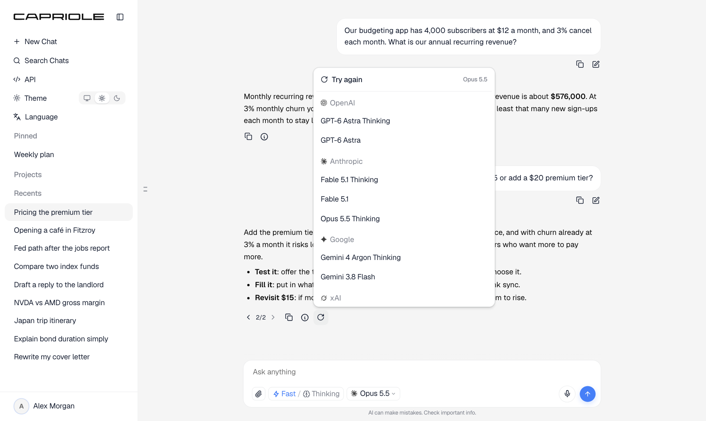
  
</Frame>

## 長いチャットでも前のメッセージへすぐ移動

長いチャットでは、送信したメッセージごとに目盛りがチャットの左側に縦に並ぶようになりました。目盛りにポインターを合わせるとメッセージと回答の冒頭をプレビューでき、選ぶとどれだけ前のメッセージでもそこへ直接移動します。キーボードでは **Tab** で目盛りに移り、矢印キーで選んで **Enter** を押します。目盛りは Web 版で、チャットの横に表示できる幅があるときに表示されます。

<Frame>
  
  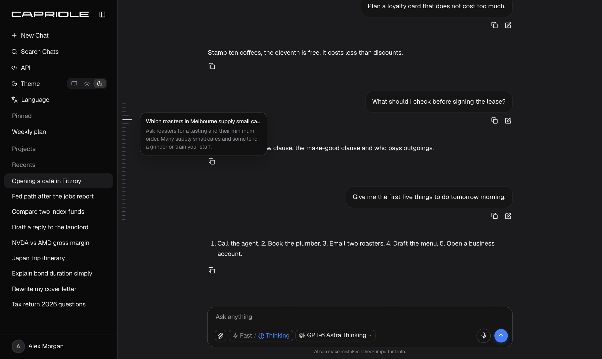
</Frame>

## 改善

- **画像生成**：生成した画像が読み込み中もサイズを保つようになり、画像のあるチャットを開いたとき、返信のたび、回答を切り替えたときに表示がずれなくなりました。

## 修正

- **メッセージの編集**：メッセージを編集した後に返信を停止した場合や、返信が失敗した場合は、元のメッセージとその回答が復元されます。
- **お知らせ**：**詳しく見る** を選んでもお知らせが閉じなくなり、後に続くお知らせも引き続き見られます。
</Update>

<Update label="2026年11月10日">
## 画像の編集

Capriole AI で画像を編集できるようになりました。**画像** モードで、クリップ アイコン、貼り付け、ドラッグのいずれかで PNG または JPEG の画像を 10 枚まで添付し、変更したい内容を説明します。**@** を入力すると、`@image1` のように画像を指定できます。生成した画像の **編集** を選ぶと、その画像がメッセージ ボックスに戻り、続けて作業できます。

GPT Image 2.6、GPT Image 2.5、Nano Banana 2.1 はいずれも画像を編集でき、Capriole AI は選択したモデルを使います。**テキスト** モードでは、チャットモデルに画像の変更を依頼することもできます。どの画像モデルを使うか判断できない場合は、チャットモデルが確認します。[画像生成ガイドを見る](/ja/guides/files-web-search)。

アスペクト比のメニューに 2 つの選択肢が加わりました。新しい既定の **Auto** は、編集する画像の形を保ち、新しい画像ではモデルが形を選びます。**21:9** は横長の画像向けです。

<Frame>
  
  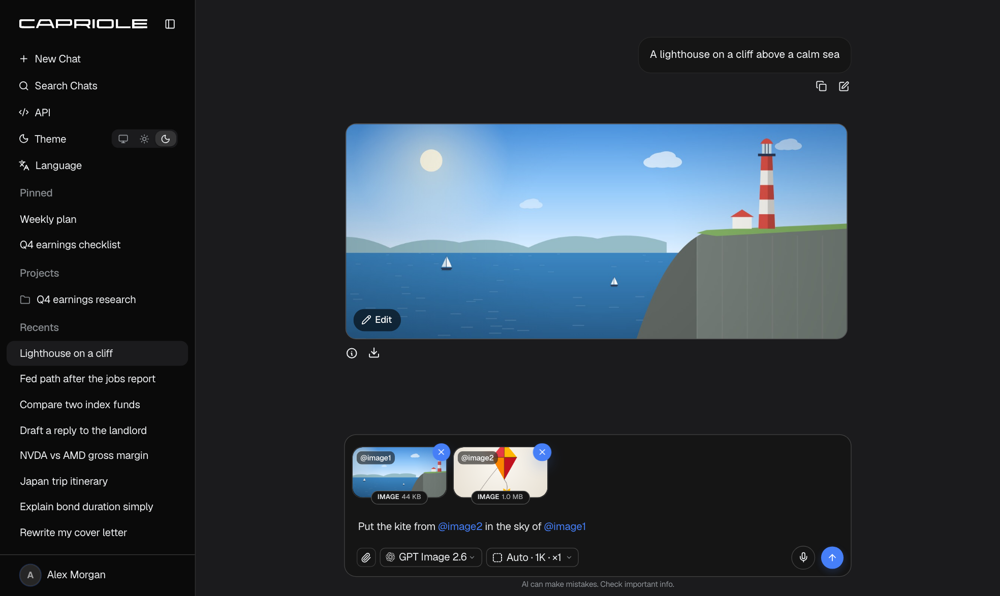
</Frame>

## GPT Image 2.6

<Frame>
  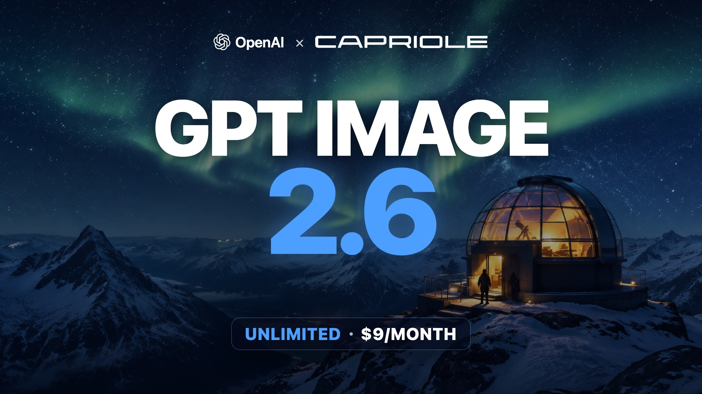
</Frame>

OpenAI の GPT Image 2.6 を利用できるようになりました。OpenAI の最新画像モデルで、**画像** モードの既定モデルです。GPT Image 2.5 と Nano Banana 2.1 は引き続き **画像** タブで選べます。このタブでは、2 つの GPT Image モデルが正式なモデル名 **GPT Image 2.6 Sunburst**、**GPT Image 2.5 Sunburst** で表示されます。[画像生成ガイドを見る](/ja/guides/files-web-search)。

<Frame>
  
  
</Frame>

## アカウントの管理

**アカウント** を開いて **アカウントを管理** を選ぶと、名前と写真の変更、パスワードの設定、ログイン中のデバイスの確認ができます。無料アカウントは **セキュリティ** タブからアカウントを削除することもできます。削除は取り消せず、同じアカウントを使う [Capriole Quant](https://quant.capriole.com/) にもログインできなくなります。有料プランのアカウントを削除する場合は、[info@capriole.ai](mailto:info@capriole.ai) までメールでご連絡ください。

<Frame>
  
  
</Frame>

## 改善

- **チャットのエクスポート**：エクスポートしたチャットで、生成画像のモデル名がチャット画面と同じ表記になりました。
</Update>

<Update label="2026年11月9日">
## Premium の料金

ウェブで新たに Premium に登録すると、月額は **USD 9** です。既存の月額 USD 8 の契約は、有効な間は引き続き **月額 USD 8** で更新されます。 [プランと上限を見る](/ja/guides/plans-and-limits).

4 月以来、誰もが最先端の AI をできる限り手頃な価格で使えるよう努めてきました。今回の料金改定により、GPT-6 Astra、Fable 5.1、Opus 5.5、Gemini 4 Argon などの最先端モデルを使った無制限のウェブチャットを引き続き提供できます。

## チャットのタイトルと状態

ウェブの新しいテキストチャットには、最初のメッセージをもとに短いタイトルが付きます。ブラウザのタブにもタイトルが表示され、チャットの切り替えや名前の変更に合わせて更新されます。

**Server Storage** を使うと、返信の生成中も別のチャットに移動できます。サイドバーの回転アイコンは生成中、青い点はまだ見ていない返信があることを示します。返信を見ると青い点が消えます。

<Frame>
  
  
</Frame>
</Update>

<Update label="2026年11月6日">
## フィードバック

直してほしいこと、作ってほしいことを Capriole AI から直接伝えられるようになりました。サイドバー下部の自分の名前を選び、**リソース** > **フィードバック** を選びます。**不具合**、**機能リクエスト**、**質問** から種類を選んで内容を書き、ファイルを 5 個まで（合計 4 MB まで）添付するか、スクリーンショットを貼り付けます。メッセージは Capriole AI のチームに直接届きます。サインインしていない場合は、サイドバー下部の **リソース** > **フィードバック** を選び、先にサインインします。

<Frame>
  
  
</Frame>

## 改善

- **OpenCode**: [OpenCode のガイド](/ja/integrations/opencode)で、バージョン 1 に加えて OpenCode 2 の設定も説明するようになりました。どちらのバージョンでもテスト済みです。
- **プロジェクト**: プロジェクトで新しく始めたチャットでは、プロジェクト名があいさつの上に一度だけ表示されるようになりました。

## 修正

- **チャット**：Claude Opus 5.5、Claude Fable 5.1、Claude Opus 5 の長い回答が途中で止まらなくなりました。
</Update>

<Update label="2026年11月5日">
## 修正

- **音声入力**：再び使えるようになりました。主要な音声文字変換サービスが停止しているときも使えます。
</Update>

<Update label="2026年10月30日">
## プロジェクトのファイルとエクスポート

チャットで使うファイルをプロジェクトに置いておけるようになりました。プロジェクト ページで新しい **ファイル** タブを開き、**ファイルを追加** を選ぶか、ファイルをタブにドロップします。追加できるのはチャットに添付できるのと同じドキュメントと画像で、どのプランでも 1 つのプロジェクトに 40 ファイルまでです。プロジェクト内のすべてのチャットがこれらのファイルを使えます。質問に必要なときは、Capriole AI がファイルを読み取ります。プロジェクトを持ち出すには、メニューから **エクスポート** を選びます。チャット、指示、ファイルをまとめた ZIP が手に入ります。**アカウント** ページの **チャット履歴をエクスポート** にも、プロジェクトの指示とファイルが含まれるようになりました。[プロジェクトのファイルの使い方を見る](/ja/guides/projects)。

<Frame>
  
  
</Frame>

## 改善

- **サイドバー**：**ピン留め** が **プロジェクト** の上に移り、プロジェクトを開くとその下にチャットも表示され、一覧がなめらかに開閉するようになりました。
- **テーマ**：サイドバーの **ライト** と **ダーク** に **システム** が加わり、デバイスのライトまたはダークの設定に従います。
</Update>

<Update label="2026年10月29日">
## プロジェクト

関連する仕事をまとめておけるようになりました。クライアント、講座、繰り返し取り組むことごとにプロジェクトを作ると、そのチャットがサイドバーのプロジェクトの下にまとまります。プロジェクトの指示は一度書くだけで、プロジェクト内のすべてのチャットがアカウントの指示に加えてそれに従います。両者が矛盾する場合は、プロジェクトの指示が優先されます。プロジェクトを作るには、サイドバーで **プロジェクト** にポインターを合わせ、**+** を選びます。あとはプロジェクトでチャットを始めるか、チャットのメニューから、またはプロジェクトの上にドラッグしてチャットを入れます。プロジェクトはすべてのプランで、ログインしてチャットをサーバーに保存していれば使えます。[プロジェクトの使い方を見る](/ja/guides/projects)。

<Frame>
  
  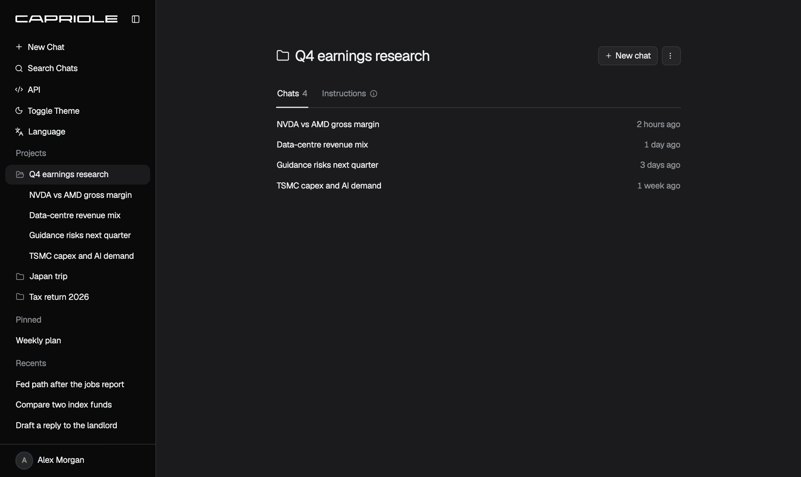
</Frame>

## 改善

- **チャットを検索**：古いチャットやプロジェクト内のチャットも含め、どのチャットもタイトルで見つかります。
</Update>

<Update label="2026年10月28日">
## チャット履歴をエクスポート

チャットをいつでも持ち出せるようになりました。**アカウント** ページの **設定** で **チャット履歴をエクスポート** を選ぶと、Capriole AI がバックグラウンドで ZIP を用意します。その間ページを離れてもかまいません。ダウンロードは 24 時間有効です。ZIP には各チャットの Markdown ファイルと、添付したファイル、生成した画像が入り、全チャットをプログラムで読める形式で収めた `conversations.json` も含まれます。1 つのチャットだけをエクスポートするには、サイドバーでそのチャットのメニューを開き、**エクスポート** を選びます。ローカル保存のチャットはすぐにダウンロードされます。

<Frame>
  
  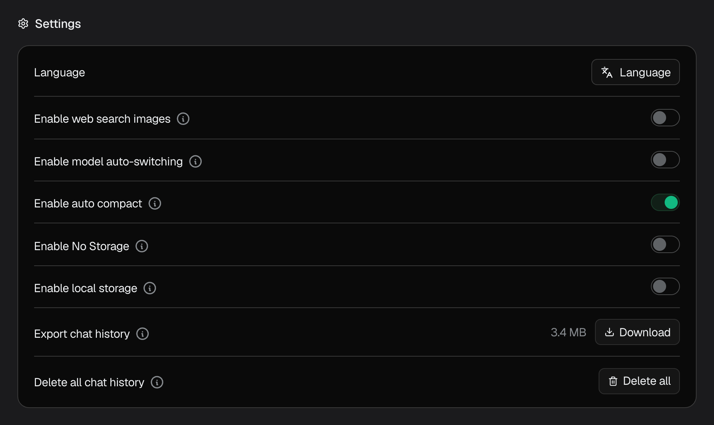
</Frame>

## 改善

- **長いチャット**：開くと、最新のメッセージがすぐに表示されます。上にスクロールすると以前のメッセージが読み込まれ、読んでいる位置はずれません。
</Update>

<Update label="2026年10月27日">
## パーソナライズ

**アカウント** ページに新しい **パーソナライズ** セクションを追加しました。Capriole AI にあなたの呼び名、お仕事、回答の好みを伝えられます。既存のチャットを含むすべてのチャットで、次のメッセージから反映されます。指示は最大 1,500 文字です。ウェブチャットとアプリに適用され、API には適用されません。

<Frame>
  
  
</Frame>

## ゲストのチャットがログイン後も残ります

アカウントなしでチャットを始め、同じタブでログインまたは新規登録すると、そのチャットはアカウントに保存されたチャットとして開きます。メッセージはすべてそのまま残り、次の返信もそれまでのやり取りを踏まえます。保存しても使用量にはカウントされません。

<Frame>
  
  
</Frame>

## Kimi K3.1 Pro

Moonshot AI の Kimi K3.1 Pro を利用できるようになりました。Kimi で最も高性能なモデルで、コーディング、3D 制作、金融リサーチの性能が大きく向上し、100 万トークンのコンテキスト ウィンドウを備えています。ウェブチャットでは、難しい作業には **Kimi K3.1 Pro Thinking**、すばやい回答には **Kimi K3.1 Pro** を選んでください。API では [Chat Completions](/ja/api-reference/endpoint/chat-completions) で `moonshot/kimi-k3.1-pro` を呼び出せます。[コーディングエージェントのガイド](/ja/integrations/opencode)にも掲載しています。Kimi K3 は引き続き **その他のモデル** から利用できます。

<Frame>
  
  
</Frame>
</Update>

<Update label="2026年10月20日">
## 更新履歴を公開しました

Capriole AI の新機能、モデルの更新、API の変更、コーディングエージェントのガイドを、今後はこのページに新しい順で掲載します。アプリでは **リソース > 最新のお知らせ** からこのページに戻れます。RSS フィードを購読すると、更新が公開されるたびに受け取れます。

<Frame>
  
  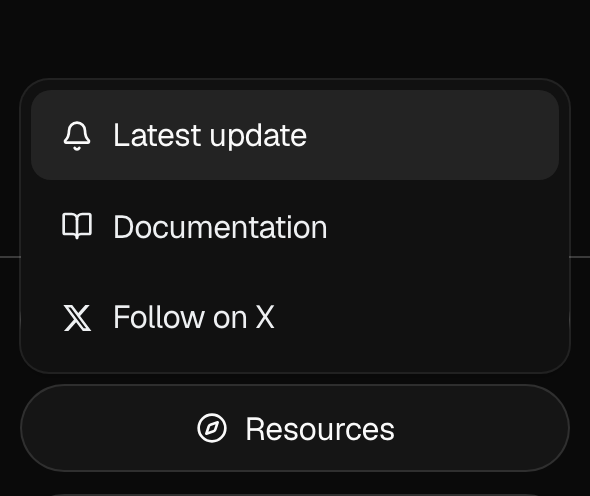
</Frame>

## チャットがモデルを記憶するようになりました

保存済みのチャットを開くと、Capriole AI は最新の回答で使われたモデルを、Fast または Thinking の設定も含めて選択します。ページの再読み込み、再ログイン、別のデバイスでも選択は保たれます。そのモデルが提供終了している場合は、現在の選択がそのまま使われます。

<Frame>
  
  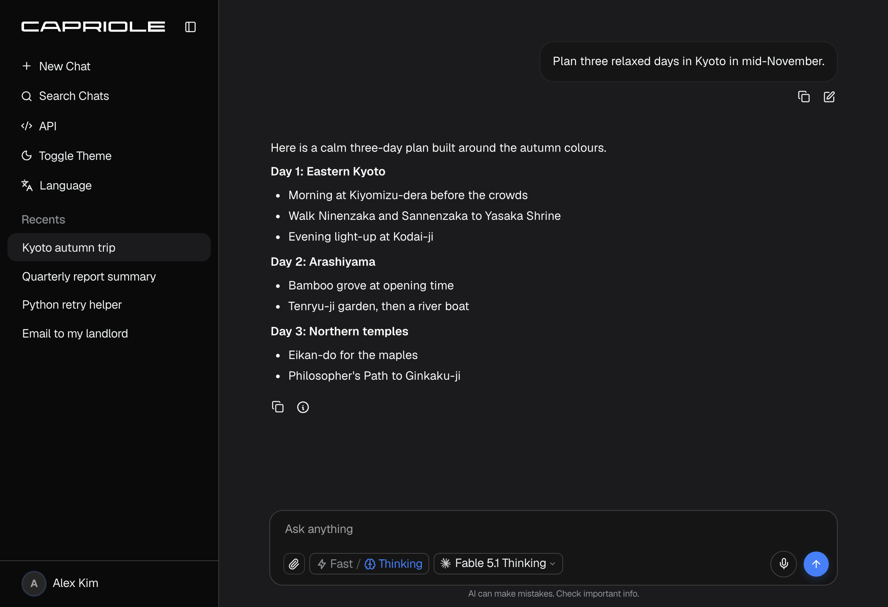
</Frame>

## コーディングエージェントのガイドを再検証しました

すべてのコーディングエージェントのガイドを現在のモデルで再検証し、[Cline](/ja/integrations/cline)、[Qwen Code](/ja/integrations/qwen-code)、[Crush](/ja/integrations/crush)、[Pi](/ja/integrations/pi) のガイドを追加しました。[OpenCode](/ja/integrations/opencode) と [Kilo Code](/ja/integrations/kilo-code) は、プロバイダー 1 つと API キー 1 つだけで設定できるようになりました。

<Frame>
  
  
</Frame>
</Update>
