<Update label="2026年11月10日">
## 改善

- **法的情報**: [利用規約](/ja/legal/terms)と[プライバシーポリシー](/ja/legal/privacy)を Capriole 全体の共通文書に切り替え、それぞれの末尾に Capriole AI の節を設けました。
</Update>

<Update label="2026年11月9日">
## Premium の料金

ウェブで新たに Premium に登録すると、月額は **USD 9** です。既存の月額 USD 8 の契約は、有効な間は引き続き **月額 USD 8** で更新されます。 [プランと上限を見る](/ja/guides/plans-and-limits).

4 月以来、誰もが最先端の AI をできる限り手頃な価格で使えるよう努めてきました。今回の料金改定により、GPT-6 Astra、Fable 5.1、Opus 5.5、Gemini 4 Argon などの最先端モデルを使った無制限のウェブチャットを引き続き提供できます。

## チャットのタイトルと状態

ウェブの新しいテキストチャットには、最初のメッセージをもとに短いタイトルが付きます。ブラウザのタブにもタイトルが表示され、チャットの切り替えや名前の変更に合わせて更新されます。

**Server Storage** を使うと、返信の生成中も別のチャットに移動できます。サイドバーの回転アイコンは生成中、青い点はまだ見ていない返信があることを示します。返信を見ると青い点が消えます。

<Frame>
  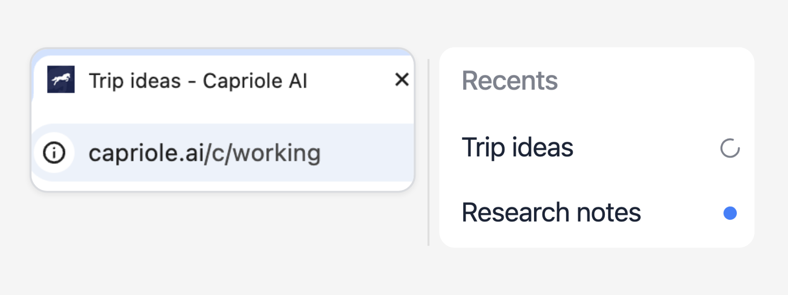
  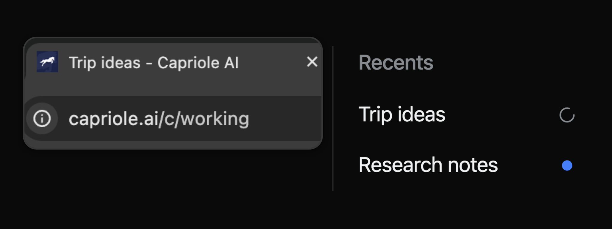
</Frame>
</Update>

<Update label="2026年11月6日">
## フィードバック

直してほしいこと、作ってほしいことを Capriole AI から直接伝えられるようになりました。サイドバー下部の自分の名前を選び、**リソース** > **フィードバック** を選びます。**不具合**、**機能リクエスト**、**質問** から種類を選んで内容を書き、ファイルを 5 個まで（合計 4 MB まで）添付するか、スクリーンショットを貼り付けます。メッセージは Capriole AI のチームに直接届きます。サインインしていない場合は、サイドバー下部の **リソース** > **フィードバック** を選び、先にサインインします。

<Frame>
  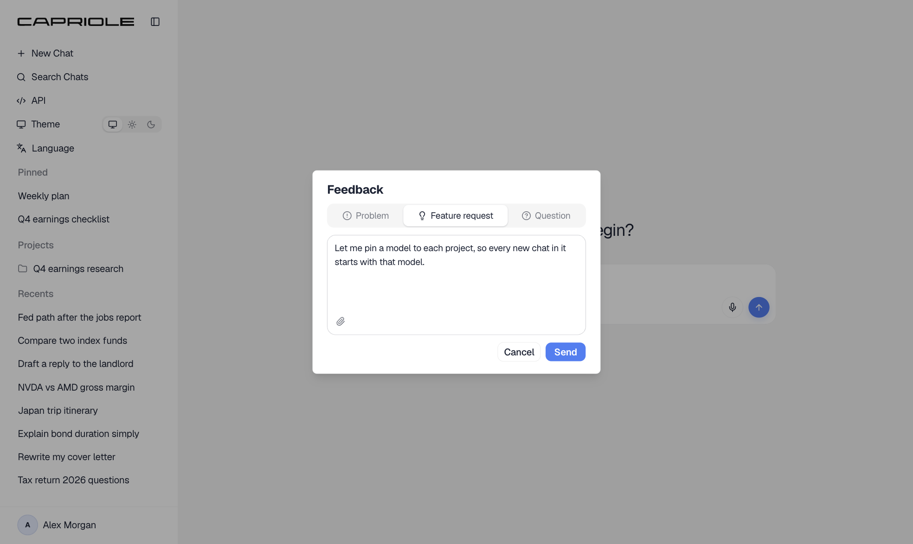
  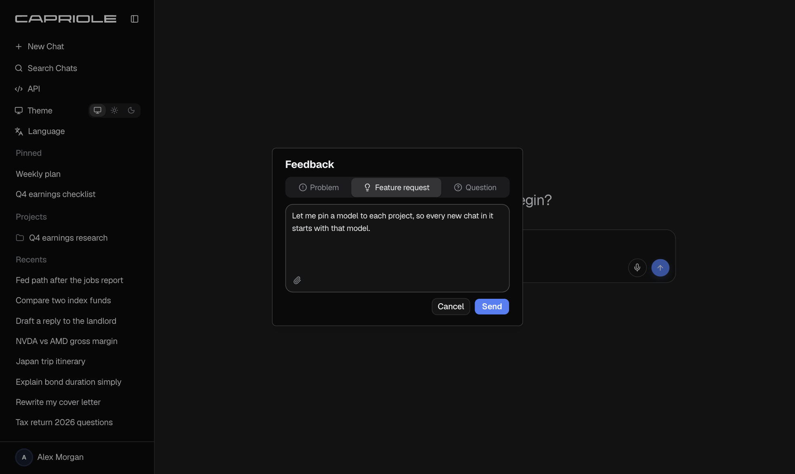
</Frame>

## 改善

- **OpenCode**: [OpenCode のガイド](/ja/integrations/opencode)で、バージョン 1 に加えて OpenCode 2 の設定も説明するようになりました。どちらのバージョンでもテスト済みです。
- **プロジェクト**: プロジェクトで新しく始めたチャットでは、プロジェクト名があいさつの上に一度だけ表示されるようになりました。

## 修正

- **チャット**：Claude Opus 5.5、Claude Fable 5.1、Claude Opus 5 の長い回答が途中で止まらなくなりました。
</Update>

<Update label="2026年11月5日">
## 修正

- **音声入力**：再び使えるようになりました。主要な音声文字変換サービスが停止しているときも使えます。
</Update>

<Update label="2026年10月30日">
## プロジェクトのファイルとエクスポート

チャットで使うファイルをプロジェクトに置いておけるようになりました。プロジェクト ページで新しい **ファイル** タブを開き、**ファイルを追加** を選ぶか、ファイルをタブにドロップします。追加できるのはチャットに添付できるのと同じドキュメントと画像で、どのプランでも 1 つのプロジェクトに 40 ファイルまでです。プロジェクト内のすべてのチャットがこれらのファイルを使えます。質問に必要なときは、Capriole AI がファイルを読み取ります。プロジェクトを持ち出すには、メニューから **エクスポート** を選びます。チャット、指示、ファイルをまとめた ZIP が手に入ります。**アカウント** ページの **チャット履歴をエクスポート** にも、プロジェクトの指示とファイルが含まれるようになりました。[プロジェクトのファイルの使い方を見る](/ja/guides/projects)。

<Frame>
  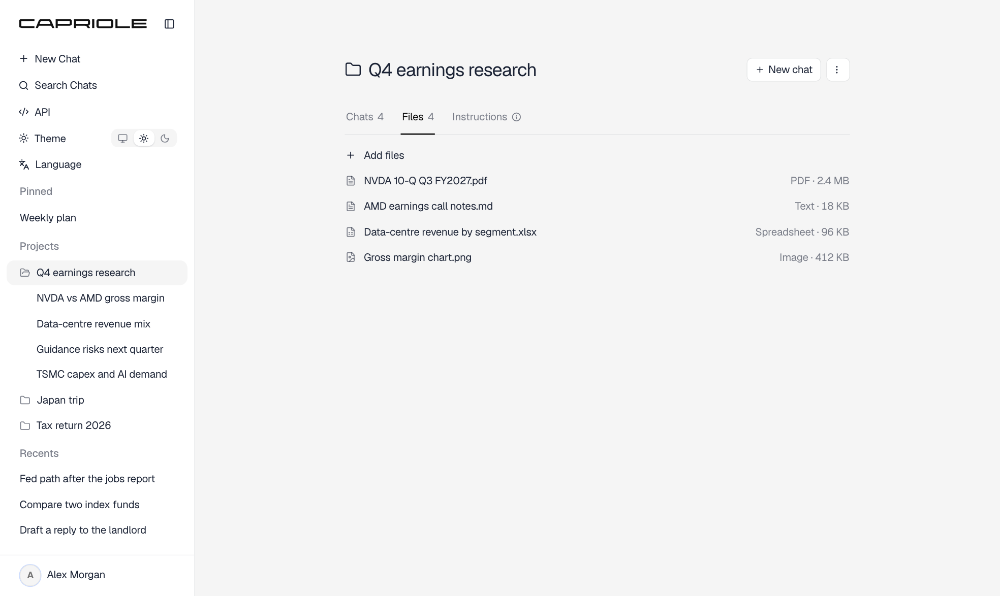
  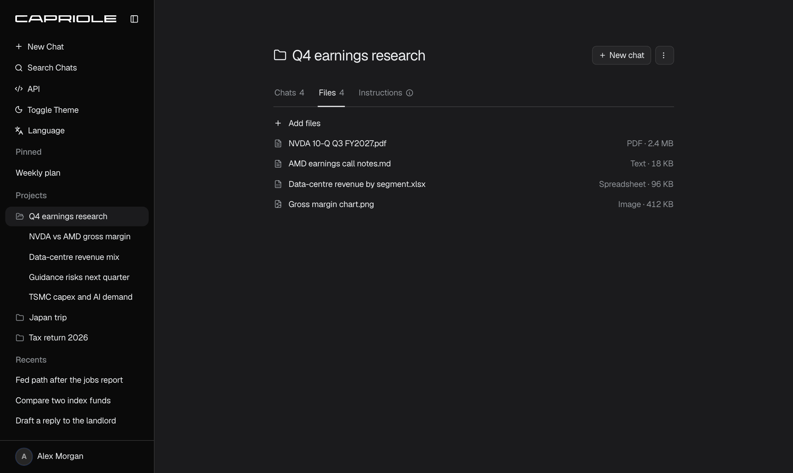
</Frame>

## 改善

- **サイドバー**：**ピン留め** が **プロジェクト** の上に移り、プロジェクトを開くとその下にチャットも表示され、一覧がなめらかに開閉するようになりました。
- **テーマ**：サイドバーの **ライト** と **ダーク** に **システム** が加わり、デバイスのライトまたはダークの設定に従います。
</Update>

<Update label="2026年10月29日">
## プロジェクト

関連する仕事をまとめておけるようになりました。クライアント、講座、繰り返し取り組むことごとにプロジェクトを作ると、そのチャットがサイドバーのプロジェクトの下にまとまります。プロジェクトの指示は一度書くだけで、プロジェクト内のすべてのチャットがアカウントの指示に加えてそれに従います。両者が矛盾する場合は、プロジェクトの指示が優先されます。プロジェクトを作るには、サイドバーで **プロジェクト** にポインターを合わせ、**+** を選びます。あとはプロジェクトでチャットを始めるか、チャットのメニューから、またはプロジェクトの上にドラッグしてチャットを入れます。プロジェクトはすべてのプランで、ログインしてチャットをサーバーに保存していれば使えます。[プロジェクトの使い方を見る](/ja/guides/projects)。

<Frame>
  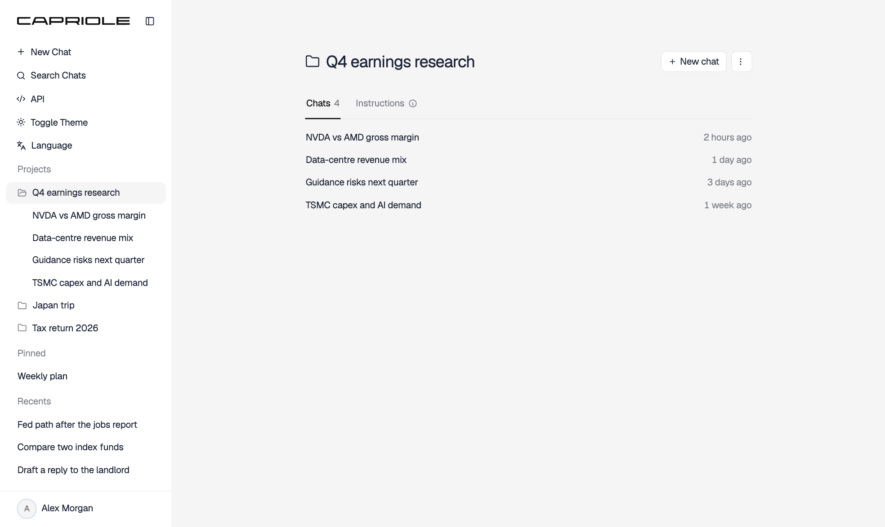
  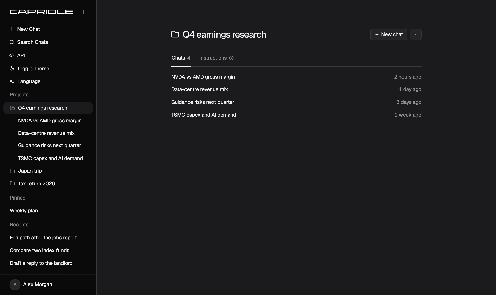
</Frame>

## 改善

- **チャットを検索**：古いチャットやプロジェクト内のチャットも含め、どのチャットもタイトルで見つかります。
</Update>

<Update label="2026年10月28日">
## チャット履歴をエクスポート

チャットをいつでも持ち出せるようになりました。**アカウント** ページの **設定** で **チャット履歴をエクスポート** を選ぶと、Capriole AI がバックグラウンドで ZIP を用意します。その間ページを離れてもかまいません。ダウンロードは 24 時間有効です。ZIP には各チャットの Markdown ファイルと、添付したファイル、生成した画像が入り、全チャットをプログラムで読める形式で収めた `conversations.json` も含まれます。1 つのチャットだけをエクスポートするには、サイドバーでそのチャットのメニューを開き、**エクスポート** を選びます。ローカル保存のチャットはすぐにダウンロードされます。

<Frame>
  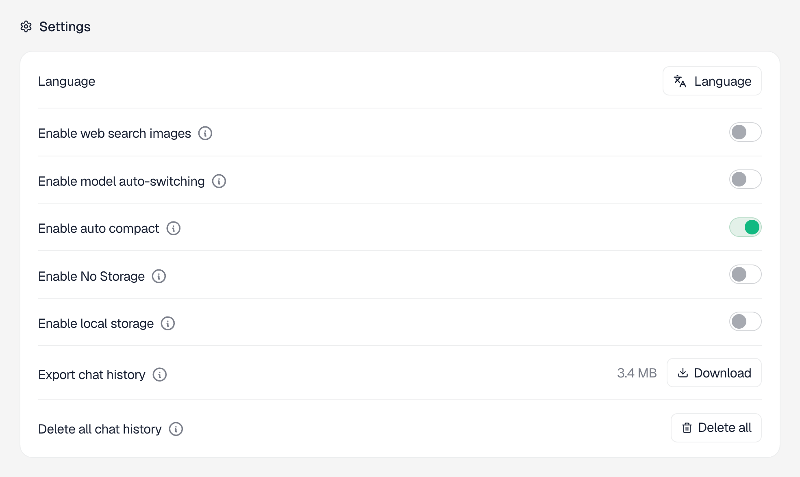
  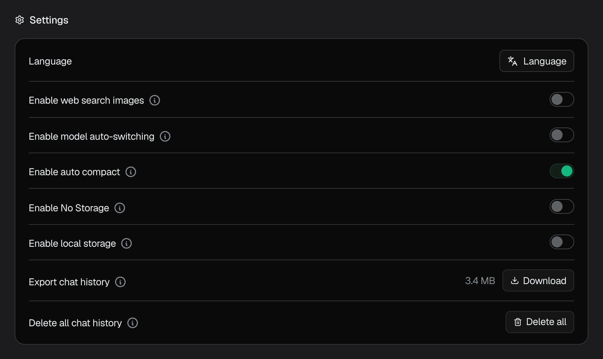
</Frame>

## 改善

- **長いチャット**：開くと、最新のメッセージがすぐに表示されます。上にスクロールすると以前のメッセージが読み込まれ、読んでいる位置はずれません。
</Update>

<Update label="2026年10月27日">
## パーソナライズ

**アカウント** ページに新しい **パーソナライズ** セクションを追加しました。Capriole AI にあなたの呼び名、お仕事、回答の好みを伝えられます。既存のチャットを含むすべてのチャットで、次のメッセージから反映されます。指示は最大 1,500 文字です。ウェブチャットとアプリに適用され、API には適用されません。

<Frame>
  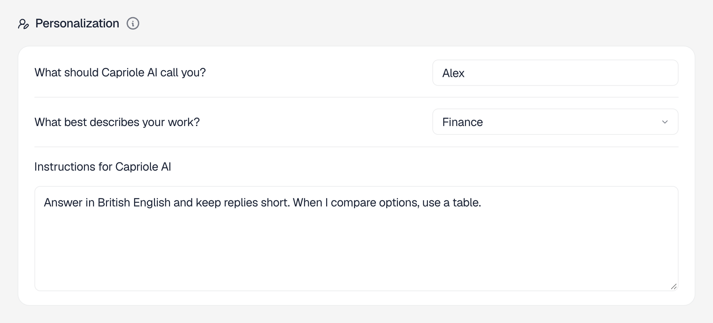
  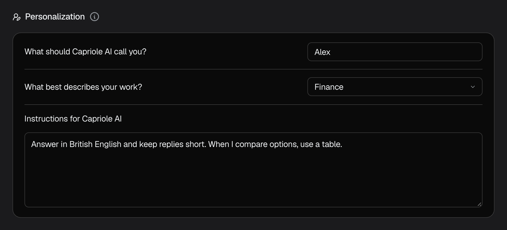
</Frame>

## ゲストのチャットがログイン後も残ります

アカウントなしでチャットを始め、同じタブでログインまたは新規登録すると、そのチャットはアカウントに保存されたチャットとして開きます。メッセージはすべてそのまま残り、次の返信もそれまでのやり取りを踏まえます。保存しても使用量にはカウントされません。

<Frame>
  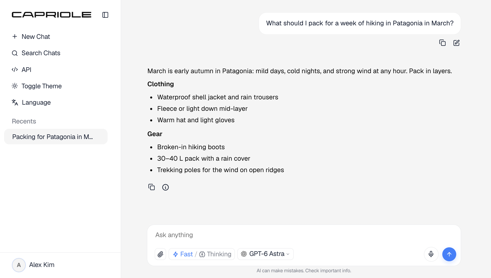
  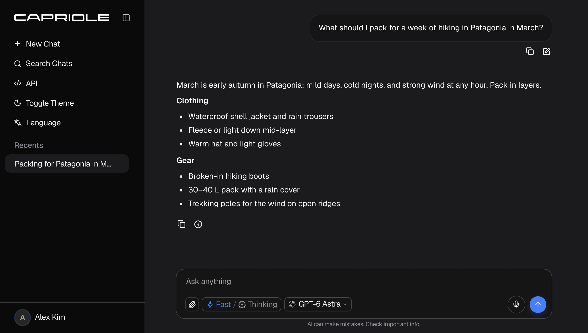
</Frame>

## Kimi K3.1 Pro

Moonshot AI の Kimi K3.1 Pro を利用できるようになりました。Kimi で最も高性能なモデルで、コーディング、3D 制作、金融リサーチの性能が大きく向上し、1M トークンのコンテキスト ウィンドウを備えています。ウェブチャットでは、難しい作業には **Kimi K3.1 Pro Thinking**、すばやい回答には **Kimi K3.1 Pro** を選んでください。API では [Chat Completions](/ja/api-reference/endpoint/chat-completions) で `moonshot/kimi-k3.1-pro` を呼び出せます。[コーディングエージェントのガイド](/ja/integrations/opencode)にも掲載しています。Kimi K3 は引き続き **その他のモデル** から利用できます。

<Frame>
  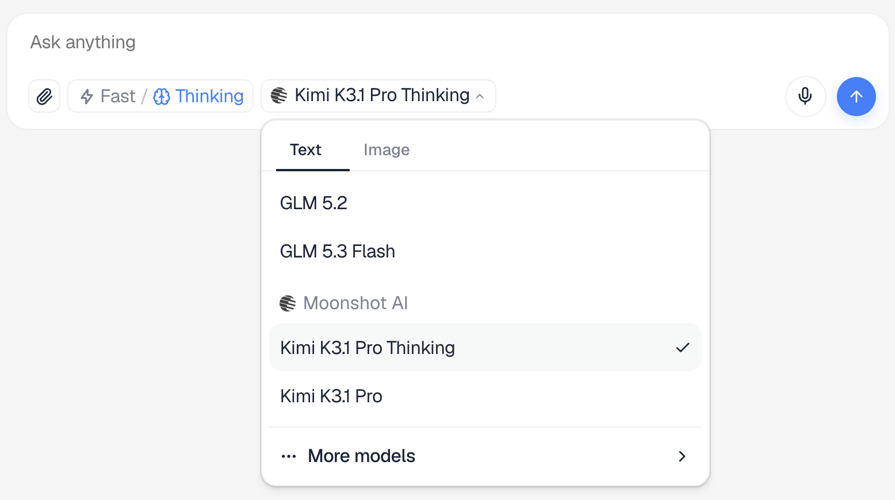
  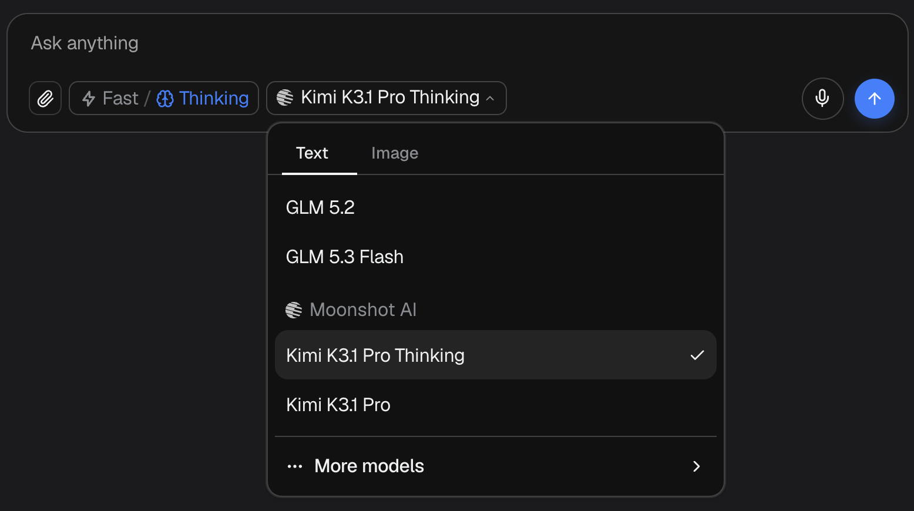
</Frame>
</Update>

<Update label="2026年10月20日">
## 更新履歴を公開しました

Capriole AI の新機能、モデルの更新、API の変更、コーディングエージェントのガイドを、今後はこのページに新しい順で掲載します。アプリでは **リソース > 最新のお知らせ** からこのページに戻れます。RSS フィードを購読すると、更新が公開されるたびに受け取れます。

<Frame>
  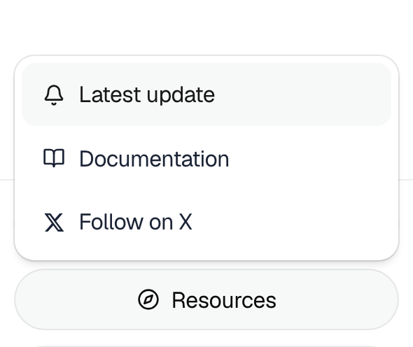
  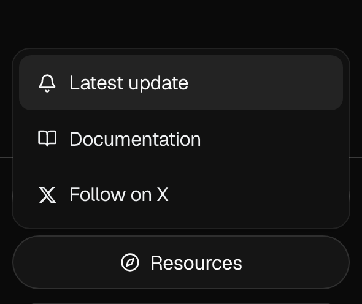
</Frame>

## チャットがモデルを記憶するようになりました

保存済みのチャットを開くと、Capriole AI は最新の回答で使われたモデルを、Fast または Thinking の設定も含めて選択します。ページの再読み込み、再ログイン、別のデバイスでも選択は保たれます。そのモデルが提供終了している場合は、現在の選択がそのまま使われます。

<Frame>
  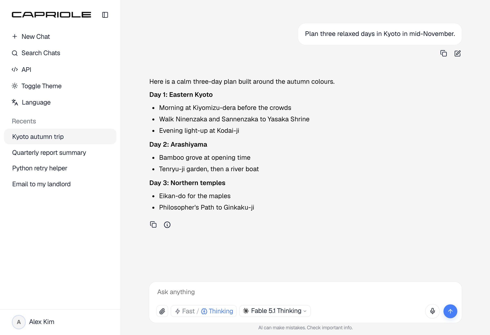
  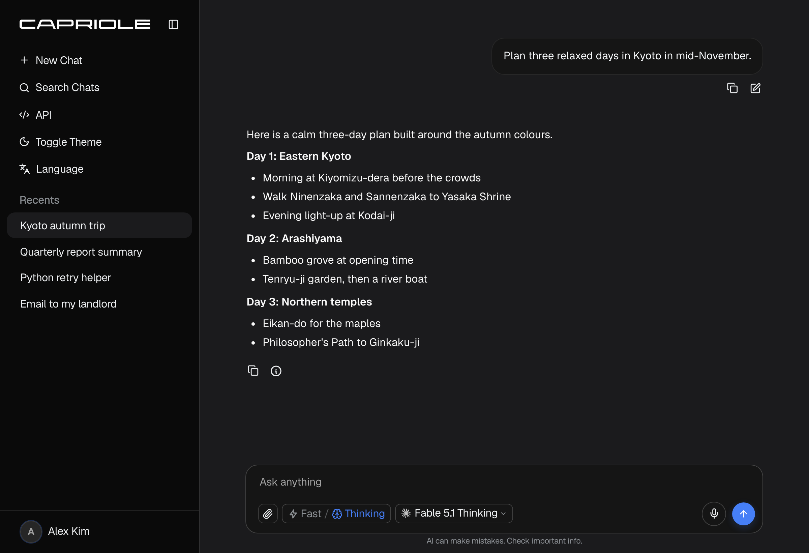
</Frame>

## コーディングエージェントのガイドを再検証しました

すべてのコーディングエージェントのガイドを現在のモデルで再検証し、[Cline](/ja/integrations/cline)、[Qwen Code](/ja/integrations/qwen-code)、[Crush](/ja/integrations/crush)、[Pi](/ja/integrations/pi) のガイドを追加しました。[OpenCode](/ja/integrations/opencode) と [Kilo Code](/ja/integrations/kilo-code) は、プロバイダー 1 つと API キー 1 つだけで設定できるようになりました。

<Frame>
  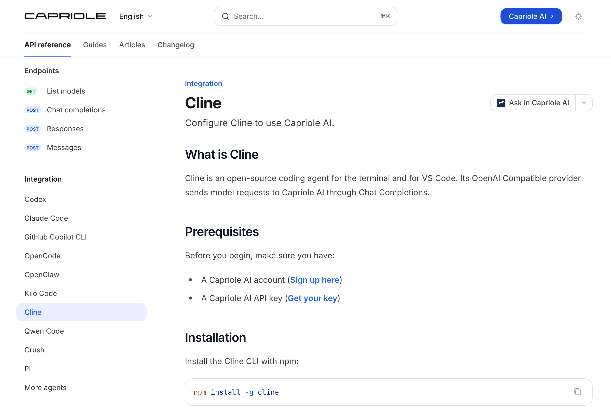
  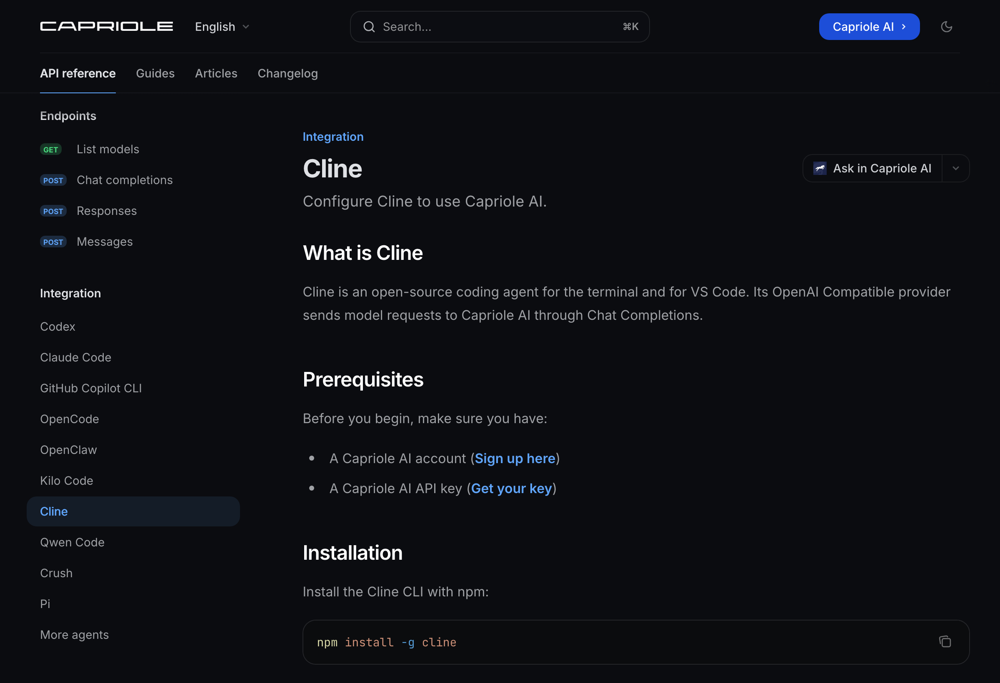
</Frame>
</Update>
