<Update label="2026년 11월 10일">
## 계정 관리

**계정**을 열고 **계정 관리**를 선택하면 이름과 사진을 바꾸고, 비밀번호를 설정하고, 로그인된 기기를 확인할 수 있습니다. 무료 계정은 **보안** 탭에서 계정을 삭제할 수도 있습니다. 삭제는 되돌릴 수 없으며, 같은 계정을 쓰는 [Capriole Quant](https://quant.capriole.com/)에도 로그인할 수 없게 됩니다. 유료 플랜 계정을 삭제하려면 [info@capriole.ai](mailto:info@capriole.ai)로 이메일을 보내 주세요.

<Frame>
  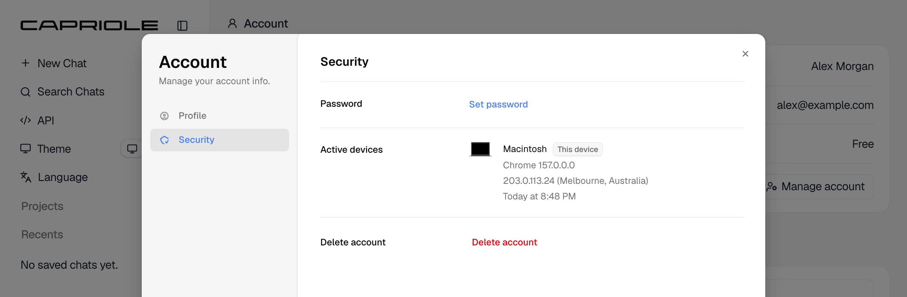
  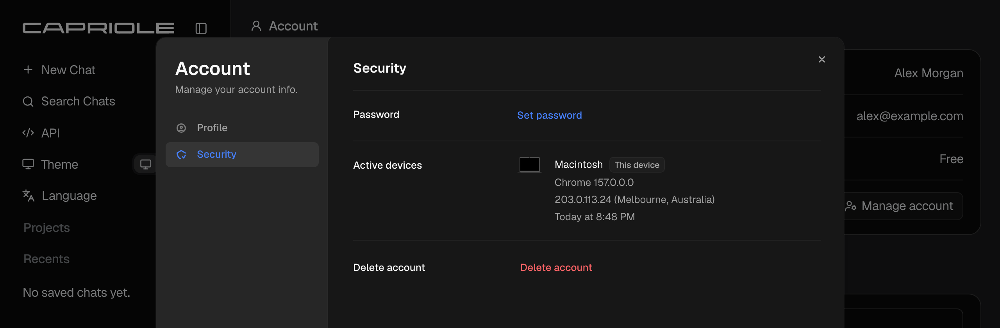
</Frame>
</Update>

<Update label="2026년 11월 9일">
## Premium 요금

웹에서 신규 Premium을 구독하면 **월 USD 9**입니다. 기존 월 USD 8 구독은 활성 상태를 유지하는 동안 **월 USD 8**로 갱신됩니다. [요금제와 한도 보기](/ko/guides/plans-and-limits).

4월부터 누구나 최첨단 AI를 최대한 합리적인 가격에 이용할 수 있도록 노력해 왔습니다. 이번 가격 조정은 GPT-6 Astra, Fable 5.1, Opus 5.5, Gemini 4 Argon 등 최첨단 모델을 이용한 무제한 웹 채팅을 계속 제공하는 데 도움이 됩니다.

## 채팅 제목과 상태

웹에서 새 텍스트 채팅을 시작하면 첫 메시지를 바탕으로 짧은 제목이 생성됩니다. 브라우저 탭에도 제목이 표시되며, 채팅을 전환하거나 이름을 바꾸면 함께 업데이트됩니다.

**Server Storage**를 사용하면 답변이 생성되는 동안 다른 채팅으로 이동할 수 있습니다. 사이드바의 회전 아이콘은 답변이 생성 중임을 나타냅니다. 파란 점은 아직 보지 않은 답변이 준비되었음을 표시하며, 답변을 보면 사라집니다.

<Frame>
  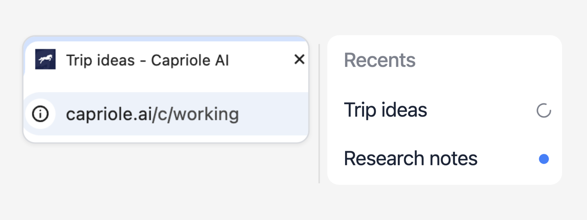
  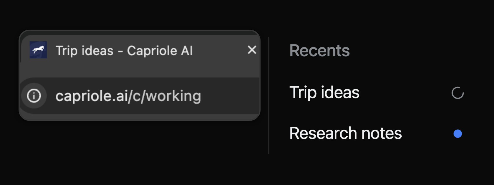
</Frame>
</Update>

<Update label="2026년 11월 6일">
## 피드백

이제 Capriole AI 안에서 바로 고칠 점과 만들 기능을 알려 주실 수 있습니다. 사이드바 하단에서 이름을 선택한 다음 **리소스** > **피드백**을 선택하세요. **문제**, **기능 요청**, **질문** 중 하나를 고르고 내용을 쓴 뒤, 파일을 5개까지(합계 4MB) 첨부하거나 스크린샷을 붙여 넣으세요. 보낸 내용은 Capriole AI 팀에 바로 전달됩니다. 로그인하지 않았다면 사이드바 하단에서 **리소스** > **피드백**을 선택하고 먼저 로그인하세요.

<Frame>
  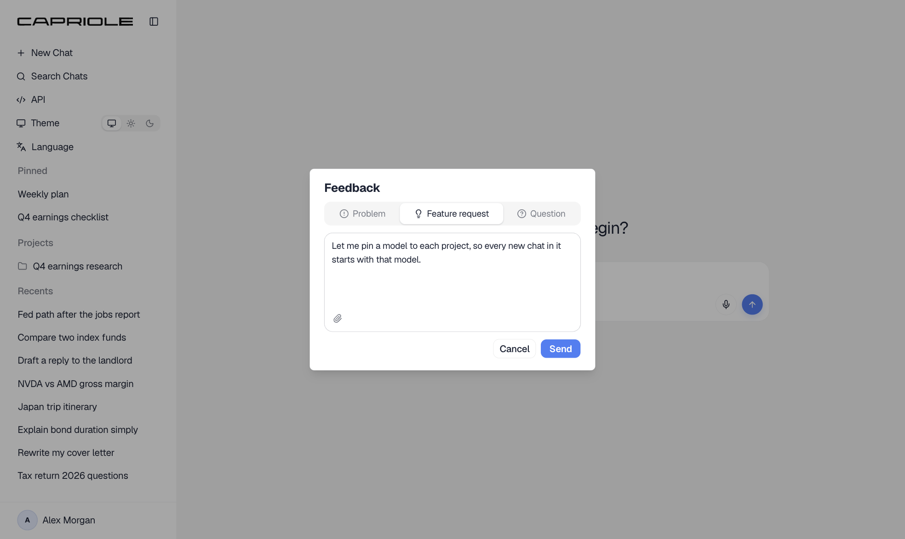
  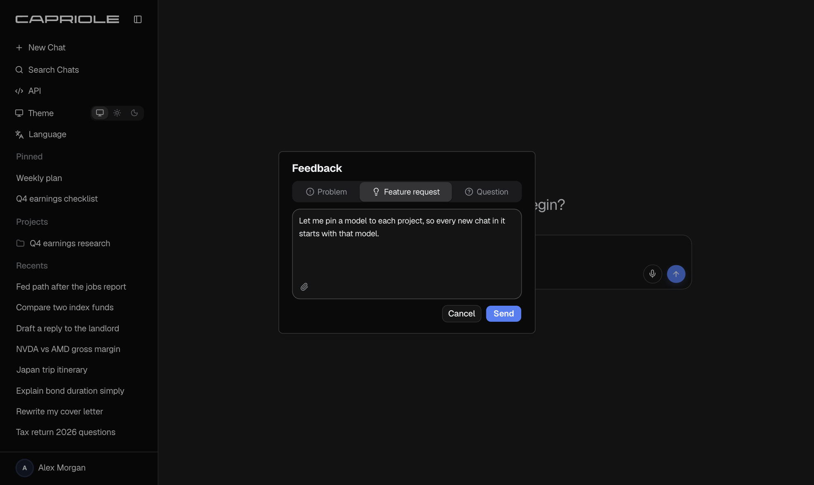
</Frame>

## 개선

- **OpenCode**: [OpenCode 가이드](/ko/integrations/opencode)가 이제 버전 1과 함께 OpenCode 2도 다루며, 두 버전 모두에서 테스트했습니다.
- **프로젝트**: 프로젝트에서 새로 시작한 채팅은 이제 인사말 위에 프로젝트 이름을 한 번만 표시합니다.

## 수정

- **채팅**: Claude Opus 5.5, Claude Fable 5.1, Claude Opus 5의 긴 답변이 더 이상 중간에 멈추지 않습니다.
</Update>

<Update label="2026년 11월 5일">
## 수정

- **음성 입력**: 다시 사용할 수 있으며, 주 음성 인식 서비스가 중단되어도 계속 작동합니다.
</Update>

<Update label="2026년 10월 30일">
## 프로젝트 파일과 내보내기

이제 채팅에 필요한 파일을 프로젝트에 넣어 둘 수 있습니다. 프로젝트 페이지에서 새 **파일** 탭을 열고 **파일 추가**를 선택하거나 파일을 탭에 끌어다 놓으세요. 채팅에 첨부할 수 있는 것과 같은 문서와 이미지를 모든 플랜에서 프로젝트당 40개까지 추가할 수 있습니다. 프로젝트의 모든 채팅이 이 파일들을 사용할 수 있으며, 질문에 필요할 때 Capriole AI가 파일을 읽습니다. 프로젝트를 가져가려면 메뉴에서 **내보내기**를 선택하세요. 채팅, 지침, 파일이 담긴 ZIP을 받습니다. **계정** 페이지의 **채팅 기록 내보내기**에도 이제 프로젝트의 지침과 파일이 포함됩니다. [프로젝트 파일 사용 방법 보기](/ko/guides/projects).

<Frame>
  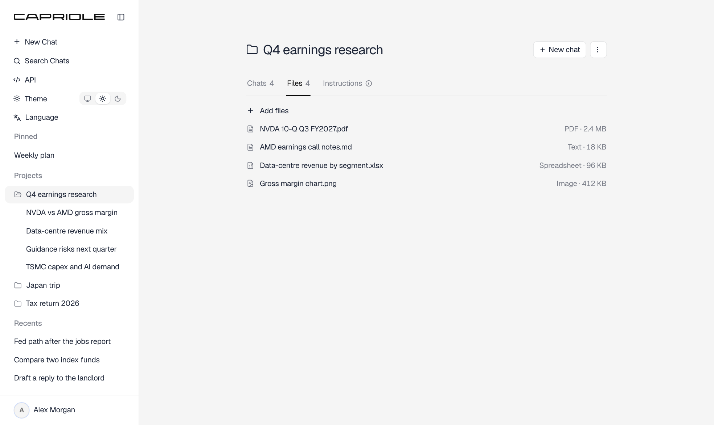
  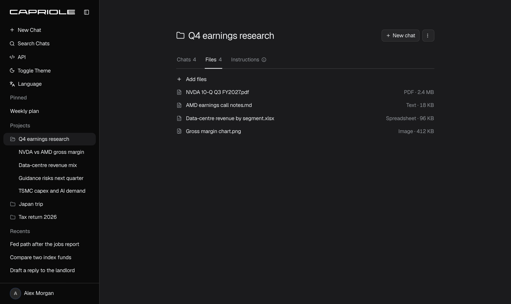
</Frame>

## 개선

- **사이드바**: **고정됨**이 **프로젝트** 위로 옮겨졌고, 프로젝트를 열면 그 아래에 채팅도 표시되며, 목록이 부드럽게 펼쳐지고 접힙니다.
- **테마**: 사이드바의 **라이트**와 **다크**에 **시스템**이 더해졌으며, 기기의 라이트 또는 다크 설정을 따릅니다.
</Update>

<Update label="2026년 10월 29일">
## 프로젝트

이제 관련된 일을 한곳에 모을 수 있습니다. 고객, 강의, 자주 다시 보는 일마다 프로젝트를 만들면 그 채팅이 사이드바의 프로젝트 아래에 모입니다. 프로젝트 지침은 한 번만 쓰면 프로젝트의 모든 채팅이 계정 지침과 함께 따르며, 둘이 충돌하면 프로젝트 지침이 우선합니다. 프로젝트를 만들려면 사이드바에서 **프로젝트**에 포인터를 올리고 **+** 버튼을 선택하세요. 그다음 프로젝트에서 채팅을 시작하거나, 채팅 메뉴에서 또는 프로젝트 위로 드래그해 채팅을 넣으면 됩니다. 프로젝트는 모든 플랜에서 로그인하고 채팅을 서버에 저장하면 사용할 수 있습니다. [프로젝트 사용 방법 보기](/ko/guides/projects).

<Frame>
  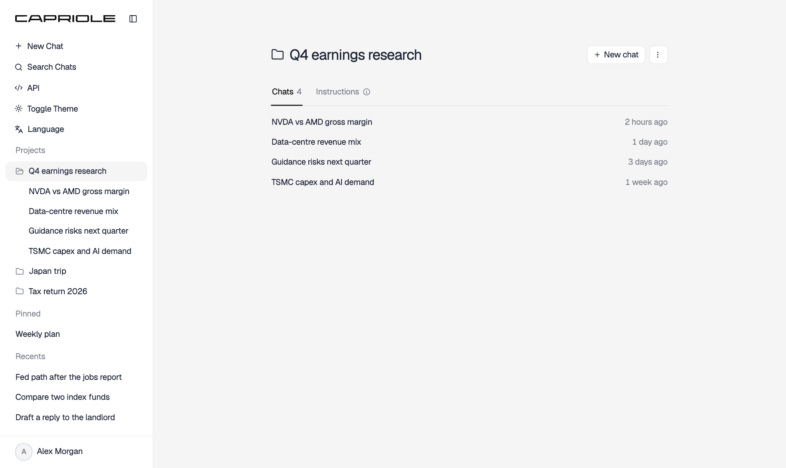
  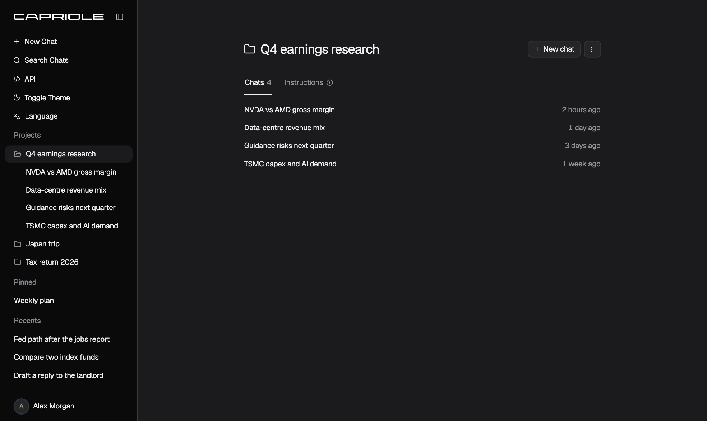
</Frame>

## 개선

- **채팅 검색**: 이전 채팅과 프로젝트의 채팅을 포함해 어떤 채팅이든 제목으로 찾습니다.
</Update>

<Update label="2026년 10월 28일">
## 채팅 기록 내보내기

이제 채팅을 언제든 가져갈 수 있습니다. **계정** 페이지의 **설정**에서 **채팅 기록 내보내기**를 선택하면 Capriole AI가 백그라운드에서 ZIP을 준비합니다. 그동안 페이지를 떠나도 되며, 다운로드는 24시간 동안 가능합니다. ZIP에는 채팅마다 Markdown 파일과 첨부한 파일, 생성한 이미지가 들어 있고, 모든 채팅을 프로그램이 읽을 수 있는 형식으로 담은 `conversations.json`도 포함됩니다. 채팅 하나만 내보내려면 사이드바에서 해당 채팅의 메뉴를 열고 **내보내기**를 선택하세요. 로컬에 저장된 채팅은 바로 다운로드됩니다.

<Frame>
  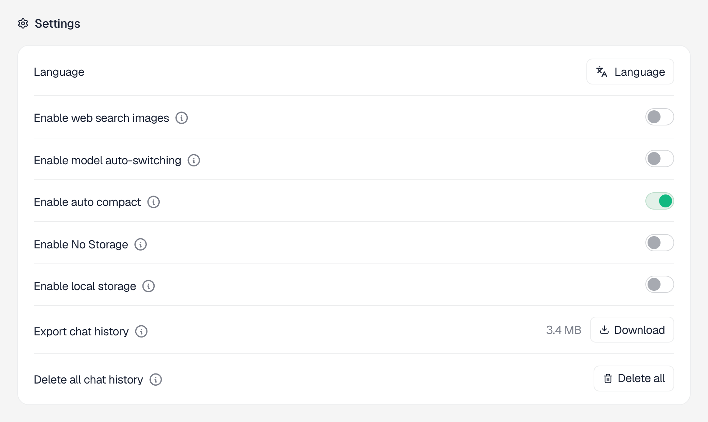
  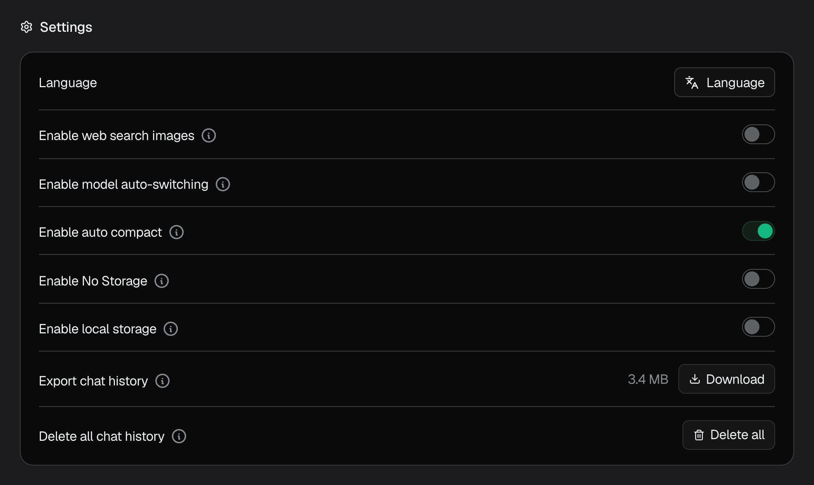
</Frame>

## 개선

- **긴 채팅**: 열면 최신 메시지가 바로 표시됩니다. 위로 스크롤하면 이전 메시지를 불러오며, 읽던 위치는 그대로 유지됩니다.
</Update>

<Update label="2026년 10월 27일">
## 개인화

**계정** 페이지의 새 **개인화** 섹션에서 Capriole AI가 나를 어떻게 부를지, 내 일을 가장 잘 설명하는 항목, 원하는 답변 방식을 알려 줄 수 있습니다. 기존 채팅을 포함한 모든 채팅이 다음 메시지부터 이 설정을 따릅니다. 지침은 최대 1,500자까지 입력할 수 있습니다. 웹 채팅과 앱에 적용되며 API에는 적용되지 않습니다.

<Frame>
  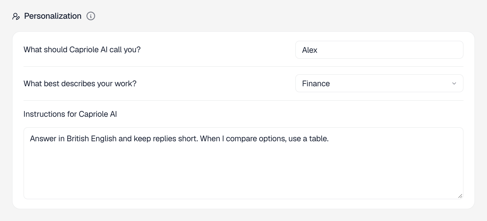
  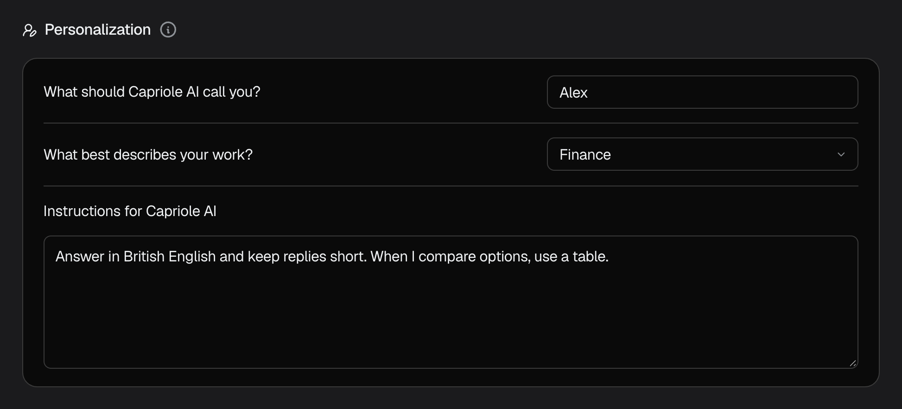
</Frame>

## 로그인 후에도 게스트 채팅이 남습니다

계정 없이 채팅을 시작한 뒤 같은 탭에서 로그인하거나 가입하면, 그 채팅이 계정에 저장된 채팅으로 열립니다. 모든 메시지가 그대로 남고, 다음 답변도 앞서 나눈 대화를 기억합니다. 저장해도 사용량에는 포함되지 않습니다.

<Frame>
  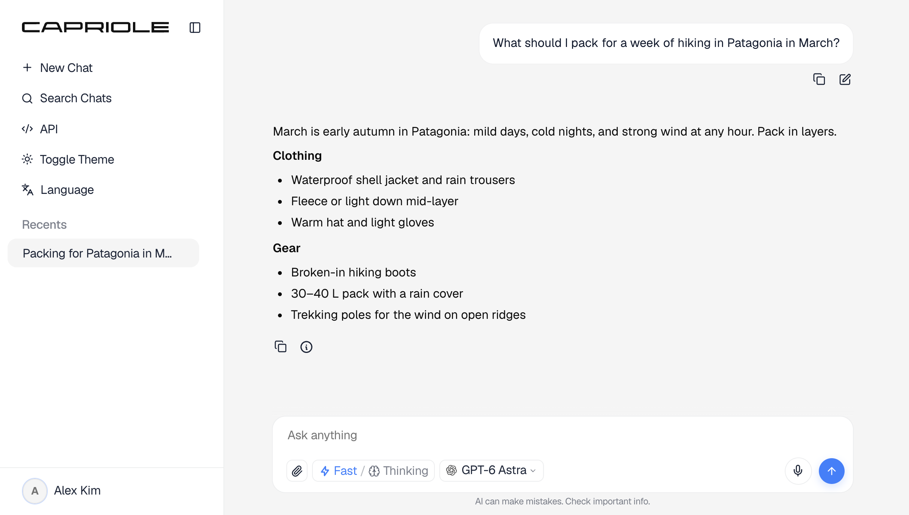
  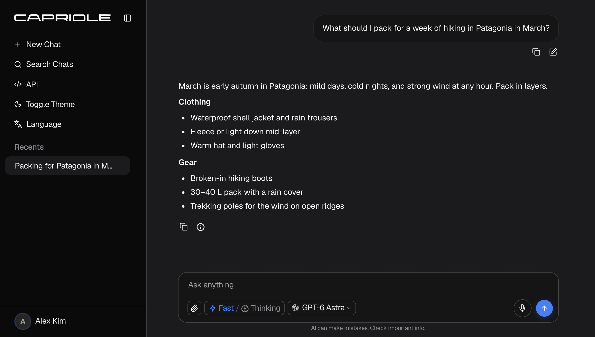
</Frame>

## Kimi K3.1 Pro

Moonshot AI의 Kimi K3.1 Pro를 이제 사용할 수 있습니다. Kimi에서 가장 뛰어난 모델로, 코딩, 3D 제작, 금융 리서치 성능이 크게 향상되었고 1M 토큰 컨텍스트 창을 지원합니다. 웹 채팅에서는 어려운 작업에는 **Kimi K3.1 Pro Thinking**을, 빠른 답변에는 **Kimi K3.1 Pro**를 선택하세요. API에서는 [Chat Completions](/ko/api-reference/endpoint/chat-completions)로 `moonshot/kimi-k3.1-pro`를 호출하세요. [코딩 에이전트 가이드](/ko/integrations/opencode)에도 추가했습니다. Kimi K3는 계속 **더 많은 모델**에서 사용할 수 있습니다.

<Frame>
  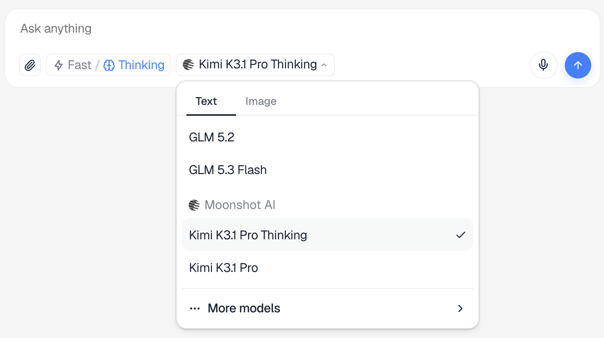
  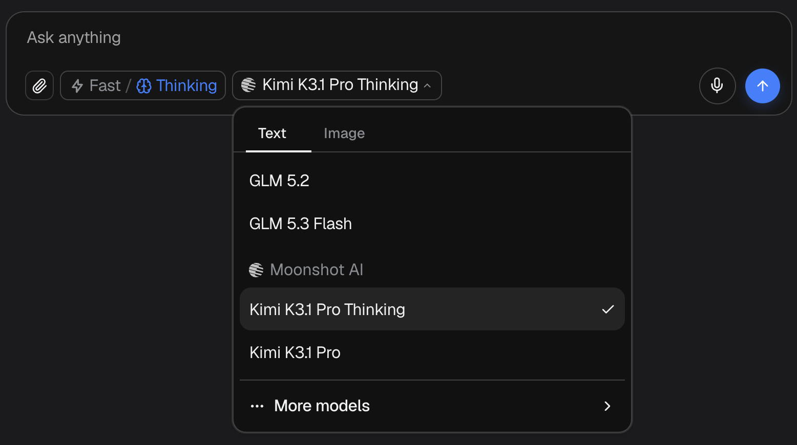
</Frame>
</Update>

<Update label="2026년 10월 20일">
## 업데이트 내역 페이지를 열었습니다

Capriole AI의 새 기능, 모델 업데이트, API 변경 사항, 코딩 에이전트 가이드를 이제 이 페이지에 최신순으로 게시합니다. 앱에서 **리소스 > 최신 소식**을 열면 이 페이지로 돌아올 수 있습니다. RSS 피드를 구독하면 업데이트가 공개될 때마다 받아볼 수 있습니다.

<Frame>
  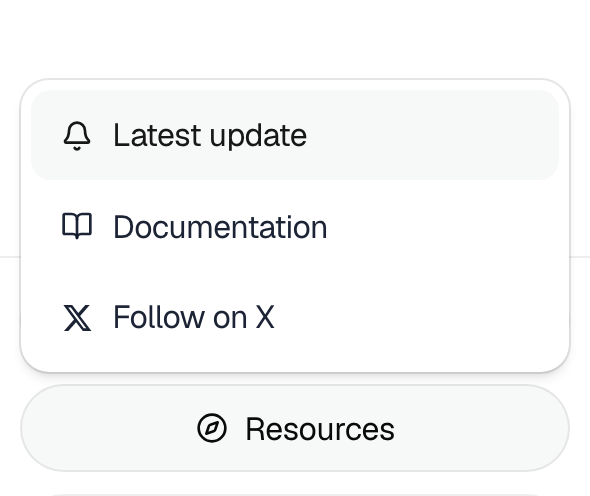
  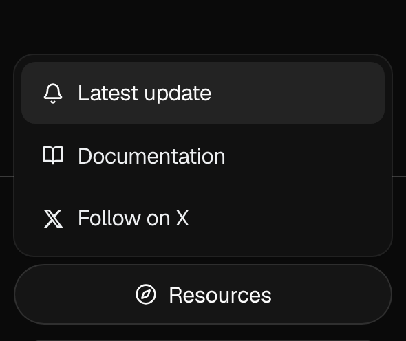
</Frame>

## 채팅이 모델을 기억합니다

저장된 채팅을 열면 Capriole AI가 가장 최근 답변에 사용된 모델을 Fast 또는 Thinking 설정까지 그대로 선택합니다. 새로고침하거나 다시 로그인하거나 다른 기기에서 열어도 선택이 유지됩니다. 해당 모델이 지원 종료된 경우에는 현재 선택이 유지됩니다.

<Frame>
  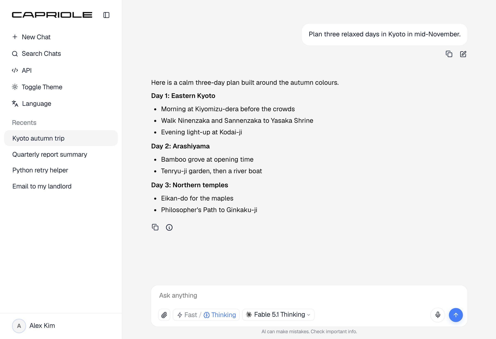
  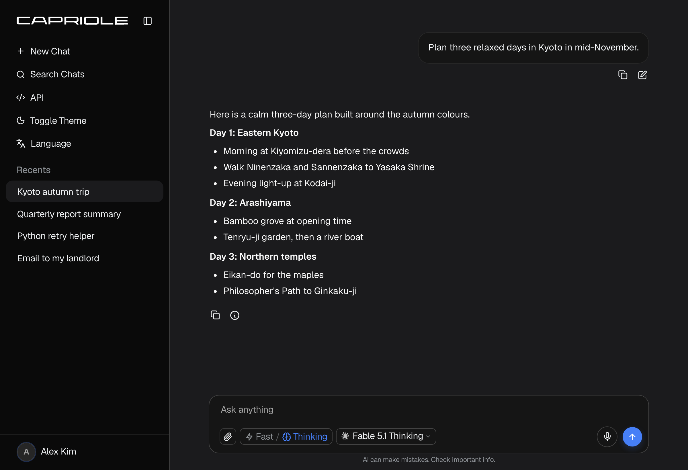
</Frame>

## 코딩 에이전트 가이드를 다시 검증했습니다

현재 모델로 모든 코딩 에이전트 가이드를 다시 검증하고 [Cline](/ko/integrations/cline), [Qwen Code](/ko/integrations/qwen-code), [Crush](/ko/integrations/crush), [Pi](/ko/integrations/pi) 가이드를 추가했습니다. 이제 [OpenCode](/ko/integrations/opencode)와 [Kilo Code](/ko/integrations/kilo-code)는 provider 하나와 API 키 하나만 있으면 됩니다.

<Frame>
  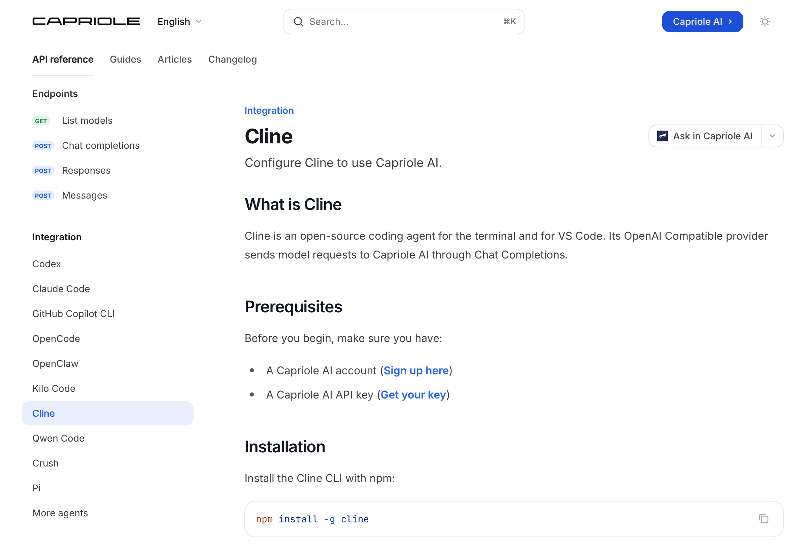
  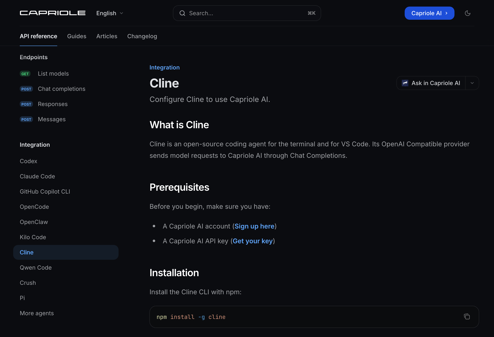
</Frame>
</Update>
