<Update label="2026년 11월 24일">
## Android용 Capriole AI

이제 Android에서 Capriole AI를 사용할 수 있습니다. 로그인하거나 무료로 가입하면 휴대폰에서 모든 모델과 채팅하고 이미지를 생성할 수 있습니다. [Google Play에서 다운로드](https://play.google.com/store/apps/details?id=com.capriole.ai).

<Frame>
  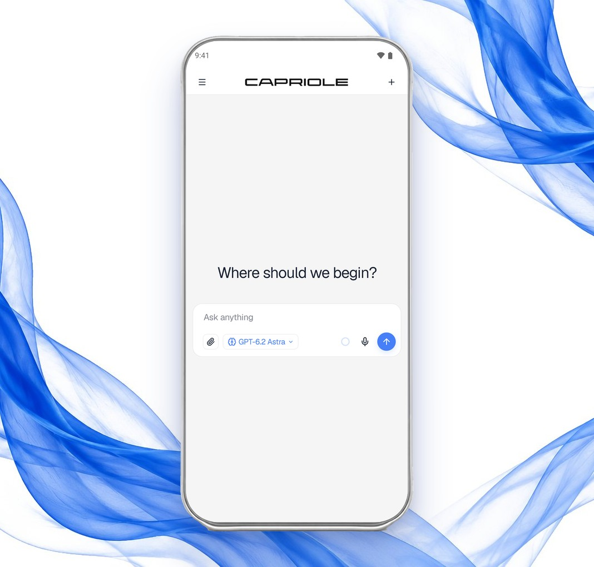
</Frame>

iPhone 앱은 곧 출시됩니다. 웹에서는 사이드바 하단에서 이름을 선택한 다음 **앱 다운로드**를 선택하고 휴대폰으로 QR 코드를 스캔하세요. 로그인하지 않았다면 사이드바 하단에서 **앱 다운로드**를 선택하세요.

## Claude Fable 5.2

<Frame>
  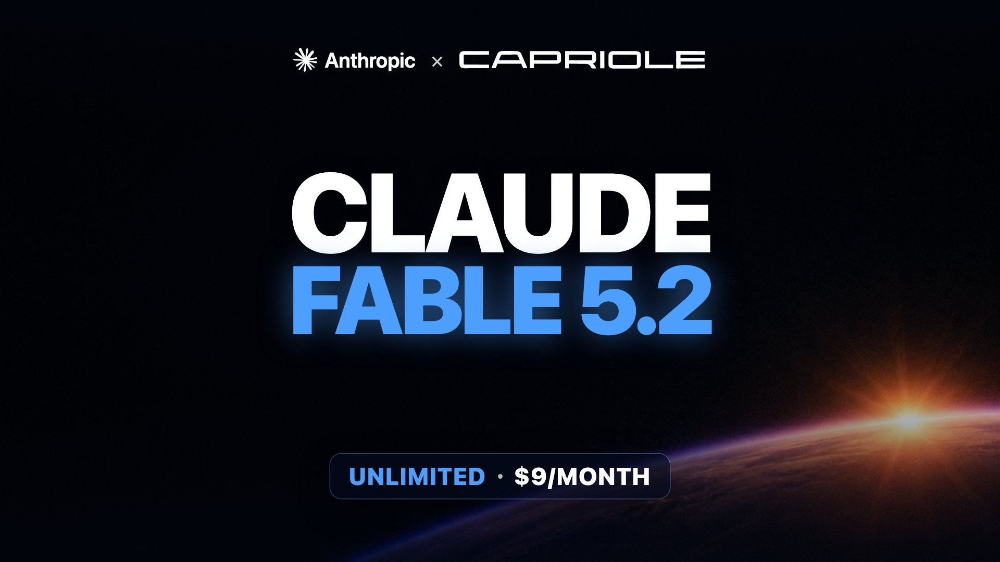
</Frame>

Claude Fable 5.2는 Claude Fable 5.1을 대신하는 Anthropic의 가장 까다로운 기술 작업용 모델입니다. [Anthropic에 따르면](https://www.anthropic.com/claude-fable-and-mythos-5-2) Fable 5.1보다 코딩, 추론, 비전 성능이 뛰어나고, 테스터들은 더 명확하게 소통한다고 평가했습니다. Anthropic은 대부분의 코딩 및 지식 작업에서 여전히 Claude Opus 5.5로 시작하기를 권장합니다.

이제 웹 채팅 모델 메뉴에 **Fable 5.2 Thinking**과 **Fable 5.2**가 있습니다. Fable 5.1은 **더 많은 모델**로 옮겨졌으며, 그곳에서 계속 사용할 수 있습니다. API에서는 [Chat Completions](/ko/api-reference/endpoint/chat-completions)로 `anthropic/claude-fable-5-2`를, [Messages](/ko/api-reference/endpoint/messages)로 `claude-fable-5-2`를 호출하세요. 이제 `claude-latest`는 Fable 5.2를 가리키며, Fable 5.1은 `anthropic/claude-fable-5-1`로 계속 사용할 수 있습니다. Anthropic API 가격은 100만 토큰당 입력 USD 8, 출력 USD 40으로 Fable 5.1보다 20% 낮습니다. [모델 선택](/ko/guides/choose-a-model)에서 다른 플래그십 모델과 비교해 보세요.

<Frame>
  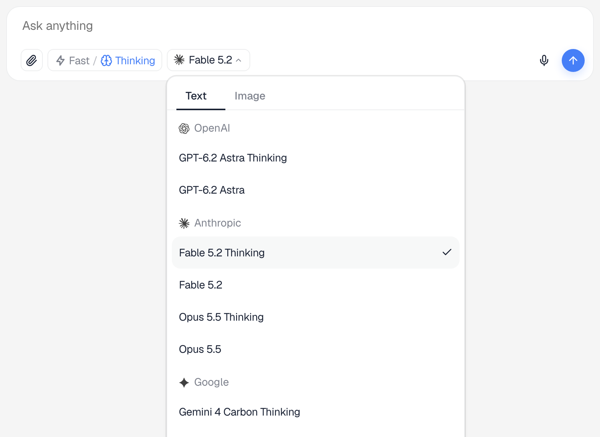
</Frame>

</Update>

<Update label="2026년 11월 23일">
## 여러 채팅에 걸친 메모리

이제 Capriole AI가 모든 채팅과 모델에 걸쳐 사용자에게 중요한 맥락을 기억합니다. 메모리는 기본적으로 켜져 있으며, **계정** → **메모리**에서 언제든지 각 사실을 보고, 추가하고, 편집하고, 삭제하거나 메모리를 끌 수 있습니다.

각 프로젝트에도 **메모리** 탭이 있습니다. 프로젝트의 채팅은 공통 메모리와 해당 프로젝트의 메모리를 함께 사용하고, 새 사실은 프로젝트에 저장합니다. 공통 메모리와 각 프로젝트의 메모리는 모두 최대 2,400자입니다.

메모리는 앱의 채팅을 포함해 로그인한 상태에서 **Server Storage**로 저장되는 채팅에서 작동하고, 관리는 웹에서 합니다. [메모리 작동 방식 알아보기](/ko/guides/personalization-and-memory).

<Frame>
  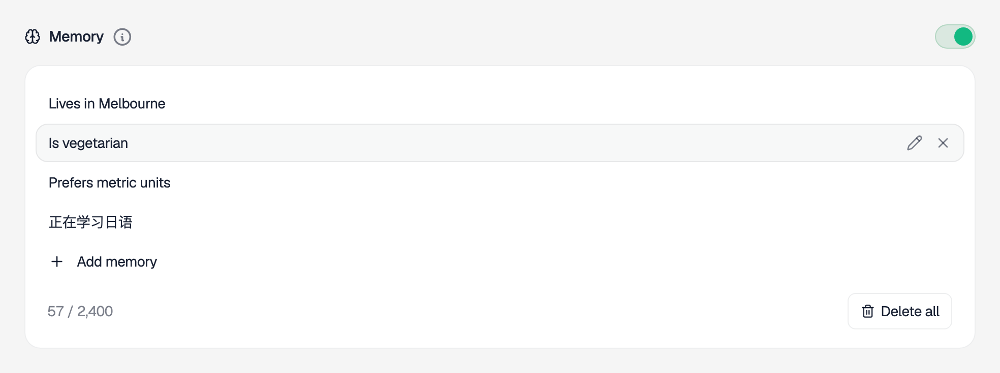
</Frame>

</Update>

<Update label="2026년 11월 21일">
## 개선

- **복사**: 텍스트와 이미지가 함께 있거나 이미지가 여러 장인 응답에서 **복사**로 텍스트, 원하는 이미지 하나 또는 전체를 복사할 수 있습니다. 이미지도 바로 복사됩니다.

</Update>

<Update label="2026년 11월 20일">
## GPT-5.5

Capriole AI의 GPT-5.5 지원이 종료되었습니다. GPT-6.2 Astra 또는 GPT-6.2 Sol로 전환하세요. API 호출에는 `openai-latest` 또는 `openai/gpt-6.2-astra`를 사용하세요.

## 응답 신고

이제 모든 응답 아래에 깃발 아이콘이 있습니다. 유해하다고 생각되는 응답을 여기서 신고할 수 있습니다. 사유를 하나 고르고 필요하면 세부 정보를 덧붙이세요. 이미지가 있는 응답에서는 신고할 이미지를 선택할 수 있습니다. 저희는 그 응답과 바로 앞의 메시지를 받아 모든 신고를 검토합니다. 대화는 그대로 이어지며, 텍스트 응답은 로그인하지 않아도 신고할 수 있습니다.

<Frame>
  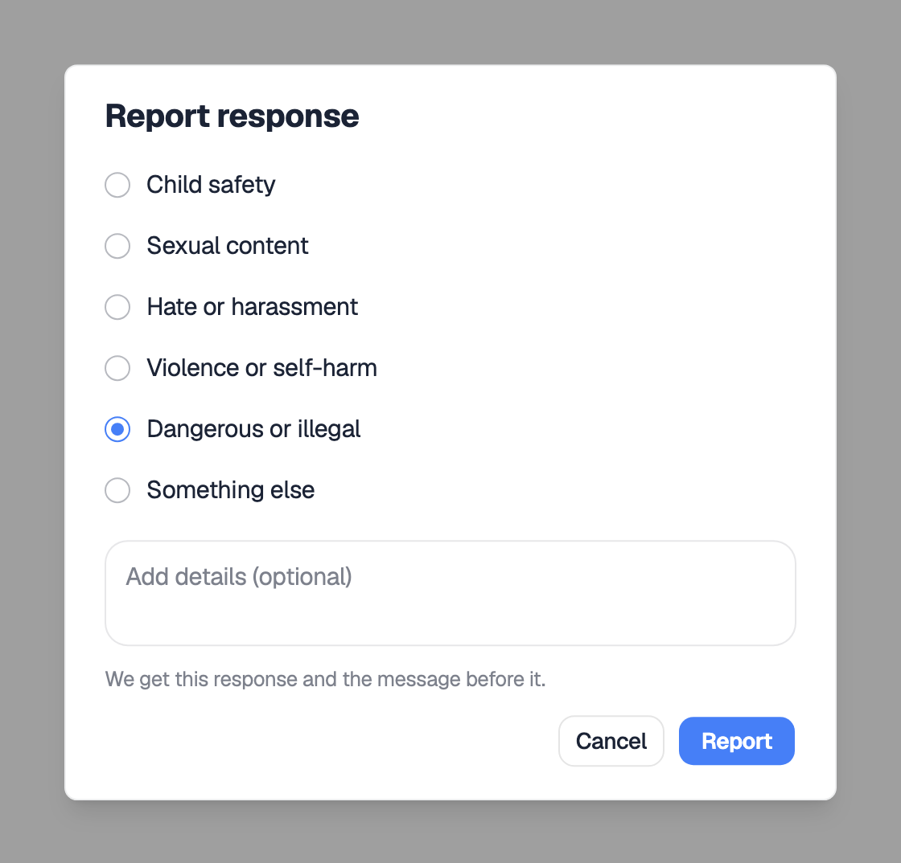
</Frame>

## 개선

- **이미지 생성**: 이미지만 있는 응답에도 **이미지 복사**가 생겼습니다. 이미지가 하나면 바로 복사하고, 여러 개면 고를 수 있습니다. 터치스크린에서는 이미지의 **…** 메뉴에도 **이미지 복사**가 있습니다.

</Update>

<Update label="2026년 11월 18일">
## GPT-6.2 Astra와 Sol

<Frame>
  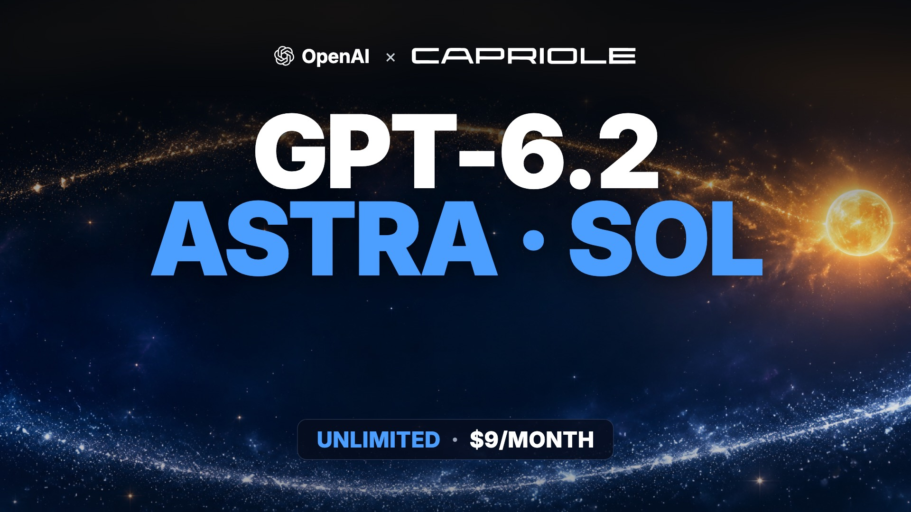
</Frame>

GPT-6.2 Astra는 GPT-6 Astra를 대신하는 OpenAI의 새 플래그십이고, GPT-6.2 Sol은 GPT-6.1 Sol을 대신하는 OpenAI의 일상 업무용 모델입니다. [OpenAI는](https://openai.com/index/introducing-gpt-6-2-astra-sol/) Astra를 "가장 어려운 프로젝트를 위한 새 최첨단 모델"이라고, Sol을 "일상 업무를 위한 효율적이고 다재다능한 모델"이라고 부릅니다.

이제 웹 채팅 모델 메뉴의 OpenAI 그룹 맨 위에는 **Thinking**과 **Fast**를 갖춘 GPT-6.2 Astra가 있으며, 게스트와 새 계정은 **GPT-6.2 Astra Thinking**으로 시작합니다. GPT-6.2 Sol도 **Thinking**과 **Fast**로 제공되며 **더 많은 모델**의 OpenAI 모델 중 맨 앞에 있고, GPT-6 Astra와 GPT-6.1 Sol도 그곳에서 계속 사용할 수 있습니다. API에서는 [Responses](/ko/api-reference/endpoint/responses) 또는 [Chat Completions](/ko/api-reference/endpoint/chat-completions)로 `openai/gpt-6.2-astra` 또는 `openai/gpt-6.2-sol`을 호출하세요. 이제 `openai-latest`는 GPT-6.2 Astra를 가리킵니다. OpenAI API 가격은 Astra가 100만 토큰당 입력 USD 8, 출력 USD 40으로 GPT-6 Astra보다 20% 낮고, Sol은 USD 2와 USD 10으로 GPT-6.1 Sol과 같습니다. [모델 선택](/ko/guides/choose-a-model)에서 다른 플래그십 모델과 비교해 보세요.

<Frame>
  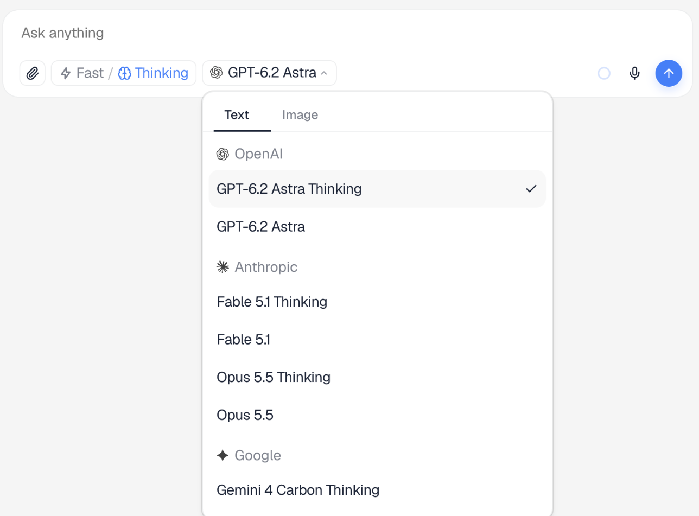
</Frame>

## 채팅에 태그 달기

사이드바에서 채팅 메뉴를 열고 **태그**를 선택하면 채팅에 색상 태그를 하나 이상 달 수 있으며, 태그는 제목 아래에 표시됩니다. **채팅 검색** 옆의 필터 버튼을 선택하면 고른 태그 중 하나라도 달린 채팅을 **최근**과 모든 프로젝트에서 모아 볼 수 있습니다. **채팅 검색**에서 태그를 골라 그 태그가 달린 채팅에서만 검색할 수도 있습니다. 태그는 로그인 후 **Server Storage**를 사용하는 계정에서 쓸 수 있습니다. [태그 사용법 보기](/ko/guides/projects#채팅에-태그-달기).

<Frame>
  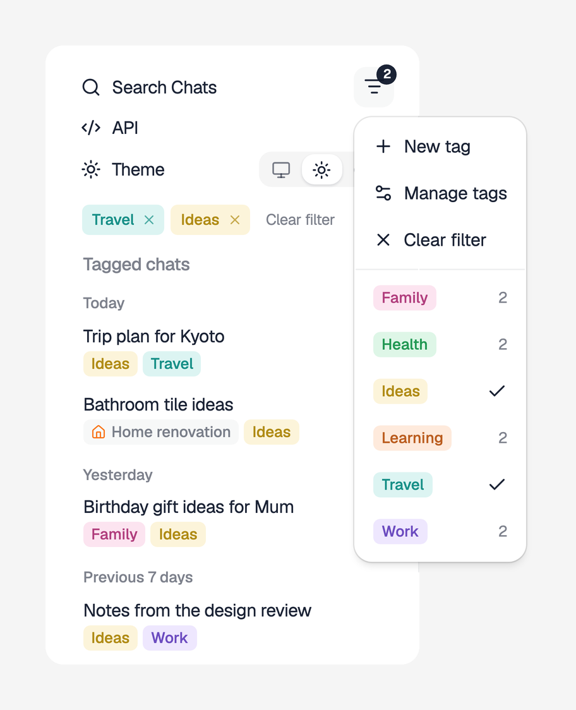
</Frame>

## 개선

- **사이드바**: 한 화면에 더 많은 채팅이 보이고, **최근**은 날짜별로 묶여 표시되며, 펼쳐 둔 섹션과 프로젝트는 브라우저가 기억합니다.
- **언어**: 로그인한 상태에서는 언어 설정이 사이드바에서 **계정** → **설정**으로 옮겨졌습니다.
- **프로젝트**: 이제 프로젝트마다 색상과 아이콘을 정할 수 있으며, 프로젝트를 만들거나 편집할 때 설정합니다. 프로젝트 이름을 선택하면 채팅 목록이 펼쳐지거나 접히고, 점 세 개 메뉴의 **프로젝트 관리**를 선택하면 프로젝트 페이지가 열립니다.
- **다시 답변받기**: 이제 최신 답변이 실패해도 그 아래에 **다시 시도**가 표시되어, 같은 모델이나 다른 모델로 메시지를 다시 보낼 수 있습니다.

## 수정

- **채팅 제목**: 새 채팅의 제목이 첫 메시지에 답하지 않고, 작성한 언어로 그 주제를 나타냅니다.
- **첨부 파일**: 일부 브라우저에서 첨부한 Markdown 파일을 이제 GPT 모델이 읽습니다.
- **이미지 생성**: 이미지 생성을 시작할 때 답변을 멈춰도 더 이상 오류가 표시되지 않습니다.
</Update>

<Update label="2026년 11월 17일">
## Gemini 4 Carbon

<Frame>
  
</Frame>

Google의 가장 강력한 모델인 Gemini 4 Carbon을 이제 사용할 수 있습니다. Google은 복잡한 여러 단계의 코딩과 디버깅, 장기 에이전트 작업, 과학적 추론처럼 모델 지능의 한계를 시험하는 작업을 위해 이 모델을 만들었습니다. 웹 채팅 모델 메뉴의 Google 그룹 맨 위에서 **Gemini 4 Carbon Thinking**을 선택하거나, [Chat Completions](/ko/api-reference/endpoint/chat-completions)로 `google/gemini-4-carbon`을 호출하세요. 이제 `google-latest`는 Carbon을 가리키며, Chat Completions에서 더 가볍게 호출하려면 [Google의 `thinking_level`을 `low`로 설정](/ko/guides/choose-a-model#api-모델-id)할 수 있습니다. Gemini 4 Argon은 웹 채팅에서 **Gemini 4 Argon Thinking**으로, API에서 `google/gemini-4-argon`으로 계속 사용할 수 있습니다.

<Frame>
  
</Frame>

## Seedream 5.5

<Frame>
  
</Frame>

ByteDance Seed의 Seedream 5.5를 이제 **이미지** 모드에서 사용할 수 있습니다. ByteDance Seed에 따르면 [여러 번 편집하는 동안 원하는 부분만 정확하게 바꾸고 편집하지 않은 영역은 그대로 유지](https://seed.bytedance.com/en/seedream5_5)하며, 조명은 더 자연스럽고 재질은 더 섬세하며 피부 질감은 더 정교합니다. 모델 메뉴의 **이미지** 탭에서 **ByteDance** 아래의 **Seedream 5.5**를 선택해 새 이미지를 만들거나 첨부한 이미지를 편집하세요. 해상도는 1K와 2K이며, **자동**을 포함한 모든 화면 비율을 지원합니다. 다른 이미지 모델과 마찬가지로 로그인 후 **Server Storage**를 사용하는 계정은 무료로 사용할 수 있습니다. 기본 모델은 계속 GPT Image 2.6입니다. **텍스트** 모드의 Text Agent는 사용자가 지정한 이미지 모델을 사용하고, 지정하지 않으면 채팅의 가장 최근 이미지에 쓰인 모델을, 그런 이미지도 없으면 GPT Image 2.6을 사용합니다. 이제 어떤 모델을 쓸지 묻지 않습니다. [이미지 생성 가이드 보기](/ko/guides/files-web-search).

<Frame>
  
</Frame>

## 개선

- **긴 채팅**: GPT-6 Astra의 컨텍스트 압축을 최적화해 더 빠르고 효율적입니다.

## 수정

- **채팅**: 이제 Claude 모델이 사진이 더 많은 메시지를 처리합니다.
- **Gemini**: 답변이 더 안정적입니다.
- **이미지 모드**: 웹에서 이미지를 만드는 동안 사이드바에 진행 상태가 표시되고, 자리를 비운 사이 완성되면 채팅에 파란 점이 표시됩니다.
</Update>

<Update label="2026년 11월 16일">
## Ctrl/⌘ + Enter로 보내기

이제 컴퓨터에서도 Enter 키로 줄을 바꿀 수 있습니다. **계정** 페이지의 **설정**에서 **Ctrl/⌘ + Enter로 보내기**를 켜면 Enter 키는 줄을 바꾸고, Ctrl+Enter(Mac에서는 ⌘+Enter)로 보냅니다. 설정은 계정에 저장되어 어느 컴퓨터에서나 똑같이 적용됩니다.

<Frame>
  
</Frame>

## 채팅 제목 전체 보기

사이드바에서 잘린 채팅 제목에 포인터를 올리면 사이드바 옆에 전체 제목이 나타납니다. 채팅을 열지 않아도 원하는 채팅을 찾을 수 있습니다.

<Frame>
  
</Frame>

## 개선

- **휴대폰의 메시지 입력창**: 이제 Enter 키를 누르면 줄이 바뀌고, 메시지는 보내기 버튼으로 보냅니다. 긴 메시지는 높이가 줄어든 입력창 안에서 스크롤되므로 키보드 위로 채팅이 계속 보입니다.

## 수정

- **채팅**: 최신 메시지로 돌아가는 화살표 버튼이 더 이상 높아진 입력창에서 입력 중인 내용을 가리지 않습니다.
</Update>

<Update label="2026년 11월 12일">
## 사용량을 한눈에

메시지 입력창의 작은 링에 이 채팅의 컨텍스트가 얼마나 남았는지 표시됩니다. 링을 선택하면 자세한 내용을, Free 플랜이라면 이번 달 사용 한도까지 볼 수 있습니다.

**계정** 페이지의 **설정**에서 **사용량 표시**를 끄면 링이 숨겨지고, **사용량 막대 표시**에서 막대가 **남은 양**과 **사용한 양** 중 무엇을 보여 줄지 고를 수 있습니다.

<Frame>
  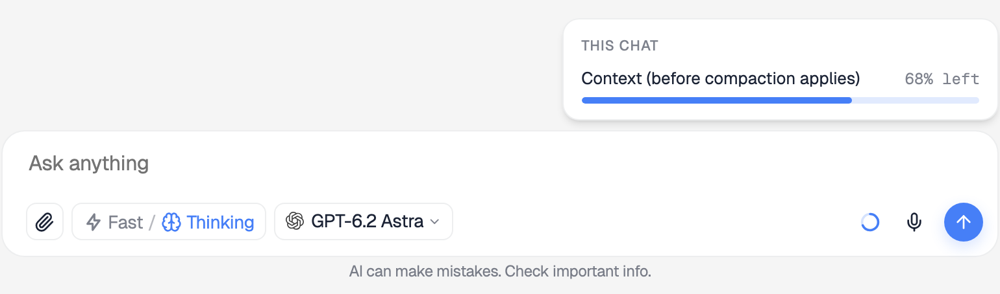
  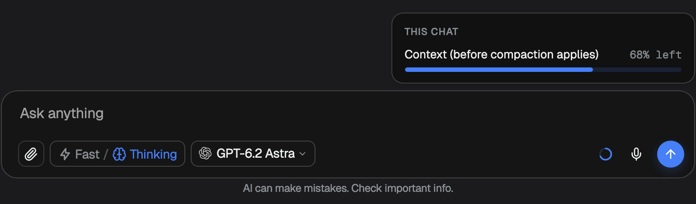
</Frame>

## 개선

- **다시 답변받기**: 이제 답변 사이를 오가면 바로 바뀝니다.
- **이미지 생성**: 이미지를 만들지 못하면 이제 채팅 모델이 다음 답변에서 그 이유를 알려 줍니다.
- **새 채팅**: 이제 새 채팅은 GPT-6 Astra Thinking이나 마지막으로 연 채팅의 모델 대신, 마지막으로 직접 고른 모델로 시작합니다.
- **메시지 입력창**: 휴대폰에서 모델 버튼에 모델 이름이 잘리지 않고 표시되고 입력창이 더 넓어졌습니다. 마이크와 보내기 버튼은 더 작아졌습니다.

## 수정

- **음성 입력**: 받아쓰기가 더 빨라지고 실패가 줄었습니다. 말소리가 없는 녹음에는 오류 대신 다시 녹음하라는 안내가 나옵니다.
- **첨부 파일**: 텍스트를 읽을 수 없는 PDF는 대화가 너무 길다는 안내 대신 파일을 읽을 수 없다고 표시됩니다.
- **긴 채팅**: 이제 긴 채팅이 모델별 컨텍스트 창에 맞춰 요약되므로, 창이 작은 모델이나 중국어·일본어·한국어로 된 긴 채팅도 '대화가 너무 깁니다' 오류로 멈추지 않습니다.
</Update>

<Update label="2026년 11월 11일">
## 다른 모델로 다시 답변받기

최신 답변 아래의 **다시 시도**를 선택하면 새 답변을 받을 수 있습니다. 메뉴 맨 위의 **다시 시도**는 같은 모델을 쓰고, 그 아래에서는 메시지 입력창의 모델 중 하나를 제공사별로 골라 쓸 수 있습니다. 새 답변은 이전 답변 자리를 그대로 대신하며, **2/2** 양옆의 화살표로 답변을 오갈 수 있습니다. 정보 버튼은 화면에 보이는 답변을 어떤 모델이 썼는지 보여 주고, 메시지 입력창도 선택한 모델로 바뀝니다.

답변을 여러 개 남길 수 있는 것은 가장 최근 메시지뿐입니다. 새 메시지를 보내거나 그 메시지를 편집하면 화면에 보이지 않는 답변은 사라집니다. Server Storage, Local Storage, No Storage 모두에서 사용할 수 있습니다. 새 답변은 하나당 메시지 1개로 계산되며, 답변 사이를 오가는 것은 계산되지 않습니다.

<Frame>
  
  
</Frame>

## 긴 채팅에서도 이전 메시지로 바로 이동

긴 채팅에서 보낸 메시지마다 눈금이 채팅 왼쪽에 세로로 표시됩니다. 눈금에 포인터를 올리면 메시지와 답변의 앞부분을 미리 볼 수 있고, 선택하면 아무리 오래된 메시지라도 바로 그곳으로 이동합니다. 키보드에서는 **Tab**으로 눈금에 이동하고 화살표 키로 고른 뒤 **Enter**를 누르세요. 눈금은 웹에서 채팅 옆에 표시할 공간이 있을 때 나타납니다.

<Frame>
  
  
</Frame>

## 개선

- **이미지 생성**: 생성된 이미지가 로드되는 동안에도 크기를 유지해, 이미지가 있는 채팅을 열 때, 답변이 올 때마다, 답변을 오갈 때 화면이 더 이상 밀리지 않습니다.

## 수정

- **메시지 편집**: 메시지를 편집한 뒤 답변을 중지하거나 답변이 실패하면 원래 메시지와 그 답변이 복원됩니다.
- **소식**: 소식에서 **자세히 보기**를 선택해도 더 이상 닫히지 않아, 뒤에 이어지는 소식도 계속 볼 수 있습니다.
</Update>

<Update label="2026년 11월 10일">
## 이미지 편집

이제 Capriole AI에서 이미지를 편집할 수 있습니다. **이미지** 모드에서 클립 아이콘, 붙여넣기 또는 끌어다 놓기로 PNG 또는 JPEG 이미지를 10장까지 첨부한 다음 바꿀 내용을 설명하세요. **@** 기호를 입력하면 `@image1`처럼 이미지를 지정할 수 있습니다. 생성된 이미지에서 **편집**을 선택하면 그 이미지가 메시지 입력창에 다시 들어가 이어서 작업할 수 있습니다.

GPT Image 2.6, GPT Image 2.5, Nano Banana 2.1 모두 이미지를 편집할 수 있으며, Capriole AI는 선택한 모델을 사용합니다. **텍스트** 모드에서는 채팅 모델에게 이미지를 바꿔 달라고 요청할 수도 있습니다. 어떤 이미지 모델을 써야 할지 알 수 없으면 채팅 모델이 물어봅니다. [이미지 생성 가이드 보기](/ko/guides/files-web-search).

화면 비율 메뉴에 두 가지가 추가되었습니다. 새 기본값인 **자동**은 편집하는 이미지의 형태를 유지하고, 새 이미지에서는 모델이 형태를 고릅니다. **21:9**는 가로로 넓은 이미지에 맞는 비율입니다.

<Frame>
  
  
</Frame>

## GPT Image 2.6

<Frame>
  
</Frame>

OpenAI의 GPT Image 2.6을 이제 사용할 수 있습니다. OpenAI의 최신 이미지 모델이자 **이미지** 모드의 기본 모델입니다. GPT Image 2.5와 Nano Banana 2.1은 **이미지** 탭에서 계속 사용할 수 있습니다. 이 탭에서 두 GPT Image 모델은 전체 모델명인 **GPT Image 2.6 Sunburst**와 **GPT Image 2.5 Sunburst**로 표시됩니다. [이미지 생성 가이드 보기](/ko/guides/files-web-search).

<Frame>
  
  
</Frame>

## 계정 관리

**계정**을 열고 **계정 관리**를 선택하면 이름과 사진을 바꾸고, 비밀번호를 설정하고, 로그인된 기기를 확인할 수 있습니다. 무료 계정은 **보안** 탭에서 계정을 삭제할 수도 있습니다. 삭제는 되돌릴 수 없으며, 같은 계정을 쓰는 [Capriole Quant](https://quant.capriole.com/)에도 로그인할 수 없게 됩니다. 유료 플랜 계정을 삭제하려면 [info@capriole.ai](mailto:info@capriole.ai)로 이메일을 보내 주세요.

<Frame>
  
  
</Frame>

## 개선

- **채팅 내보내기**: 내보낸 채팅에서 생성 이미지의 모델 이름이 이제 채팅 화면과 똑같이 표시됩니다.
</Update>

<Update label="2026년 11월 9일">
## Premium 요금

웹에서 신규 Premium을 구독하면 **월 USD 9**입니다. 기존 월 USD 8 구독은 활성 상태를 유지하는 동안 **월 USD 8**로 갱신됩니다. [요금제와 한도 보기](/ko/guides/plans-and-limits).

4월부터 누구나 최첨단 AI를 최대한 합리적인 가격에 이용할 수 있도록 노력해 왔습니다. 이번 가격 조정은 GPT-6 Astra, Fable 5.1, Opus 5.5, Gemini 4 Argon 등 최첨단 모델을 이용한 무제한 웹 채팅을 계속 제공하는 데 도움이 됩니다.

## 채팅 제목과 상태

웹에서 새 텍스트 채팅을 시작하면 첫 메시지를 바탕으로 짧은 제목이 생성됩니다. 브라우저 탭에도 제목이 표시되며, 채팅을 전환하거나 이름을 바꾸면 함께 업데이트됩니다.

**Server Storage**를 사용하면 답변이 생성되는 동안 다른 채팅으로 이동할 수 있습니다. 사이드바의 회전 아이콘은 답변이 생성 중임을 나타냅니다. 파란 점은 아직 보지 않은 답변이 준비되었음을 표시하며, 답변을 보면 사라집니다.

<Frame>
  
  
</Frame>
</Update>

<Update label="2026년 11월 6일">
## 피드백

이제 Capriole AI 안에서 바로 고칠 점과 만들 기능을 알려 주실 수 있습니다. 사이드바 하단에서 이름을 선택한 다음 **리소스** > **피드백**을 선택하세요. **문제**, **기능 요청**, **질문** 중 하나를 고르고 내용을 쓴 뒤, 파일을 5개까지(합계 4MB) 첨부하거나 스크린샷을 붙여 넣으세요. 보낸 내용은 Capriole AI 팀에 바로 전달됩니다. 로그인하지 않았다면 사이드바 하단에서 **리소스** > **피드백**을 선택하고 먼저 로그인하세요.

<Frame>
  
  
</Frame>

## 개선

- **OpenCode**: [OpenCode 가이드](/ko/integrations/opencode)가 이제 버전 1과 함께 OpenCode 2도 다루며, 두 버전 모두에서 테스트했습니다.
- **프로젝트**: 프로젝트에서 새로 시작한 채팅은 이제 인사말 위에 프로젝트 이름을 한 번만 표시합니다.

## 수정

- **채팅**: Claude Opus 5.5, Claude Fable 5.1, Claude Opus 5의 긴 답변이 더 이상 중간에 멈추지 않습니다.
</Update>

<Update label="2026년 11월 5일">
## 수정

- **음성 입력**: 다시 사용할 수 있으며, 주 음성 인식 서비스가 중단되어도 계속 작동합니다.
</Update>

<Update label="2026년 10월 30일">
## 프로젝트 파일과 내보내기

이제 채팅에 필요한 파일을 프로젝트에 넣어 둘 수 있습니다. 프로젝트 페이지에서 새 **파일** 탭을 열고 **파일 추가**를 선택하거나 파일을 탭에 끌어다 놓으세요. 채팅에 첨부할 수 있는 것과 같은 문서와 이미지를 모든 플랜에서 프로젝트당 40개까지 추가할 수 있습니다. 프로젝트의 모든 채팅이 이 파일들을 사용할 수 있으며, 질문에 필요할 때 Capriole AI가 파일을 읽습니다. 프로젝트를 가져가려면 메뉴에서 **내보내기**를 선택하세요. 채팅, 지침, 파일이 담긴 ZIP을 받습니다. **계정** 페이지의 **채팅 기록 내보내기**에도 이제 프로젝트의 지침과 파일이 포함됩니다. [프로젝트 파일 사용 방법 보기](/ko/guides/projects).

<Frame>
  
  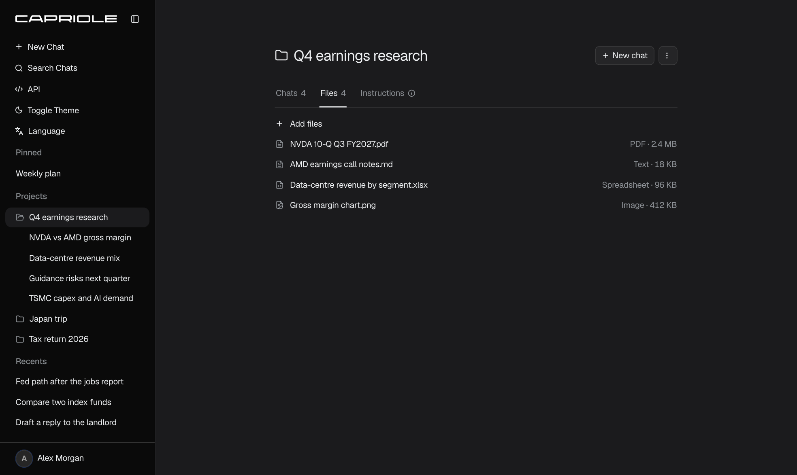
</Frame>

## 개선

- **사이드바**: **고정됨**이 **프로젝트** 위로 옮겨졌고, 프로젝트를 열면 그 아래에 채팅도 표시되며, 목록이 부드럽게 펼쳐지고 접힙니다.
- **테마**: 사이드바의 **라이트**와 **다크**에 **시스템**이 더해졌으며, 기기의 라이트 또는 다크 설정을 따릅니다.
</Update>

<Update label="2026년 10월 29일">
## 프로젝트

이제 관련된 일을 한곳에 모을 수 있습니다. 고객, 강의, 자주 다시 보는 일마다 프로젝트를 만들면 그 채팅이 사이드바의 프로젝트 아래에 모입니다. 프로젝트 지침은 한 번만 쓰면 프로젝트의 모든 채팅이 계정 지침과 함께 따르며, 둘이 충돌하면 프로젝트 지침이 우선합니다. 프로젝트를 만들려면 사이드바에서 **프로젝트**에 포인터를 올리고 **+** 버튼을 선택하세요. 그다음 프로젝트에서 채팅을 시작하거나, 채팅 메뉴에서 또는 프로젝트 위로 드래그해 채팅을 넣으면 됩니다. 프로젝트는 모든 플랜에서 로그인하고 채팅을 서버에 저장하면 사용할 수 있습니다. [프로젝트 사용 방법 보기](/ko/guides/projects).

<Frame>
  
  
</Frame>

## 개선

- **채팅 검색**: 이전 채팅과 프로젝트의 채팅을 포함해 어떤 채팅이든 제목으로 찾습니다.
</Update>

<Update label="2026년 10월 28일">
## 채팅 기록 내보내기

이제 채팅을 언제든 가져갈 수 있습니다. **계정** 페이지의 **설정**에서 **채팅 기록 내보내기**를 선택하면 Capriole AI가 백그라운드에서 ZIP을 준비합니다. 그동안 페이지를 떠나도 되며, 다운로드는 24시간 동안 가능합니다. ZIP에는 채팅마다 Markdown 파일과 첨부한 파일, 생성한 이미지가 들어 있고, 모든 채팅을 프로그램이 읽을 수 있는 형식으로 담은 `conversations.json`도 포함됩니다. 채팅 하나만 내보내려면 사이드바에서 해당 채팅의 메뉴를 열고 **내보내기**를 선택하세요. 로컬에 저장된 채팅은 바로 다운로드됩니다.

<Frame>
  
  
</Frame>

## 개선

- **긴 채팅**: 열면 최신 메시지가 바로 표시됩니다. 위로 스크롤하면 이전 메시지를 불러오며, 읽던 위치는 그대로 유지됩니다.
</Update>

<Update label="2026년 10월 27일">
## 개인화

**계정** 페이지의 새 **개인화** 섹션에서 Capriole AI가 나를 어떻게 부를지, 내 일을 가장 잘 설명하는 항목, 원하는 답변 방식을 알려 줄 수 있습니다. 기존 채팅을 포함한 모든 채팅이 다음 메시지부터 이 설정을 따릅니다. 지침은 최대 1,500자까지 입력할 수 있습니다. 웹 채팅과 앱에 적용되며 API에는 적용되지 않습니다.

<Frame>
  
  
</Frame>

## 로그인 후에도 게스트 채팅이 남습니다

계정 없이 채팅을 시작한 뒤 같은 탭에서 로그인하거나 가입하면, 그 채팅이 계정에 저장된 채팅으로 열립니다. 모든 메시지가 그대로 남고, 다음 답변도 앞서 나눈 대화를 기억합니다. 저장해도 사용량에는 포함되지 않습니다.

<Frame>
  
  
</Frame>

## Kimi K3.1 Pro

Moonshot AI의 Kimi K3.1 Pro를 이제 사용할 수 있습니다. Kimi에서 가장 뛰어난 모델로, 코딩, 3D 제작, 금융 리서치 성능이 크게 향상되었고 1M 토큰 컨텍스트 창을 지원합니다. 웹 채팅에서는 어려운 작업에는 **Kimi K3.1 Pro Thinking**을, 빠른 답변에는 **Kimi K3.1 Pro**를 선택하세요. API에서는 [Chat Completions](/ko/api-reference/endpoint/chat-completions)로 `moonshot/kimi-k3.1-pro`를 호출하세요. [코딩 에이전트 가이드](/ko/integrations/opencode)에도 추가했습니다. Kimi K3는 계속 **더 많은 모델**에서 사용할 수 있습니다.

<Frame>
  
  
</Frame>
</Update>

<Update label="2026년 10월 20일">
## 업데이트 내역 페이지를 열었습니다

Capriole AI의 새 기능, 모델 업데이트, API 변경 사항, 코딩 에이전트 가이드를 이제 이 페이지에 최신순으로 게시합니다. 앱에서 **리소스 > 최신 소식**을 열면 이 페이지로 돌아올 수 있습니다. RSS 피드를 구독하면 업데이트가 공개될 때마다 받아볼 수 있습니다.

<Frame>
  
  
</Frame>

## 채팅이 모델을 기억합니다

저장된 채팅을 열면 Capriole AI가 가장 최근 답변에 사용된 모델을 Fast 또는 Thinking 설정까지 그대로 선택합니다. 새로고침하거나 다시 로그인하거나 다른 기기에서 열어도 선택이 유지됩니다. 해당 모델이 지원 종료된 경우에는 현재 선택이 유지됩니다.

<Frame>
  
  
</Frame>

## 코딩 에이전트 가이드를 다시 검증했습니다

현재 모델로 모든 코딩 에이전트 가이드를 다시 검증하고 [Cline](/ko/integrations/cline), [Qwen Code](/ko/integrations/qwen-code), [Crush](/ko/integrations/crush), [Pi](/ko/integrations/pi) 가이드를 추가했습니다. 이제 [OpenCode](/ko/integrations/opencode)와 [Kilo Code](/ko/integrations/kilo-code)는 provider 하나와 API 키 하나만 있으면 됩니다.

<Frame>
  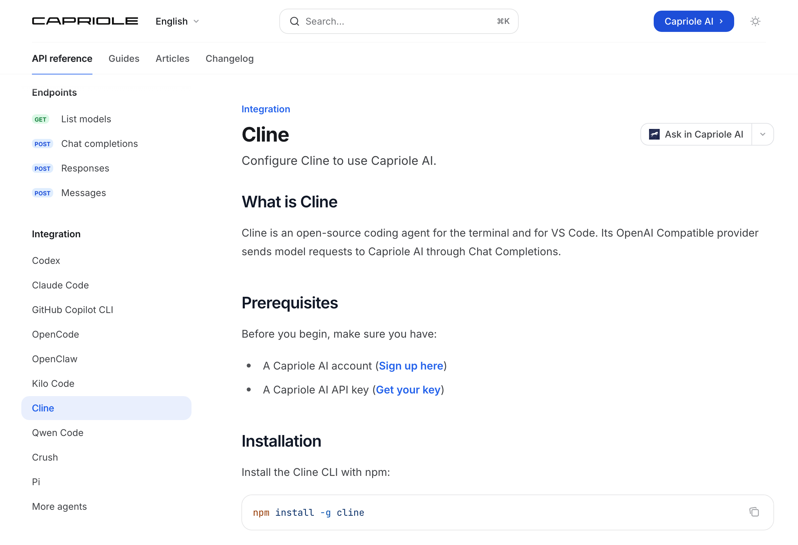
  
</Frame>
</Update>
