<Update label="17 de novembro de 2026">
## Gemini 4 Carbon

<Frame>
  
</Frame>

O Gemini 4 Carbon, o modelo mais poderoso do Google, já está disponível. O Google o criou para tarefas que testam os limites da inteligência de um modelo, como programação e depuração complexas em várias etapas, trabalho agêntico de longo horizonte e raciocínio científico. No chat web, escolha **Gemini 4 Carbon Thinking** no topo do grupo Google do seletor de modelos, ou chame `google/gemini-4-carbon` em [Chat Completions](/pt-br/api-reference/endpoint/chat-completions); `google-latest` agora aponta para o Carbon e, no Chat Completions, você pode [definir o `thinking_level` do Google](/pt-br/guides/choose-a-model#ids-de-modelo-para-a-api) como `low` para chamadas mais leves. O Gemini 4 Argon continua disponível como **Gemini 4 Argon Thinking** no chat web e como `google/gemini-4-argon` na API.

<Frame>
  
</Frame>

## Seedream 5.5

<Frame>
  
</Frame>

O Seedream 5.5, da ByteDance Seed, já está disponível no modo **Imagem**. Segundo a ByteDance Seed, ele faz [alterações precisas e pontuais ao longo de várias edições, mantendo intactas as áreas não editadas](https://seed.bytedance.com/en/seedream5_5), com iluminação mais natural, materiais mais finos e texturas de pele mais refinadas. Escolha **Seedream 5.5** em **ByteDance**, na aba **Imagem** do seletor de modelos, para criar imagens ou editar as que você anexar, em 1K ou 2K e em qualquer proporção, incluindo **Auto**. Como os outros modelos de imagem, ele é gratuito para contas com login que usam **Server Storage**. O GPT Image 2.6 continua sendo o padrão. No modo **Texto**, o Text Agent usa o modelo de imagem que você indicar; se você não indicar nenhum, o modelo da imagem mais recente do chat; e, se não houver nenhuma, o GPT Image 2.6. Ele não pergunta mais qual usar. [Veja o guia de geração de imagens](/pt-br/guides/files-web-search).

<Frame>
  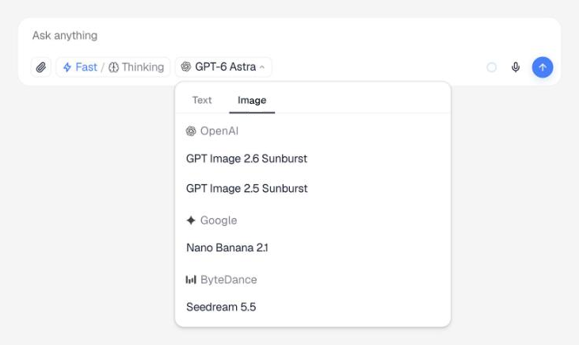
</Frame>
</Update>

<Update label="16 de novembro de 2026">
## Enviar com Ctrl/⌘ + Enter

Agora o Enter também pode começar uma nova linha no computador. Na sua página **Conta**, em **Configurações**, ative **Enviar com Ctrl/⌘ + Enter**. Assim o Enter começa uma nova linha, e Ctrl+Enter (⌘+Enter no Mac) envia. A configuração fica salva na sua conta, então vale em qualquer computador.

<Frame>
  
</Frame>

## Veja o título completo dos chats

Passe o ponteiro sobre um chat da barra lateral com o título cortado, e o título inteiro aparece ao lado da barra lateral. Assim você encontra o chat certo sem abri-lo.

<Frame>
  
</Frame>

## Melhorias

- **Caixa de mensagem no celular**: O Enter agora começa uma nova linha, e o botão Enviar envia. Uma mensagem longa rola dentro de uma caixa mais baixa, então o chat continua visível acima do teclado.

## Correções

- **Chat**: A seta que leva à última mensagem não cobre mais o que você está digitando quando a caixa de mensagem fica alta.
</Update>

<Update label="12 de novembro de 2026">
## Veja seu uso de relance

Um pequeno anel na caixa de mensagem mostra quanto do contexto deste chat ainda resta. Selecione-o para ver as mensagens e as imagens de hoje, quando elas reiniciam no seu horário local e, no plano Free, a franquia deste mês. Quando suas mensagens ou imagens estiverem acabando ou já tiverem acabado, aparece um aviso acima da caixa de mensagem.

O chat web com login tem limites de uso justo de 200 mensagens e 30 imagens por conta por dia (UTC), bem acima do uso normal, para impedir abusos automatizados. [Confira os planos e limites](/pt-br/guides/plans-and-limits#o-que-significa-ilimitado).

Na página **Conta**, em **Configurações**, desative **Mostrar uso** para esconder o anel, e em **As barras de uso mostram** escolha se as barras indicam **Restante** ou **Usado**.

<Frame>
  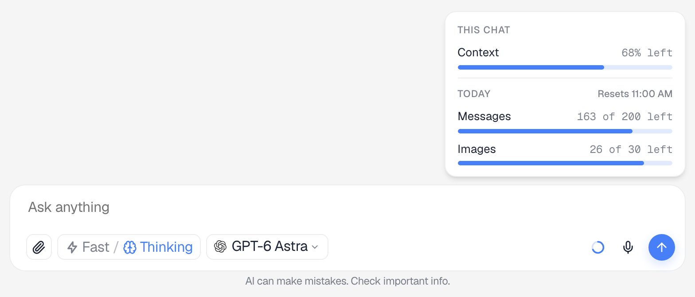
  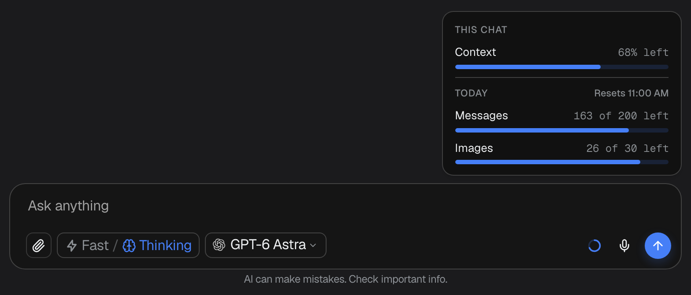
</Frame>

## Melhorias

- **Nova resposta**: Alternar entre as respostas agora é instantâneo.
- **Geração de imagens**: Quando não é possível criar uma imagem, o modelo de chat agora explica o motivo na próxima resposta, e as imagens que o modelo de imagem recusa não contam mais para as suas 30 por dia.
- **Novos chats**: Um novo chat agora começa com o último modelo que você escolheu, em vez do GPT-6 Astra Thinking ou do modelo do último chat que você abriu.
- **Caixa de mensagem**: No celular, o botão do modelo agora mostra o nome do modelo em vez de cortá-lo e a caixa de mensagem ficou mais larga; os botões de microfone e Enviar ficaram menores.

## Correções

- **Entrada de voz**: A transcrição está mais rápida e falha menos. Se uma gravação não tiver fala, agora ela pede que você grave novamente em vez de mostrar um erro.
- **Anexos**: Um PDF cujo texto não pode ser extraído agora informa que o arquivo não pode ser lido, em vez de dizer que a conversa está longa demais.
- **Chats longos**: Os chats longos agora são resumidos no ponto certo para a janela de contexto de cada modelo, então modelos com janelas menores e chats longos em chinês, japonês ou coreano não param mais com o erro “conversa longa demais”.
</Update>

<Update label="11 de novembro de 2026">
## Peça nova resposta a outro modelo

Selecione **Tentar novamente** abaixo da última resposta para receber uma nova. No menu, **Tentar novamente**, no topo, usa o mesmo modelo, e logo abaixo você pode escolher qualquer modelo da caixa de mensagem, agrupado por provedor. A nova resposta substitui a anterior no mesmo lugar, e as setas ao lado de **2/2** alternam entre as respostas. O botão de informações mostra qual modelo escreveu a resposta na tela, e a caixa de mensagem passa para o modelo que você escolheu.

Só a sua última mensagem guarda mais de uma resposta: ao enviar uma nova mensagem ou editar a sua mensagem, as respostas que não estão na tela são descartadas. Funciona com Server Storage, Local Storage e No Storage. Cada nova resposta conta como uma mensagem enviada, e alternar entre as respostas é grátis.

<Frame>
  
  
</Frame>

## Volte atrás em conversas longas

Conversas longas agora têm uma marca para cada mensagem que você enviou, em uma coluna à esquerda do chat. Passe o ponteiro por uma marca para ver a mensagem e o início da resposta, e selecione-a para ir direto até ela, por mais atrás que esteja. Com o teclado, pressione **Tab** para chegar às marcas, use as setas e pressione **Enter**. As marcas aparecem na web quando a janela tem espaço para elas ao lado do chat.

<Frame>
  
  
</Frame>

## Melhorias

- **Geração de imagens**: As imagens geradas mantêm o tamanho enquanto carregam, então um chat com imagens não pula mais quando você o abre, depois de cada resposta ou quando você alterna entre respostas.

## Correções

- **Edição de mensagens**: Se você parar a resposta depois de editar uma mensagem, ou se a resposta falhar, sua mensagem original e a resposta dela voltam.
- **Novidades**: Selecionar **Saiba mais** em uma novidade não a fecha mais, então as novidades seguintes continuam disponíveis.
</Update>

<Update label="10 de novembro de 2026">
## Edite imagens

Agora você pode editar imagens na Capriole AI. No modo **Imagem**, anexe até 10 imagens PNG ou JPEG pelo clipe, colando ou arrastando, e descreva a alteração. Digite **@** para se referir a uma imagem, como `@image1`. Selecione **Editar** em uma imagem gerada para colocá-la de volta na caixa de mensagem e continuar trabalhando nela.

Tanto o GPT Image 2.6 quanto o GPT Image 2.5 e o Nano Banana 2.1 editam imagens, e a Capriole AI usa o modelo que você selecionou. No modo **Texto**, você também pode pedir ao modelo de chat que altere uma imagem; quando não consegue saber qual modelo de imagem usar, ele pergunta a você. [Veja o guia de geração de imagens](/pt-br/guides/files-web-search).

O menu de proporção tem duas novidades. **Auto**, o novo padrão, mantém o formato da imagem que você edita e deixa o modelo escolher o formato de uma imagem nova. **21:9** serve para imagens largas. Cada imagem editada conta para o seu limite diário de imagens.

<Frame>
  
  
</Frame>

## GPT Image 2.6

<Frame>
  
</Frame>

O GPT Image 2.6 da OpenAI já está disponível. É o modelo de imagem mais recente da OpenAI e o padrão no modo **Imagem**. O GPT Image 2.5 e o Nano Banana 2.1 continuam disponíveis na aba **Imagem**. A aba mostra os dois modelos GPT Image com o nome completo: **GPT Image 2.6 Sunburst** e **GPT Image 2.5 Sunburst**. [Veja o guia de geração de imagens](/pt-br/guides/files-web-search).

<Frame>
  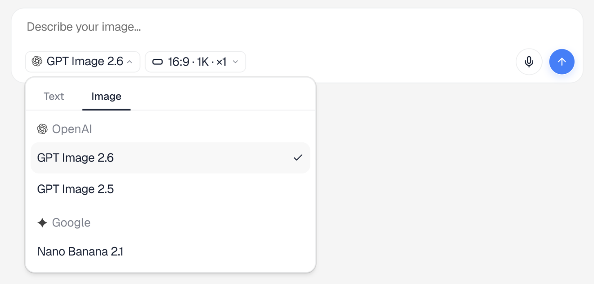
  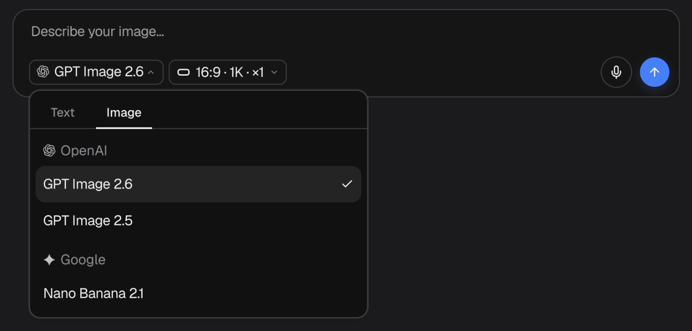
</Frame>

## Gerencie sua conta

Abra **Conta** e selecione **Gerenciar conta** para atualizar seu nome e sua foto, definir uma senha e ver os dispositivos em que você está conectado. Na aba **Segurança**, contas gratuitas também podem excluir a própria conta. A exclusão é permanente e também remove seu acesso ao [Capriole Quant](https://quant.capriole.com/), porque os dois usam a mesma conta. Para excluir uma conta com plano pago, envie um e-mail para [info@capriole.ai](mailto:info@capriole.ai).

<Frame>
  
  
</Frame>

## Melhorias

- **Exportação de chats**: Um chat exportado agora mostra, para cada imagem gerada, o mesmo nome de modelo que o próprio chat.
</Update>

<Update label="9 de novembro de 2026">
## Preço do Premium

Novas assinaturas do Premium pela web custam **USD 9 por mês**. Assinaturas existentes de USD 8 continuam sendo renovadas por **USD 8 por mês** enquanto permanecerem ativas. [Confira os planos e limites](/pt-br/guides/plans-and-limits).

Desde abril, trabalhamos para tornar a IA de ponta o mais acessível possível para todos. Esse ajuste de preço nos ajuda a continuar oferecendo chat web ilimitado com GPT-6 Astra, Fable 5.1, Opus 5.5, Gemini 4 Argon e outros modelos de ponta.

## Títulos e status dos chats

Novos chats de texto na web recebem um título curto com base na sua primeira mensagem. A aba do navegador mostra o título e é atualizada quando você troca de chat ou muda seu nome.

Com **Server Storage**, você pode trocar de chat enquanto uma resposta é gerada. Um indicador giratório na barra lateral mostra que a resposta está em andamento. Um ponto azul indica uma resposta pronta que você ainda não viu e desaparece quando você a visualiza.

<Frame>
  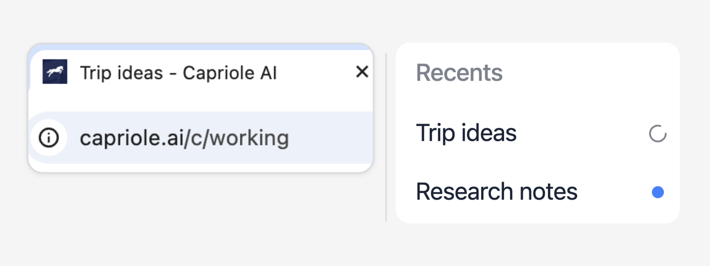
  
</Frame>
</Update>

<Update label="6 de novembro de 2026">
## Feedback

Diga o que devemos corrigir ou criar sem sair da Capriole AI. Selecione seu nome na parte inferior da barra lateral e depois **Recursos** > **Feedback**. Escolha **Problema**, **Sugestão** ou **Dúvida**, escreva o que você tem em mente e anexe até 5 arquivos (4 MB no total) ou cole uma captura de tela. Sua mensagem vai direto para a equipe da Capriole AI. Se você ainda não fez login, selecione **Recursos** > **Feedback** na parte inferior da barra lateral e entre primeiro.

<Frame>
  
  
</Frame>

## Melhorias

- **OpenCode**: O [guia do OpenCode](/pt-br/integrations/opencode) agora cobre o OpenCode 2 além da versão 1, e testamos com as duas.
- **Projetos**: Um novo chat em um projeto mostra o nome do projeto uma única vez, acima da saudação.

## Correções

- **Chat**: Respostas longas do Claude Opus 5.5, do Claude Fable 5.1 e do Claude Opus 5 não param mais no meio.
</Update>

<Update label="5 de novembro de 2026">
## Correções

- **Entrada de voz**: Voltou a funcionar e continua funcionando mesmo quando nosso principal provedor de voz para texto está fora do ar.
</Update>

<Update label="30 de outubro de 2026">
## Arquivos e exportação em projetos

Dê a um projeto os arquivos de que os chats dele precisam. Na página do projeto, abra a nova aba **Arquivos** e selecione **Adicionar arquivos**, ou solte arquivos na aba. Você pode adicionar os mesmos documentos e imagens aceitos como anexos no chat, até 40 por projeto em todos os planos. Todos os chats do projeto podem usá-los: a Capriole AI lê um arquivo quando a sua pergunta precisa dele. Para levar um projeto com você, abra o menu dele e escolha **Exportar**: você recebe um ZIP com os chats, as instruções e os arquivos dele. **Exportar histórico de chats**, na página **Conta**, agora também inclui as instruções e os arquivos dos seus projetos. [Saiba como usar arquivos de projeto](/pt-br/guides/projects).

<Frame>
  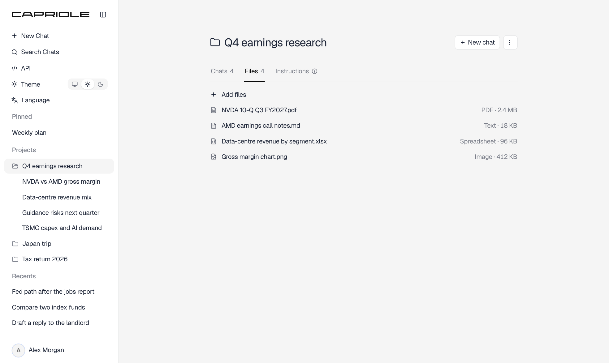
  
</Frame>

## Melhorias

- **Barra lateral**: **Fixados** agora vem antes de **Projetos**, abrir um projeto também mostra os chats dele logo abaixo, e as listas abrem e fecham com suavidade.
- **Tema**: **Sistema** se junta a **Claro** e **Escuro** na barra lateral e segue o modo claro ou escuro do seu dispositivo.
</Update>

<Update label="29 de outubro de 2026">
## Projetos

Mantenha juntos os trabalhos relacionados. Crie um projeto para um cliente, um curso ou qualquer coisa à qual você volte, e os chats ficam abaixo dele na barra lateral. Escreva as instruções do projeto uma vez, e cada chat do projeto passa a segui-las, além das instruções da sua conta; se as duas entrarem em conflito, prevalecem as do projeto. Para criar um projeto, passe o ponteiro sobre **Projetos** na barra lateral e selecione **+**. Depois, comece um chat nele ou mova um chat pelo menu do chat ou arrastando-o até o projeto. Os projetos estão disponíveis em todos os planos para usuários com login que guardam os chats no servidor. [Saiba como usar projetos](/pt-br/guides/projects).

<Frame>
  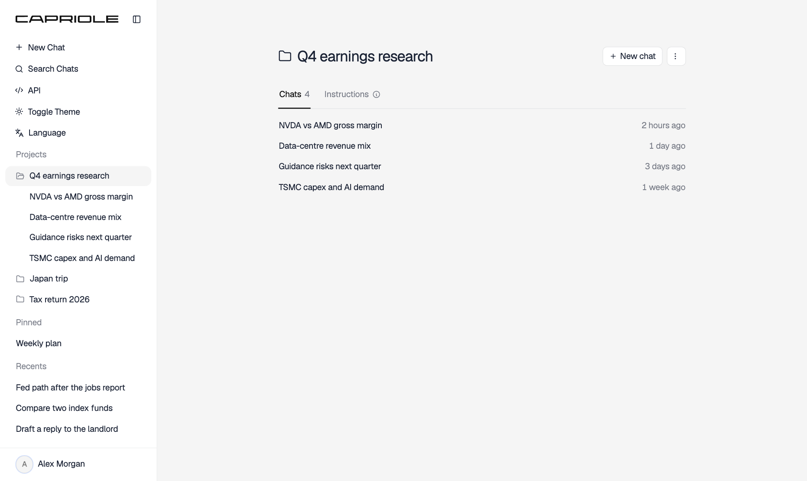
  
</Frame>

## Melhorias

- **Buscar chats**: encontra qualquer chat pelo título, inclusive chats mais antigos e chats em projetos.
</Update>

<Update label="28 de outubro de 2026">
## Exporte seu histórico de chats

Leve seus chats com você. Na página **Conta**, em **Configurações**, escolha **Exportar histórico de chats**. A Capriole AI prepara um ZIP em segundo plano, então você pode sair da página enquanto isso, e o download fica disponível por 24 horas. O ZIP traz cada chat como arquivo Markdown, junto com os arquivos que você anexou e as imagens que gerou, além do `conversations.json`, com todos os chats em um formato que programas conseguem ler. Para exportar um único chat, abra o menu dele na barra lateral e escolha **Exportar**. Chats guardados no armazenamento local são baixados na hora.

<Frame>
  
  
</Frame>

## Melhorias

- **Chats longos**: abrem mostrando na hora as mensagens mais recentes. As mensagens anteriores carregam conforme você rola para cima, e o que você está lendo não sai do lugar.
</Update>

<Update label="27 de outubro de 2026">
## Personalização

Diga à Capriole AI como chamar você, o que melhor descreve seu trabalho e como você prefere as respostas, na nova seção **Personalização** da página **Conta**. Todos os chats seguem essas informações a partir da sua próxima mensagem, inclusive os que você já tem. As instruções aceitam até 1,500 caracteres. Elas valem para o chat web e o app, não para a API.

<Frame>
  
  
</Frame>

## Chats de visitante continuam depois do login

Comece um chat sem conta e depois faça login ou crie uma conta na mesma aba. O chat abre como um chat salvo na sua conta, com todas as mensagens, e a próxima resposta lembra o que você perguntou antes. Salvar o chat não conta no seu uso.

<Frame>
  
  
</Frame>

## Kimi K3.1 Pro

O Kimi K3.1 Pro, da Moonshot AI, já está disponível. É o modelo mais capaz do Kimi, com ganhos expressivos em programação, criação 3D e pesquisa financeira, e uma janela de contexto de 1M de tokens. No chat web, escolha **Kimi K3.1 Pro Thinking** para tarefas mais difíceis ou **Kimi K3.1 Pro** para respostas mais rápidas. Pela API, chame `moonshot/kimi-k3.1-pro` em [Chat Completions](/pt-br/api-reference/endpoint/chat-completions); os [guias de agentes de programação](/pt-br/integrations/opencode) também o incluem. O Kimi K3 continua disponível em **Mais modelos**.

<Frame>
  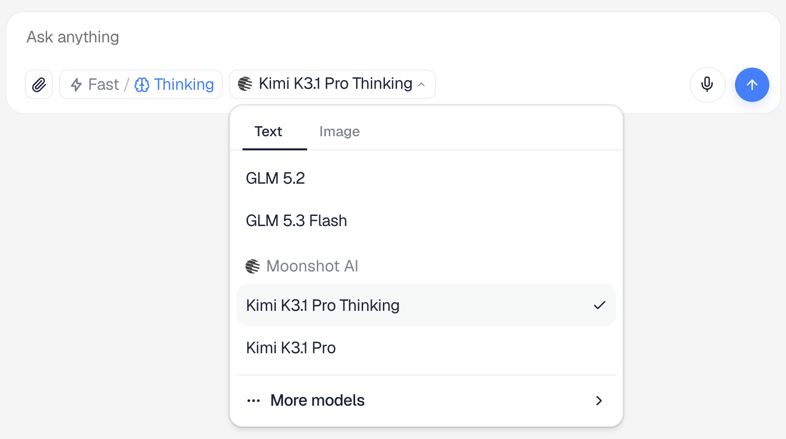
  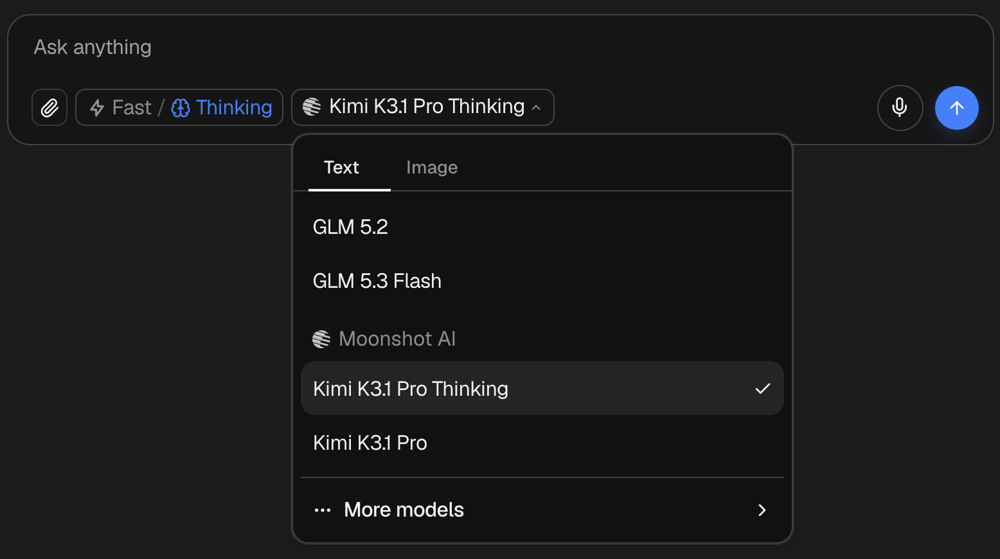
</Frame>
</Update>

<Update label="20 de outubro de 2026">
## O registro de alterações está no ar

Novos recursos, atualizações de modelos, mudanças na API e guias de agentes de programação da Capriole AI agora aparecem nesta página, do mais recente para o mais antigo. No app, abra **Recursos > Última novidade** para voltar aqui. Assine o feed RSS para receber cada atualização assim que ela for lançada.

<Frame>
  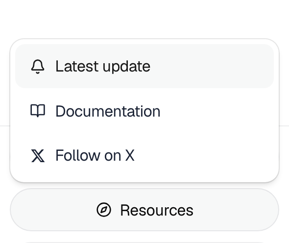
  
</Frame>

## Os chats lembram o modelo

Ao abrir um chat salvo, a Capriole AI seleciona o modelo da última resposta, incluindo a configuração Fast ou Thinking. A escolha continua depois de recarregar a página, entrar de novo ou usar outro dispositivo. Se esse modelo tiver sido descontinuado, sua seleção atual continua.

<Frame>
  
  
</Frame>

## Guias de agentes de programação testados de novo

Testamos de novo todos os guias de agentes de programação com os modelos atuais e adicionamos guias para [Cline](/pt-br/integrations/cline), [Qwen Code](/pt-br/integrations/qwen-code), [Crush](/pt-br/integrations/crush) e [Pi](/pt-br/integrations/pi). [OpenCode](/pt-br/integrations/opencode) e [Kilo Code](/pt-br/integrations/kilo-code) agora precisam de apenas um provedor e uma chave de API.

<Frame>
  
  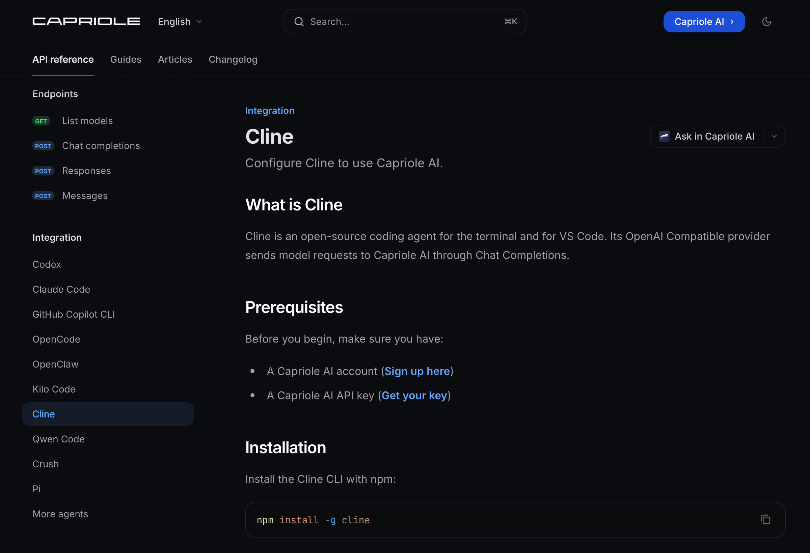
</Frame>
</Update>
