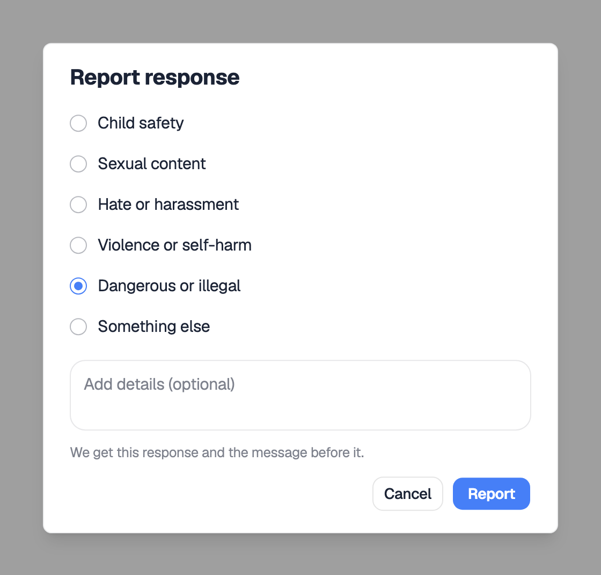
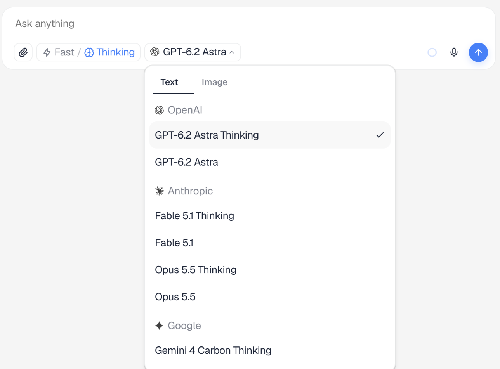
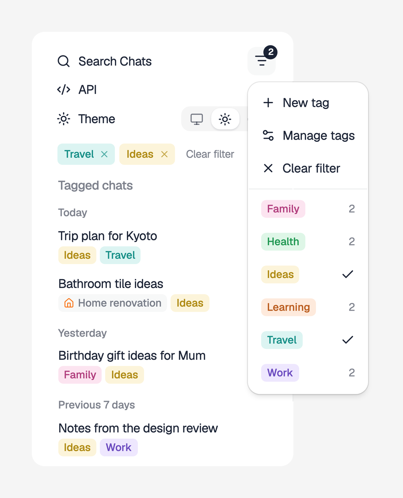
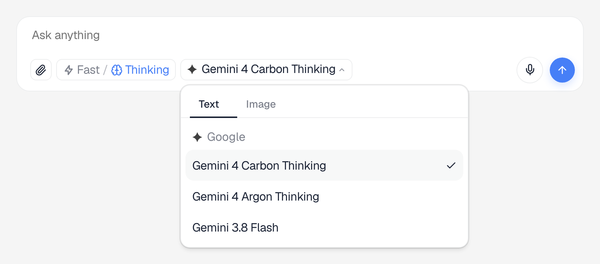
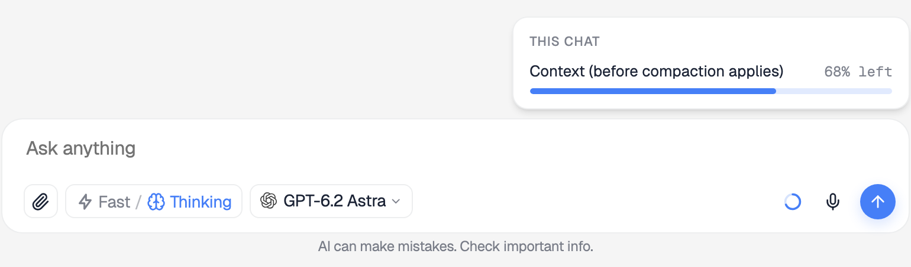
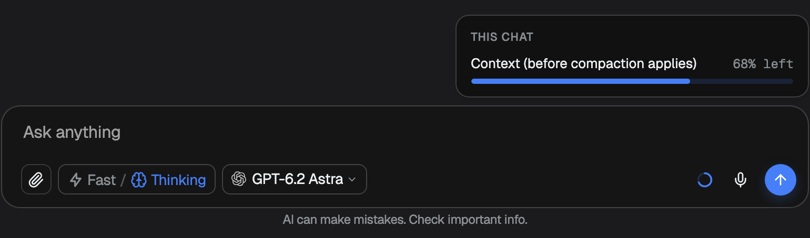
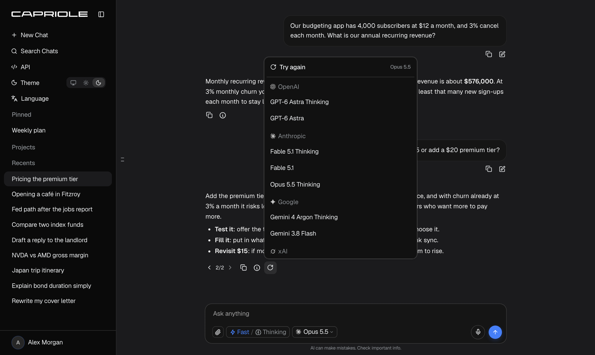
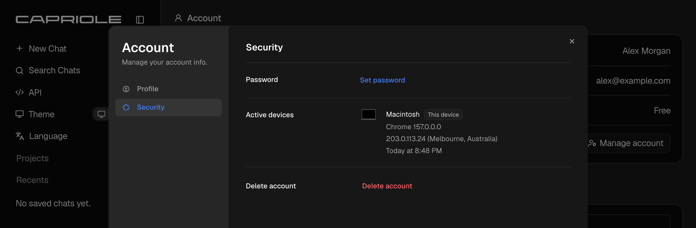
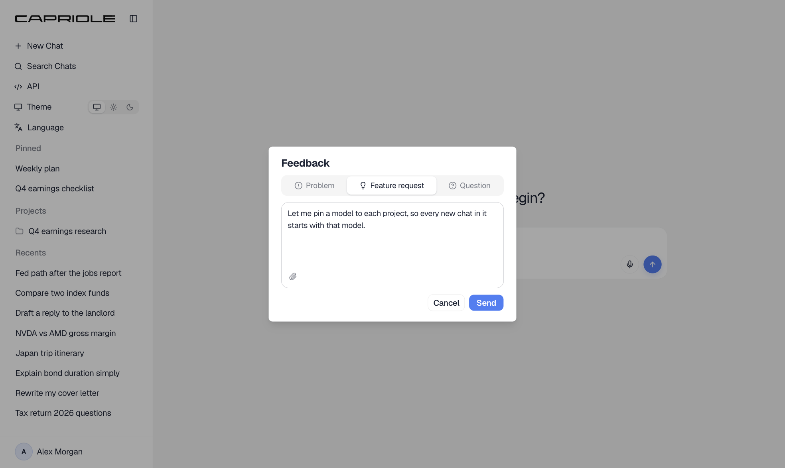
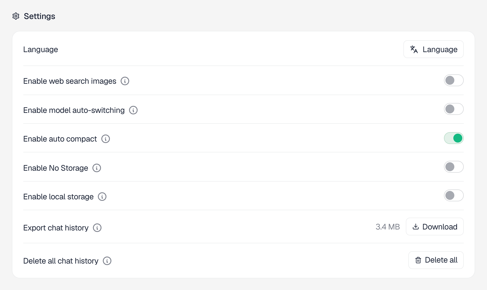

<Update label="2026 年 11 月 20 日">
## GPT-5.5

Capriole AI 已停止支持 GPT-5.5。请改用 GPT-6.2 Astra 或 GPT-6.2 Sol。API 调用请使用 `openai-latest` 或 `openai/gpt-6.2-astra`。

## 举报回答

每条回答下面现在多了一面旗子。觉得某条回答有害时，点它举报：选一个原因，可以补充说明；有图片的回答还可以勾选要举报的图片。我们会收到这条回答和它前面的那条消息，每条举报都会查看。对话照常继续，不登录也能举报文字回答。

<Frame>
  
</Frame>

## 改进

- **生图**：只有图片的回答现在也有 **复制图片**：一张图直接复制，几张图时可以选。在触屏上，图片的 **…** 菜单也有 **复制图片**。

</Update>

<Update label="2026 年 11 月 18 日">
## GPT-6.2 Astra 和 Sol

<Frame>
  
</Frame>

GPT-6.2 Astra 是 OpenAI 新的旗舰模型，取代 GPT-6 Astra；GPT-6.2 Sol 取代 GPT-6.1 Sol，成为 OpenAI 的日常模型。[OpenAI 称](https://openai.com/index/introducing-gpt-6-2-astra-sol/) Astra 是“我们面向你最艰巨项目的全新前沿模型”，Sol 是“我们高效、多用途的日常工作模型”。

在网页聊天的模型菜单中，GPT-6.2 Astra 现在位于 OpenAI 分组最上面，提供 **Thinking** 和 **Fast**；访客和新账户默认使用 **GPT-6.2 Astra Thinking**。GPT-6.2 Sol 同样提供 **Thinking** 和 **Fast**，在 **更多模型** 中排在 OpenAI 模型的第一位，GPT-6 Astra 和 GPT-6.1 Sol 也继续在那里提供。在 API 上，可以在 [Responses](/zh/api-reference/endpoint/responses) 或 [Chat Completions](/zh/api-reference/endpoint/chat-completions) 上调用 `openai/gpt-6.2-astra` 或 `openai/gpt-6.2-sol`；`openai-latest` 现在指向 GPT-6.2 Astra。OpenAI 的 API 价格为：Astra 每 100 万 token 输入 USD 8、输出 USD 40，比 GPT-6 Astra 低 20%；Sol 输入 USD 2、输出 USD 10，与 GPT-6.1 Sol 相同。[选择模型](/zh/guides/choose-a-model)将它们与其他旗舰模型做了对比。

<Frame>
  
</Frame>

## 给对话加标签

在侧栏中打开对话的菜单，选择 **标签**，就能给对话加上一个或多个彩色标签，标签显示在标题下方。**搜索对话** 旁边的筛选按钮会列出 **最近** 和所有项目中带有任一所选标签的对话；在 **搜索对话** 中也可以选择标签，只在带这些标签的对话中搜索。已登录并使用 **Server Storage** 的账户可以使用标签。[了解如何使用标签](/zh/guides/projects#给对话加标签)。

<Frame>
  
</Frame>

## 改进

- **侧栏**：一屏能显示更多对话，**最近** 按日期分组，浏览器还会记住你展开了哪些区块和项目。
- **语言**：登录后，语言设置从侧栏移到了 **账户** → **设置** 中。
- **项目**：现在每个项目都可以有自己的颜色和图标，在创建或编辑项目时设置。选择项目名称会展开或收起它的对话，在它的三点菜单中选择 **管理项目** 可打开项目页。
- **重新回答**：最新的回答失败时，它下方现在也会显示 **重试**，可以用同一个模型或换一个模型重新发送你的消息。

## 修复

- **对话标题**：新对话的标题会概括第一句的主题，并用你提问的语言，不再直接回答它。
- **附件**：部分浏览器上传的 Markdown 文件，现在 GPT 模型也能正常读取。
- **图片生成**：在开始生成图片时停止回复不再报错。
</Update>

<Update label="2026 年 11 月 17 日">
## Gemini 4 Carbon

<Frame>
  
</Frame>

Google 的 Gemini 4 Carbon 现已上线。这是 Google 最强的模型，适合考验模型智能极限的任务，例如复杂的多步骤编程和调试、长周期智能体任务和科学推理。在网页聊天的模型菜单中，选择 Google 分组最上面的 **Gemini 4 Carbon Thinking**；或在 [Chat Completions](/zh/api-reference/endpoint/chat-completions) 上调用 `google/gemini-4-carbon`。`google-latest` 现在指向 Carbon；在 Chat Completions 上，如需更轻量的调用，可以把 [Google 的 `thinking_level`](/zh/guides/choose-a-model#api-模型-id) 设为 `low`。Gemini 4 Argon 仍可使用：网页聊天中为 **Gemini 4 Argon Thinking**，API 上为 `google/gemini-4-argon`。

<Frame>
  
</Frame>

## Seedream 5.5

<Frame>
  
</Frame>

字节跳动 Seed 团队的 Seedream 5.5 现已在 **图片** 模式上线。据字节跳动 Seed 介绍，它能[在多轮编辑中精准修改指定内容，同时保持未编辑的区域不变](https://seed.bytedance.com/en/seedream5_5)，光影更自然，材质更精细，肤质也更细腻。在模型菜单的 **图片** 标签页中，选择 **ByteDance** 分组下的 **Seedream 5.5**，即可生成新图片或编辑你添加的图片，分辨率为 1K 或 2K，支持包括 **自动** 在内的所有比例。和其他图像模型一样，已登录并使用 **Server Storage** 的账户可以免费使用。默认模型仍是 GPT Image 2.6。在 **文本** 模式中，Text Agent 会用你点名的图像模型；没有点名时，用对话中最新一张图片的模型；对话里还没有图片时，用 GPT Image 2.6，不再询问你用哪个。[查看生图指南](/zh/guides/files-web-search)。

<Frame>
  
</Frame>

## 改进

- **长对话**：优化了 GPT-6 Astra 的上下文压缩，更快、更高效。

## 修复

- **对话**：Claude 模型现在能处理图片更多的消息。
- **Gemini**：回答更稳定。
- **图片模式**：网页上，生成图片时侧栏会显示进度；你离开时生成完成，对话会显示未读蓝点。
</Update>

<Update label="2026 年 11 月 16 日">
## 用 Ctrl/⌘ + Enter 发送

现在电脑上也能让回车换行。在**账户**页的**设置**里打开**用 Ctrl/⌘ + Enter 发送**，之后回车换行，按 Ctrl+Enter（Mac 上是 ⌘+Enter）发送。这个设置存在你的账户里，换台电脑也一样。

<Frame>
  
</Frame>

## 看完整的对话标题

侧栏里的对话标题显示不全时，把鼠标移到上面，完整标题就会显示在侧栏旁边，不用打开对话也能找到想要的那一个。

<Frame>
  
</Frame>

## 改进

- **手机上的输入框**：回车现在换行，点发送按钮才发送；消息写长了会在更矮的输入框里滚动，键盘上方还能看到对话。

## 修复

- **对话**：回到最新消息的箭头按钮，不再挡住你在变高的输入框里正在写的内容。
</Update>

<Update label="2026 年 11 月 12 日">
## 用量一目了然

输入框里的小圆环显示本对话还剩多少上下文。点一下可以查看详情；Free 账户还能看到本月额度。

在 **账户** 页的 **设置** 里，关闭 **显示用量** 即可隐藏圆环；**用量条显示** 可以让用量条在 **剩余** 和 **已用** 之间切换。

<Frame>
  
  
</Frame>

## 改进

- **重新回答**：现在可以在几个回答之间即时切换。
- **生图**：图片没能生成时，聊天模型会在下一条回复里告诉你原因。
- **新对话**：新对话现在用你上次手动选的模型，不再固定为 GPT-6 Astra Thinking，也不会沿用刚打开的旧对话的模型。
- **输入框**：手机上模型按钮能完整显示模型名，不再被截断，输入框也更宽；麦克风和发送按钮更小巧。

## 修复

- **语音输入**：转写更快，也更少失败；没有录到语音时会提示你重新录制，不再显示错误。
- **附件**：读不出文字的 PDF 现在会提示无法读取这个文件，不再误报对话太长。
- **长对话**：长对话现在按每个模型的上下文窗口在合适的时候自动总结，窗口较小的模型和很长的中文、日文、韩文对话不会再因“对话过长”报错而中断。
</Update>

<Update label="2026 年 11 月 11 日">
## 换个模型重新回答

在最新回答下方点 **重试**，就能得到一个新回答。菜单顶部的 **重试** 沿用同一个模型，下面可以从输入框的模型列表里另选一个，按提供商分组。新回答会在原处替换旧回答，**2/2** 两侧的箭头可以在几个回答之间切换。信息按钮会显示当前回答由哪个模型生成，输入框也会切换到你选的模型。

只有最新一条消息会保留多个回答：发送新消息或编辑这条消息后，未显示的回答会被丢弃。Server Storage、Local Storage 和 No Storage 都支持。每个新回答按发送一条消息计算，在回答之间切换不计数。

<Frame>
  
  
</Frame>

## 长对话里直接跳回之前的消息

长对话的左侧现在有一列刻度，你发的每条消息对应一条。把鼠标移到刻度上，可以预览那条消息和回答的开头；点一下就直接跳过去，再早的消息也一样。用键盘时，按 **Tab** 移到刻度上，用方向键选择，再按 **Enter**。网页版在对话旁边有足够空间时显示刻度。

<Frame>
  
  
</Frame>

## 改进

- **生图**：生成的图片在加载时就保持原有尺寸，打开带图片的对话、每次回复之后或在回答之间切换时，页面不再跳动。

## 修复

- **编辑消息**：编辑消息后停止回复，或者回复失败时，原来的消息和它的回答会恢复。
- **公告**：点公告里的 **了解更多** 不会再关闭公告，后面的公告也能接着看。
</Update>

<Update label="2026 年 11 月 10 日">
## 编辑图片

现在可以在 Capriole AI 里编辑图片了。在 **图片** 模式下，通过回形针按钮、粘贴或拖入，最多可以附上 10 张 PNG 或 JPEG 图片，然后描述要怎么改。输入 **@** 可以指定某张图片，例如 `@image1`。在生成的图片上选择 **编辑**，图片会回到输入框，可以接着改。

GPT Image 2.6、GPT Image 2.5 和 Nano Banana 2.1 都能编辑图片，Capriole AI 使用你选中的模型。在 **文本** 模式下，也可以让聊天模型修改图片；它判断不出该用哪个图像模型时，会先问你。[查看生图指南](/zh/guides/files-web-search)。

比例菜单新增两项。**Auto** 是新的默认选项：编辑时保持原图的形状，生成新图时由模型决定形状。**21:9** 适合宽幅图片。

<Frame>
  
  
</Frame>

## GPT Image 2.6

<Frame>
  
</Frame>

OpenAI 的 GPT Image 2.6 现已上线。它是 OpenAI 最新的图像模型，也是 **图片** 模式的默认模型。GPT Image 2.5 和 Nano Banana 2.1 仍可在 **图片** 标签页里选用。标签页里的两个 GPT Image 模型显示完整型号：**GPT Image 2.6 Sunburst** 和 **GPT Image 2.5 Sunburst**。[查看生图指南](/zh/guides/files-web-search)。

<Frame>
  
  
</Frame>

## 管理账号

打开**账户**，选择**管理账号**，可以修改姓名和头像、设置密码、查看已登录的设备。免费账号还可以在**安全**页删除自己的账号。删除后无法恢复，[Capriole Quant](https://quant.capriole.com/) 也会无法登录，因为两个产品共用同一个账号。付费账号如需删除，请发邮件到 [info@capriole.ai](mailto:info@capriole.ai)。

<Frame>
  
  
</Frame>

## 改进

- **导出对话**：导出的对话里，生成图片的模型名称现在和对话里显示的一致。
</Update>

<Update label="2026 年 11 月 9 日">
## Premium 订阅价格

新开通的 Premium 网页订阅为**每月 USD 9**。已有的 USD 8 订阅只要保持有效，续费仍是**每月 USD 8**。[查看方案与用量限制](/zh/guides/plans-and-limits)。

自 4 月以来，我们一直努力让每个人都能以尽可能实惠的价格使用前沿 AI。这次调价有助于我们继续提供无限网页聊天，支持 GPT-6 Astra、Fable 5.1、Opus 5.5、Gemini 4 Argon 等前沿模型。

## 对话标题与对话状态

网页端会根据第一条消息，为新的文字对话生成简短标题。浏览器标签页会显示对话名，切换对话或重命名时会同步更新。

使用 **Server Storage** 时，生成回复期间也可以切换对话。侧栏的转圈表示回复仍在生成，蓝点表示有一条已完成的回复还没看。看到回复后，蓝点会消失。

<Frame>
  
  
</Frame>
</Update>

<Update label="2026 年 11 月 6 日">
## 反馈

告诉我们该修什么、做什么，在 Capriole AI 里就能直接说。在侧栏底部选择你的名字，再选择 **资源** > **反馈**。选择 **遇到问题**、**功能建议** 或 **咨询**，写下你的想法，还可以添加最多 5 个附件（合计 4 MB）或直接粘贴截图。反馈会直接送到 Capriole AI 团队。未登录时，在侧栏底部选择 **资源** > **反馈**，先登录即可。

<Frame>
  
  
</Frame>

## 改进

- **OpenCode**: [OpenCode 指南](/zh/integrations/opencode)现在除了版本 1，也介绍 OpenCode 2 的配置，两个版本我们都已实测。
- **项目**: 在项目中新建的对话只在问候语上方显示一次项目名称。

## 修复

- **对话**：Claude Opus 5.5、Claude Fable 5.1 和 Claude Opus 5 的长回答不会再中途停止。
</Update>

<Update label="2026 年 11 月 5 日">
## 修复

- **语音输入**：恢复可用；主要的语音转文字服务出故障时也能继续使用。
</Update>

<Update label="2026 年 10 月 30 日">
## 项目文件和导出

把对话要用的文件放进项目。在项目页上打开新的 **文件** 标签，选择 **添加文件**，或把文件拖到这个标签上：可以添加的文档和图片与对话附件相同，每个项目最多 40 个，所有方案都一样。项目中的每个对话都能使用这些文件：问题需要时，Capriole AI 会读取相应的文件。要把项目带走，打开它的菜单，选择 **导出**，就能得到包含它的对话、指令和文件的 ZIP。**账户** 页的 **导出聊天历史** 现在也包含你的项目指令和文件。[了解如何使用项目文件](/zh/guides/projects)。

<Frame>
  
  
</Frame>

## 改进

- **侧栏**：**已置顶** 移到了 **项目** 上方，打开项目时会同时列出它的对话，列表的展开和收起更顺滑。
- **主题**：侧栏在 **浅色** 和 **深色** 之外新增了 **系统**，它会跟随设备的浅色或深色设置。
</Update>

<Update label="2026 年 10 月 29 日">
## 项目

相关的工作现在可以放在一起。为一位客户、一门课程或任何需要反复处理的事建一个项目，它的对话就归在侧栏中的项目下。项目指令只需写一次，项目里的每个对话都会照做，并叠加在你的账户指令之上；两者冲突时，以项目指令为准。要创建项目，在侧栏中把指针移到 **项目** 上，选择 **+**。之后可以在项目中开始对话，也可以从对话菜单把对话移进来，或直接把它拖到项目上。所有方案都能使用项目，只需登录并把对话保存在服务器上。[了解如何使用项目](/zh/guides/projects)。

<Frame>
  
  
</Frame>

## 改进

- **搜索对话**：按标题找出任何对话，包括较早的对话和项目中的对话。
</Update>

<Update label="2026 年 10 月 28 日">
## 导出聊天历史

你的对话可以随时带走。在 **账户** 页的 **设置** 里选择 **导出聊天历史**，Capriole AI 会在后台准备一个 ZIP，期间可以离开页面，准备好后 24 小时内都能下载。ZIP 里每个对话是一个 Markdown 文件，旁边附带你上传的文件和生成的图片；另有一个 `conversations.json`，用程序能读取的格式存着全部对话。只导出一个对话时，在侧栏打开它的菜单，选择 **导出**。存在本地的对话会立即下载。

<Frame>
  
  
</Frame>

## 改进

- **长对话**：打开时立即显示最新的消息。往上滚动时再加载更早的消息，正在看的内容不会跳动。
</Update>

<Update label="2026 年 10 月 27 日">
## 个性化设置

在 **账户** 页新增的 **个性化** 区块里，告诉 Capriole AI 怎么称呼你、哪一项最符合你的工作、你希望它怎样回答。从你的下一条消息开始，所有对话都会照做，包括已有的对话。指令最多 1,500 个字符。这些设置适用于网页聊天和 App，不适用于 API。

<Frame>
  
  
</Frame>

## 登录后保留访客聊天

不登录也可以先开始聊天。之后在同一个标签页登录或注册，这段聊天会作为已保存的对话出现在你的账户里，消息一条不少，接下来的回复也记得你之前问过什么。保存这段聊天不计入你的用量。

<Frame>
  
  
</Frame>

## Kimi K3.1 Pro

Moonshot AI 的 Kimi K3.1 Pro 现已上线。这是 Kimi 最强的模型，在编程、3D 创作和金融研究方面都有大幅提升，并支持 1M token 的上下文窗口。在网页聊天中，处理更难的任务时选择 **Kimi K3.1 Pro Thinking**，需要更快回复时选择 **Kimi K3.1 Pro**。通过 API，可在 [Chat Completions](/zh/api-reference/endpoint/chat-completions) 上调用 `moonshot/kimi-k3.1-pro`；[编程智能体指南](/zh/integrations/opencode)也已收录该模型。Kimi K3 仍可在 **更多模型** 中使用。

<Frame>
  
  
</Frame>
</Update>

<Update label="2026 年 10 月 20 日">
## 更新日志上线

Capriole AI 的新功能、模型更新、API 变更和编程智能体指南，今后都会按时间倒序记录在这一页。在应用中打开 **资源 > 最新动态** 即可回到这里。订阅 RSS，每次更新上线时都能收到。

<Frame>
  
  
</Frame>

## 对话会记住自己的模型

打开一个已保存的对话时，Capriole AI 会自动选中它最近一条回复所用的模型，包括 Fast 或 Thinking 设置。刷新页面、重新登录或换一台设备，选择都会保留。如果那个模型已经下线，则保持你当前的选择。

<Frame>
  
  
</Frame>

## 编程智能体指南全部重新测试

我们用当前的模型重新测试了所有编程智能体指南，并新增了 [Cline](/zh/integrations/cline)、[Qwen Code](/zh/integrations/qwen-code)、[Crush](/zh/integrations/crush) 和 [Pi](/zh/integrations/pi) 的指南。[OpenCode](/zh/integrations/opencode) 和 [Kilo Code](/zh/integrations/kilo-code) 现在只需要一个 provider 和一个 API Key。

<Frame>
  
  
</Frame>
</Update>
