<Update label="2026 年 11 月 10 日">
## 编辑图片

现在可以在 Capriole AI 里编辑图片了。在 **Image** 模式下，通过回形针按钮、粘贴或拖入，最多可以附上 10 张 PNG 或 JPEG 图片，然后描述要怎么改。输入 **@** 可以指定某张图片，例如 `@image1`。在生成的图片上选择 **Edit**，图片会回到输入框，可以接着改。

GPT Image 2.6、GPT Image 2.5 和 Nano Banana 2.1 都能编辑图片，Capriole AI 使用你选中的模型。在 **Text** 模式下，也可以让聊天模型修改图片；它判断不出该用哪个图像模型时，会先问你。[查看生图指南](/zh/guides/files-web-search)。

比例菜单新增两项。**Auto** 是新的默认选项：编辑时保持原图的形状，生成新图时由模型决定形状。**21:9** 适合宽幅图片。每张编辑出的图片都计入每日图片上限。

<Frame>
  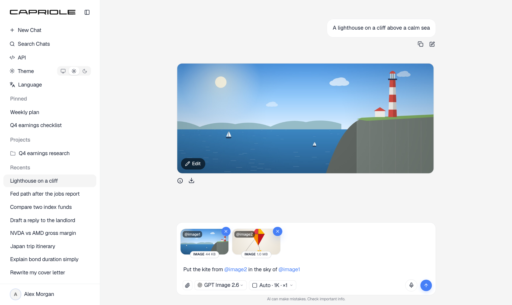
  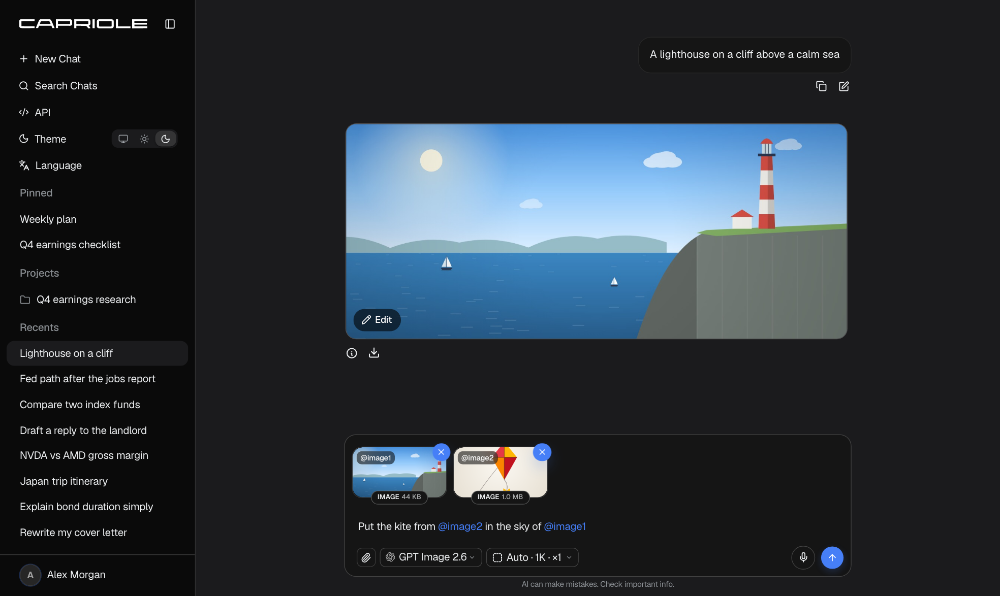
</Frame>

## GPT Image 2.6

OpenAI 的 GPT Image 2.6 现已上线。它是 OpenAI 最新的图像模型，也是 **Image** 模式的默认模型。GPT Image 2.5 和 Nano Banana 2.1 仍可在 **Image** 标签页里选用。标签页里的两个 GPT Image 模型显示完整型号：**GPT Image 2.6 Sunburst** 和 **GPT Image 2.5 Sunburst**。[查看生图指南](/zh/guides/files-web-search)。

<Frame>
  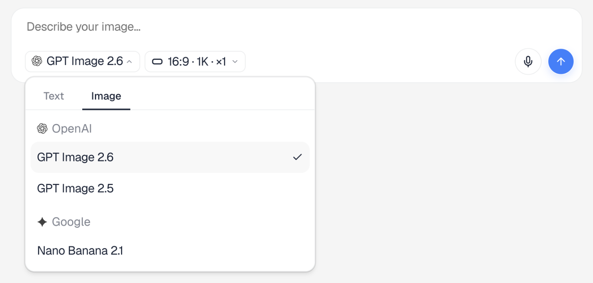
  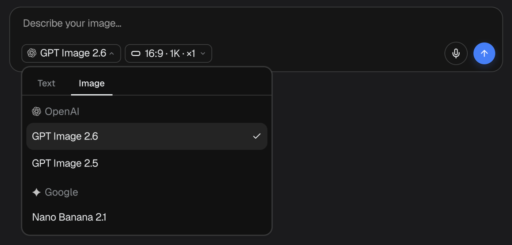
</Frame>

## 管理账号

打开**账户**，选择**管理账号**，可以修改姓名和头像、设置密码、查看已登录的设备。免费账号还可以在**安全**页删除自己的账号。删除后无法恢复，[Capriole Quant](https://quant.capriole.com/) 也会无法登录，因为两个产品共用同一个账号。付费账号如需删除，请发邮件到 [info@capriole.ai](mailto:info@capriole.ai)。

<Frame>
  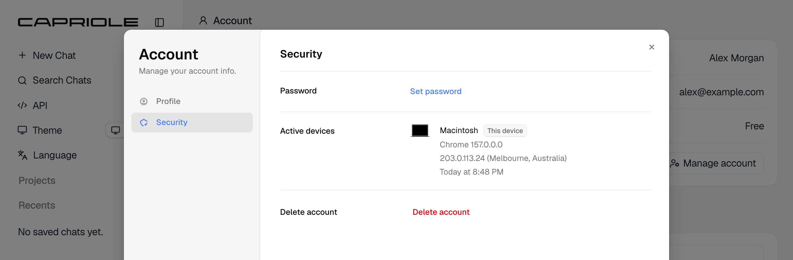
  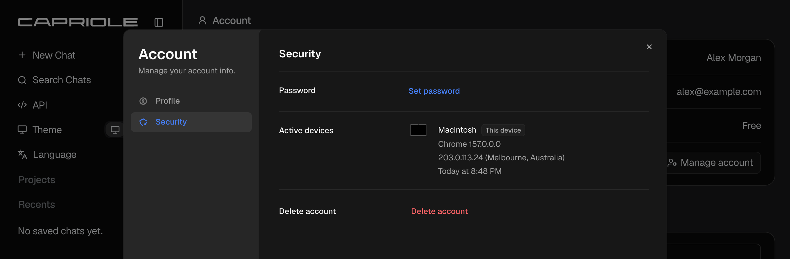
</Frame>

## 改进

- **导出对话**：导出的对话里，生成图片的模型名称现在和对话里显示的一致。
</Update>

<Update label="2026 年 11 月 9 日">
## Premium 订阅价格

新开通的 Premium 网页订阅为**每月 USD 9**。已有的 USD 8 订阅只要保持有效，续费仍是**每月 USD 8**。 [查看套餐与用量限制](/zh/guides/plans-and-limits).

自 4 月以来，我们一直努力让每个人都能以尽可能实惠的价格使用前沿 AI。这次调价有助于我们继续提供无限网页聊天，支持 GPT-6 Astra、Fable 5.1、Opus 5.5、Gemini 4 Argon 等前沿模型。

## 对话标题与对话状态

网页端会根据第一条消息，为新的文字对话生成简短标题。浏览器标签页会显示对话名，切换对话或重命名时会同步更新。

使用 **Server Storage** 时，生成回复期间也可以切换对话。侧栏的转圈表示回复仍在生成，蓝点表示有一条已完成的回复还没看。看到回复后，蓝点会消失。

<Frame>
  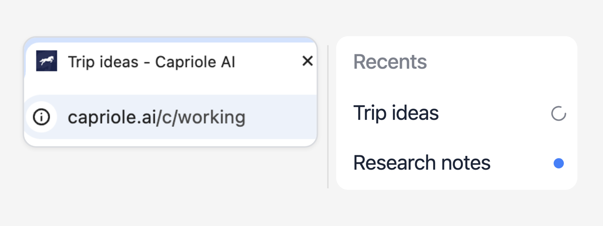
  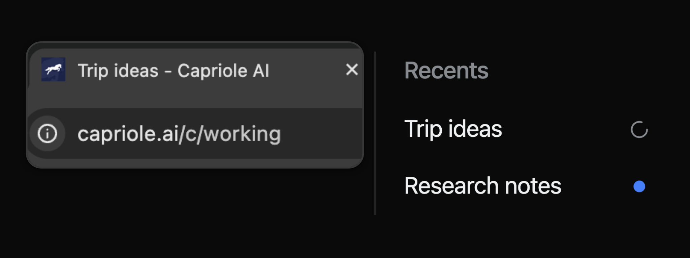
</Frame>
</Update>

<Update label="2026 年 11 月 6 日">
## 反馈

告诉我们该修什么、做什么，在 Capriole AI 里就能直接说。在侧栏底部选择你的名字，再选择 **资源** > **反馈**。选择 **遇到问题**、**功能建议** 或 **咨询**，写下你的想法，还可以添加最多 5 个附件（合计 4 MB）或直接粘贴截图。反馈会直接送到 Capriole AI 团队。未登录时，在侧栏底部选择 **资源** > **反馈**，先登录即可。

<Frame>
  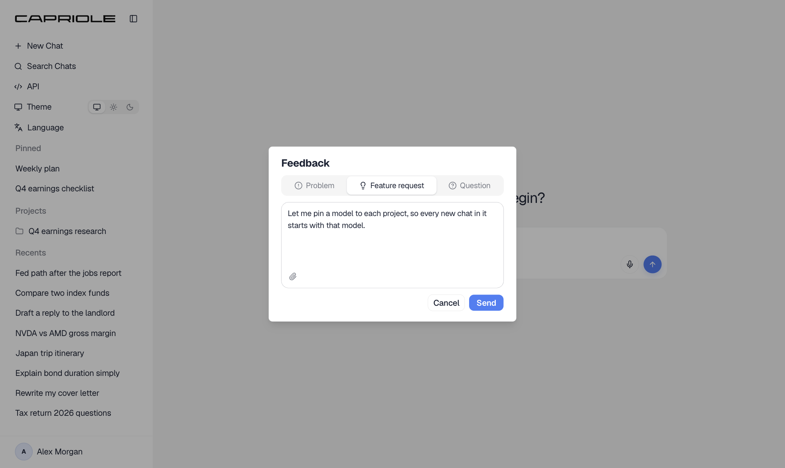
  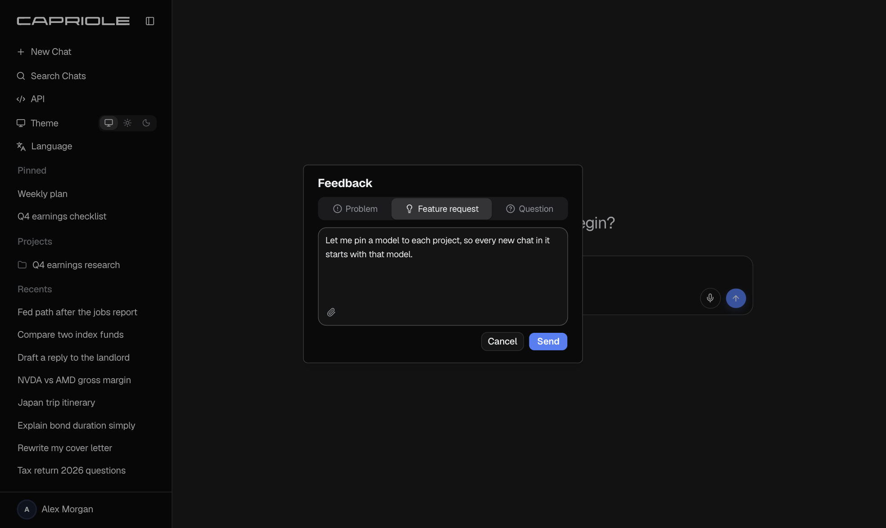
</Frame>

## 改进

- **OpenCode**: [OpenCode 指南](/zh/integrations/opencode)现在除了版本 1，也介绍 OpenCode 2 的配置，两个版本我们都已实测。
- **项目**: 在项目中新建的对话只在问候语上方显示一次项目名称。

## 修复

- **对话**：Claude Opus 5.5、Claude Fable 5.1 和 Claude Opus 5 的长回答不会再中途停止。
</Update>

<Update label="2026 年 11 月 5 日">
## 修复

- **语音输入**：恢复可用；主要的语音转文字服务出故障时也能继续使用。
</Update>

<Update label="2026 年 10 月 30 日">
## 项目文件和导出

把对话要用的文件放进项目。在项目页上打开新的 **文件** 标签，选择 **添加文件**，或把文件拖到这个标签上：可以添加的文档和图片与对话附件相同，每个项目最多 40 个，所有方案都一样。项目中的每个对话都能使用这些文件：问题需要时，Capriole AI 会读取相应的文件。要把项目带走，打开它的菜单，选择 **导出**，就能得到包含它的对话、指令和文件的 ZIP。**账户** 页的 **导出聊天历史** 现在也包含你的项目指令和文件。[了解如何使用项目文件](/zh/guides/projects)。

<Frame>
  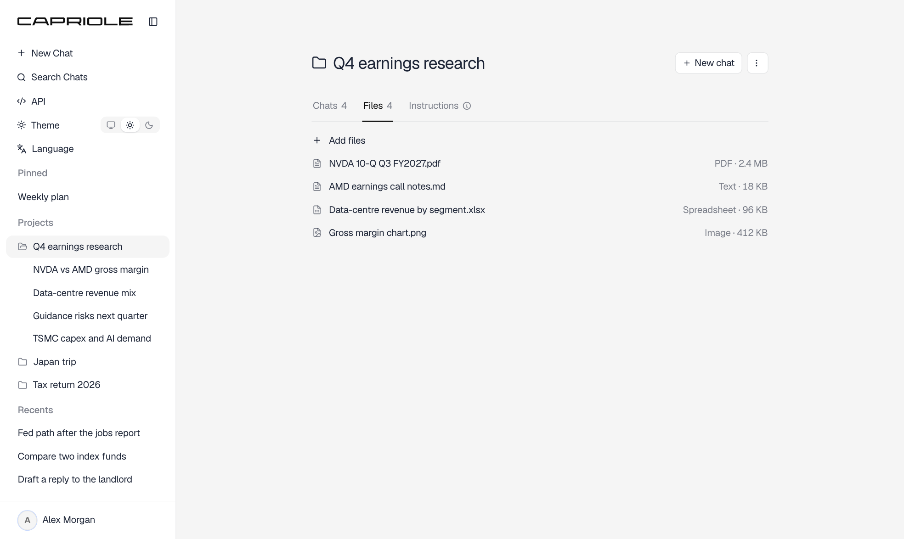
  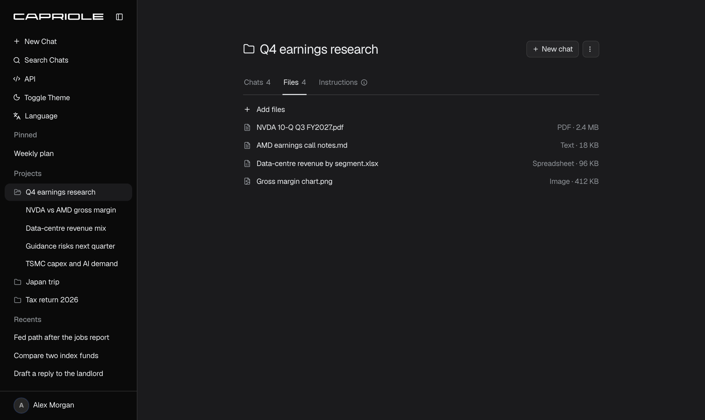
</Frame>

## 改进

- **侧栏**：**已置顶** 移到了 **项目** 上方，打开项目时会同时列出它的对话，列表的展开和收起更顺滑。
- **主题**：侧栏在 **浅色** 和 **深色** 之外新增了 **系统**，它会跟随设备的浅色或深色设置。
</Update>

<Update label="2026 年 10 月 29 日">
## 项目

相关的工作现在可以放在一起。为一位客户、一门课程或任何需要反复处理的事建一个项目，它的对话就归在侧栏中的项目下。项目指令只需写一次，项目里的每个对话都会照做，并叠加在你的账户指令之上；两者冲突时，以项目指令为准。要创建项目，在侧栏中把指针移到 **项目** 上，选择 **+**。之后可以在项目中开始对话，也可以从对话菜单把对话移进来，或直接把它拖到项目上。所有方案都能使用项目，只需登录并把对话保存在服务器上。[了解如何使用项目](/zh/guides/projects)。

<Frame>
  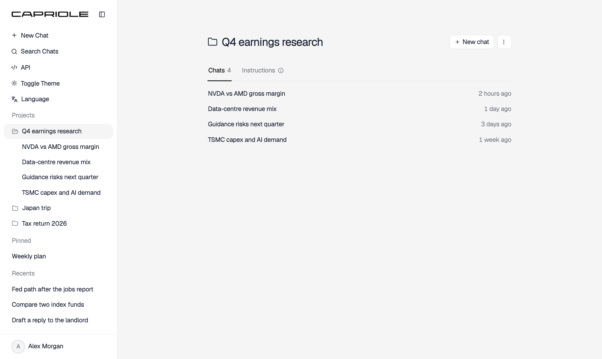
  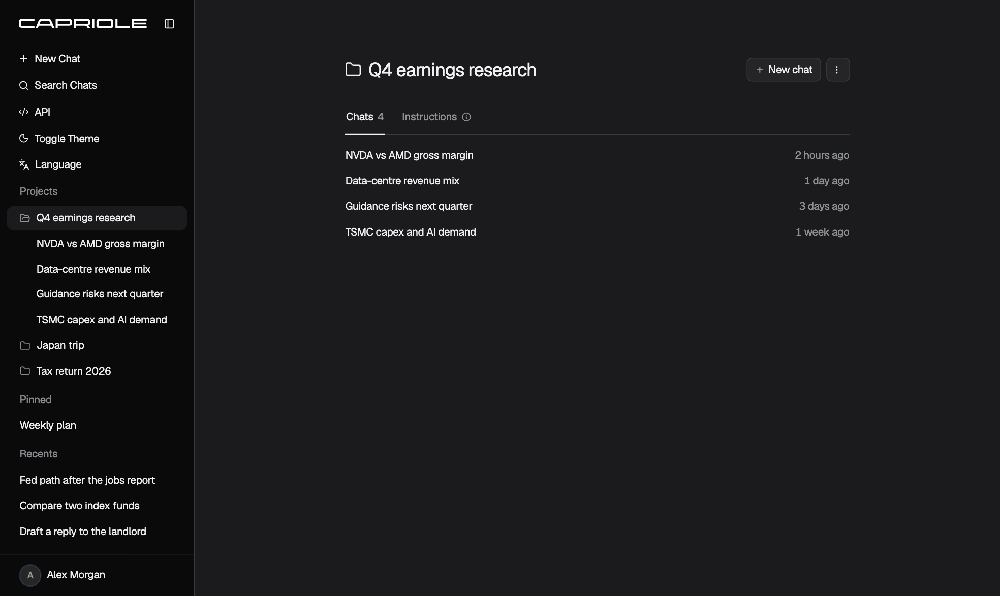
</Frame>

## 改进

- **搜索对话**：按标题找出任何对话，包括较早的对话和项目中的对话。
</Update>

<Update label="2026 年 10 月 28 日">
## 导出聊天历史

你的对话可以随时带走。在 **账户** 页的 **设置** 里选择 **导出聊天历史**，Capriole AI 会在后台准备一个 ZIP，期间可以离开页面，准备好后 24 小时内都能下载。ZIP 里每个对话是一个 Markdown 文件，旁边附带你上传的文件和生成的图片；另有一个 `conversations.json`，用程序能读取的格式存着全部对话。只导出一个对话时，在侧栏打开它的菜单，选择 **导出**。存在本地的对话会立即下载。

<Frame>
  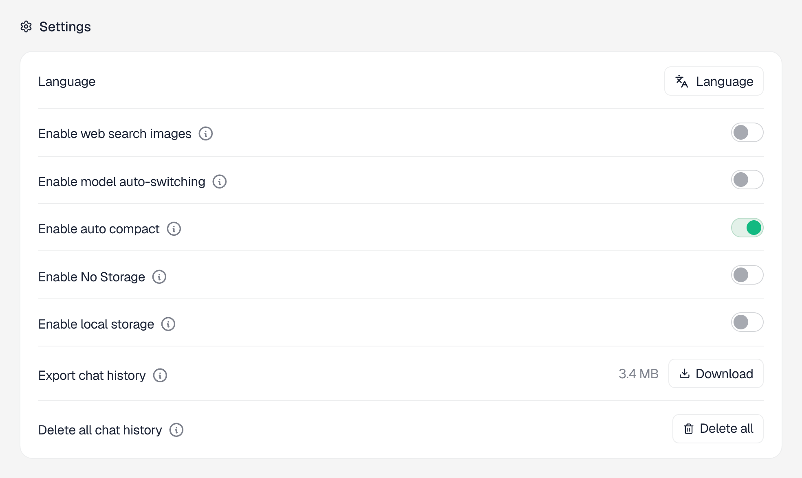
  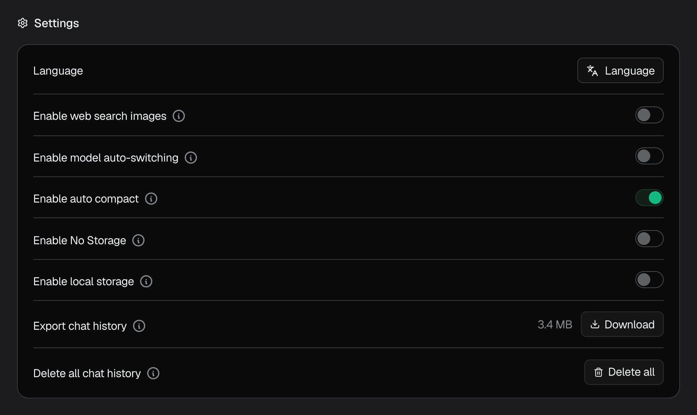
</Frame>

## 改进

- **长对话**：打开时立即显示最新的消息。往上滚动时再加载更早的消息，正在看的内容不会跳动。
</Update>

<Update label="2026 年 10 月 27 日">
## 个性化设置

在 **账户** 页新增的 **个性化** 区块里，告诉 Capriole AI 怎么称呼你、哪一项最符合你的工作、你希望它怎样回答。从你的下一条消息开始，所有对话都会照做，包括已有的对话。指令最多 1,500 个字符。这些设置适用于网页聊天和 App，不适用于 API。

<Frame>
  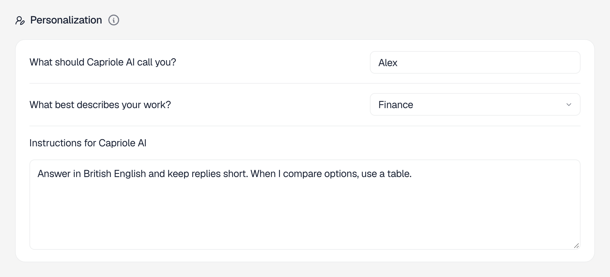
  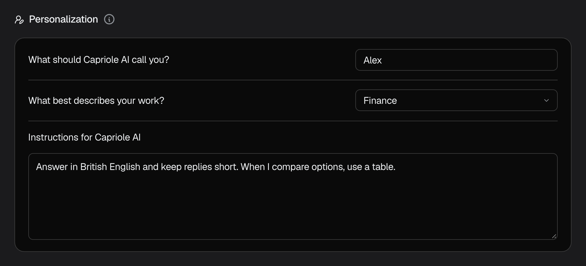
</Frame>

## 登录后保留访客聊天

不登录也可以先开始聊天。之后在同一个标签页登录或注册，这段聊天会作为已保存的对话出现在你的账户里，消息一条不少，接下来的回复也记得你之前问过什么。保存这段聊天不计入你的用量。

<Frame>
  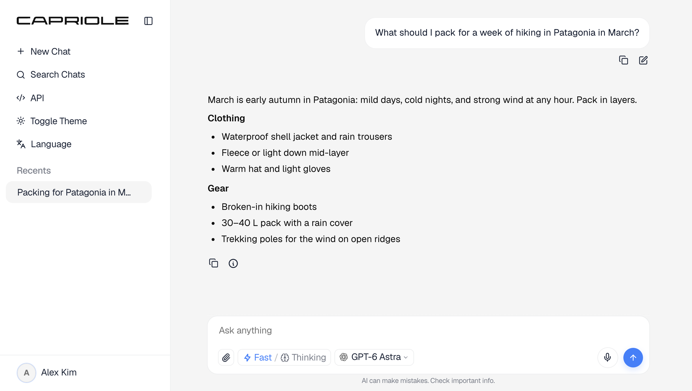
  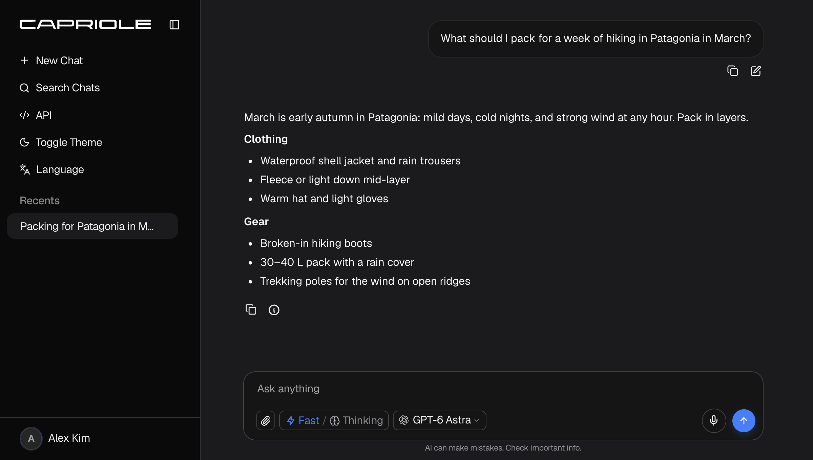
</Frame>

## Kimi K3.1 Pro

Moonshot AI 的 Kimi K3.1 Pro 现已上线。这是 Kimi 最强的模型，在编程、3D 创作和金融研究方面都有大幅提升，并支持 1M token 的上下文窗口。在网页聊天中，处理更难的任务时选择 **Kimi K3.1 Pro Thinking**，需要更快回复时选择 **Kimi K3.1 Pro**。通过 API，可在 [Chat Completions](/zh/api-reference/endpoint/chat-completions) 上调用 `moonshot/kimi-k3.1-pro`；[编程智能体指南](/zh/integrations/opencode)也已收录该模型。Kimi K3 仍可在 **更多模型** 中使用。

<Frame>
  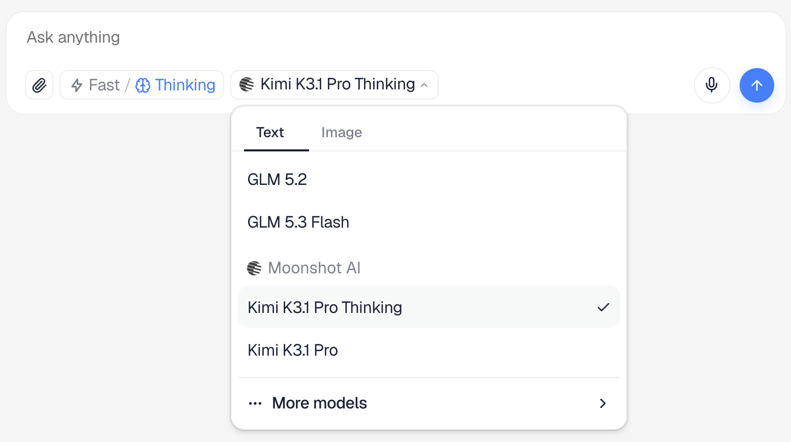
  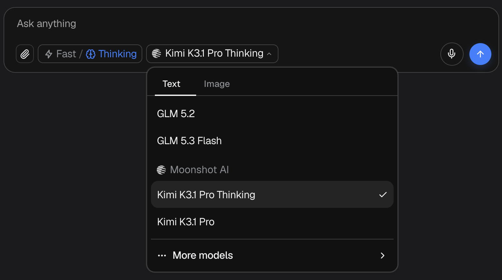
</Frame>
</Update>

<Update label="2026 年 10 月 20 日">
## 更新日志上线

Capriole AI 的新功能、模型更新、API 变更和编程智能体指南，今后都会按时间倒序记录在这一页。在应用中打开 **资源 > 最新动态** 即可回到这里。订阅 RSS，每次更新上线时都能收到。

<Frame>
  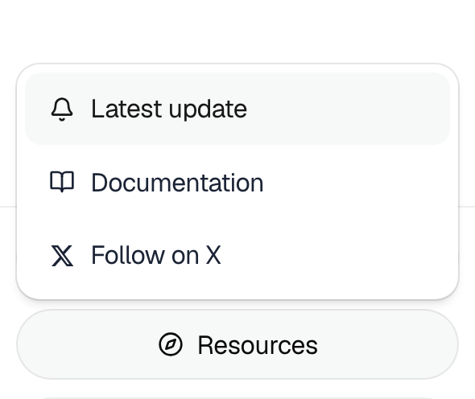
  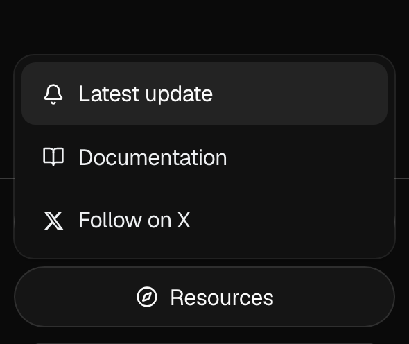
</Frame>

## 对话会记住自己的模型

打开一个已保存的对话时，Capriole AI 会自动选中它最近一条回复所用的模型，包括 Fast 或 Thinking 设置。刷新页面、重新登录或换一台设备，选择都会保留。如果那个模型已经下线，则保持你当前的选择。

<Frame>
  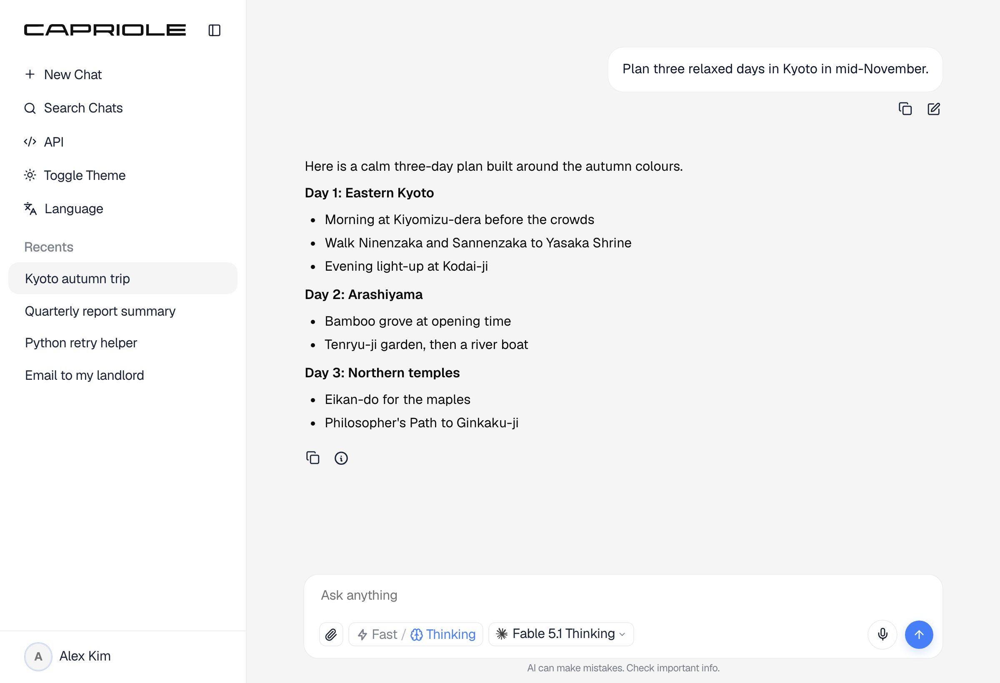
  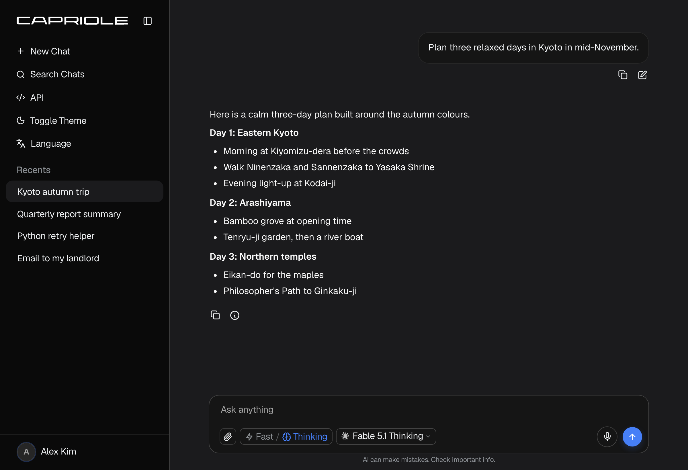
</Frame>

## 编程智能体指南全部重新测试

我们用当前的模型重新测试了所有编程智能体指南，并新增了 [Cline](/zh/integrations/cline)、[Qwen Code](/zh/integrations/qwen-code)、[Crush](/zh/integrations/crush) 和 [Pi](/zh/integrations/pi) 的指南。[OpenCode](/zh/integrations/opencode) 和 [Kilo Code](/zh/integrations/kilo-code) 现在只需要一个 provider 和一个 API Key。

<Frame>
  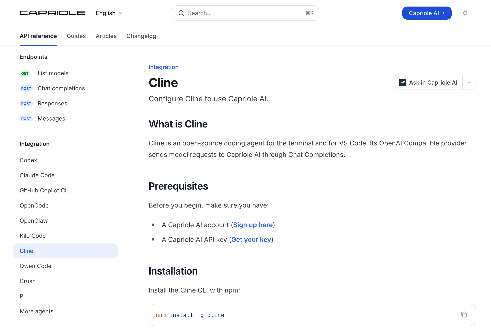
  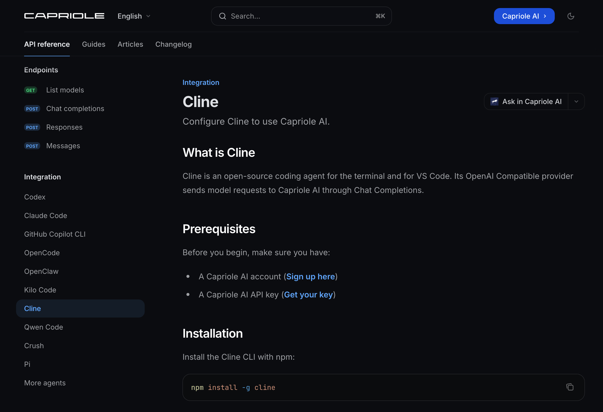
</Frame>
</Update>
